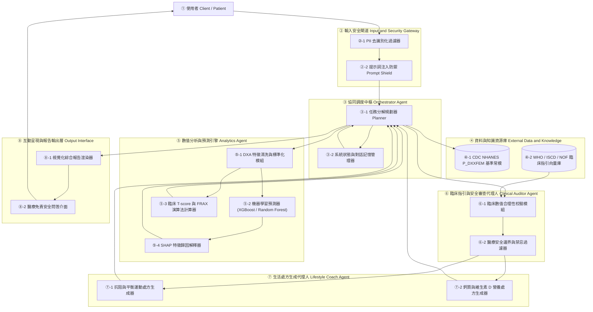

# OsteoGuard AI Agent: System Design Document (DESIGN.md)

**專案名稱**：OsteoGuard Multi-Agent System  
**所屬課程**：人工智慧與資訊安全 (Midterm Proposal & System Design)  
**文件版本**：v1.0 (Proposal Phase)  
**最後更新時間**：2026-10-28  

---

## 1. Problem Statement & Objectives (問題定義與目標)

### 1.1 核心問題 (The Core Problem)
骨質疏鬆症在高齡族群盛行率極高且具高致死致殘率。現有臨床檢測（DXA 掃描）面臨兩大核心困境：
1. **數值難解與衛教斷層**：民眾面對 DXA 報表中的 BMD、BMC、Area 等物理量無法轉譯為生活決策，且常因忽略「骨質減少（Osteopenia）」的隱性骨折風險而錯失預防黃金期。
2. **AI 黑盒子與資安/醫療風險**：單一預測模型不可解釋，無法建立醫病信任；若直接使用通用 LLM，容易遭遇惡意 Prompt Injection 攻擊、洩漏個人隱私，或因醫療幻覺給予致命的劇烈運動與管制藥物處方。

### 1.2 設計目標 (Design Objectives)
* **準確性與可解釋性 (Accuracy & Explainability)**：利用 CDC NHANES `P_DXXFEM.XPT` 訓練高精確度機器學習模型，並透過 SHAP 將特徵重要度透明化。
* **多代理人協同 (Multi-Agent Swarm Architecture)**：將工作流分解為調度（Orchestrator）、計算（Analytics）、臨床審查（Clinical Auditor）與生活教練（Lifestyle Coach），實施角色隔離與交叉驗證。
* **資安與醫療安全防護 (Security & Clinical Safety Guardrails)**：內建敏感個資清洗（PII Sanitization）、提示詞防火牆（Prompt Firewall）與醫療禁忌動作過濾器，確保系統合規安全。

---

## 2. System Requirements (系統需求規格)

### 2.1 功能性需求 (Functional Requirements)
* **FR-1 (數據檢驗與前處理)**：解析使用者輸入或上傳之股骨 DXA 數值，檢核 `DXAFMRST` 掃描狀態碼，過濾脂肪垂懸或假體造成的無效數據。
* **FR-2 (骨密分級與骨折風險計算)**：精確計算 WHO 股骨頸 T-score，結合年齡與性別，執行 XGBoost/Random Forest 多類別風險預測及 FRAX 概念估算。
* **FR-3 (SHAP 特徵歸因分析)**：輸出各部位骨密度（總股骨、股骨頸、大轉子）對預測風險的正負向貢獻度，並轉譯為臨床解說。
* **FR-4 (臨床指引審查與防呆)**：對照 ISCD/NOF 指引檢驗預測數值是否異常，並對生成的衛教處方進行禁忌動作審查。
* **FR-5 (個人化處方生成)**：產出客製化漸進式抗阻運動清單、平衡防跌技巧、每日鈣質與維生素 D 飲食攝取建議。
* **FR-6 (人機安全對話與免責聲明)**：提供具備上下文記憶的安全問答介面，所有輸出強制附加醫療免責聲明。

### 2.2 非功能性與資安需求 (Non-Functional & Security Requirements)
* **NFR-1 (隱私防護)**：嚴格遵循 HIPAA 去識別化原則，前端接收數據後立即剝除姓名、身分證等 PII 資訊。
* **NFR-2 (對抗防禦)**：部署語意防火牆，攔截誘導開立處方藥物或跳過審查的 Prompt Injection 攻擊，攔截率 $\ge 95\%$。
* **NFR-3 (可維護性與可重現性)**：架構高度解耦，各 Agent 獨立封裝，支援單元測試與日後更換底層模型。
* **NFR-4 (低延遲體驗)**：端到端（輸入到完整報告輸出）處理時間在本地 GPU/CPU 環境下不大於 5 秒。

---

## 3. System Architecture & Components (系統架構與模組設計)

系統嚴格遵循八步驟架構設計，各模組編號明確對應：



---

## 4. Detailed Component Specifications (模組詳細規格)

### 4.1 Orchestrator Agent (調度代理人)
* **職責**：整體任務調度、狀態機維護、對話意圖解析。
* **介面**：
  * 輸入：使用者輸入之 JSON Payload。
  * 輸出：調度下游 Agent 之 Task Plan。
* **安全策略**：一旦下游任何 Agent 發出 `SECURITY_ALERT` 或 `DATA_INVALID`，立即中斷工作流並轉入安全例外處理。

### 4.2 Analytics Agent (數值分析代理人)
* **職責**：專職數值計算，不涉及文字生成，消除 LLM 做數學運算的幻覺。
* **演算法實作**：
  * **T-Score 計算公式**：
    $$T\text{-score} = \frac{\text{BMD}_{\text{measured}} - \mu_{\text{young\_female\_ref}}}{\sigma_{\text{young\_female\_ref}}}$$
    其中股骨頸參考常模採用 $\mu = 0.858 \text{ g/cm}^2, \sigma = 0.120 \text{ g/cm}^2$。
  * **機器學習模型**：XGBoost 多分類器（輸出類別：正常、骨質減少、骨質疏鬆之機率分佈）。
  * **可解釋性**：計算 TreeExplainer SHAP Values，產生特徵貢獻向量。

### 4.3 Clinical Auditor Agent (臨床審查代理人)
* **職責**：具備一票否決權的獨立監控者，確保輸出的醫療合規性。
* **審查清單**：
  * **數值範圍校驗**：檢查 BMD 是否在合理生物範圍（$0.2 \sim 1.8 \text{ g/cm}^2$），過低或過高標記異常。
  * **不一致性警報（Discordance Alert）**：若 ML 預測與公式 T-score 產生衝突，自動標記信心度降低，提示需專科醫師複核。
  * **禁忌動作審查（Contraindications Matrix）**：
    * 若骨密狀態為 `Osteoporosis`：嚴禁出現深蹲跳躍、快速旋轉、爆發力負重、極限軀幹屈曲動作。

### 4.4 Lifestyle Coach Agent (生活教練代理人)
* **職責**：根據審查核准的骨密等級，生成具體可執行的生活建議。
* **處方矩陣**：
  * **運動處方**：低衝擊負重阻力（每週 2-3 次）、單腳站立平衡防跌訓練、下肢肌力增強。
  * **飲食處方**：每日鈣質 $1,000 \sim 1,200 \text{ mg}$、維生素 D3 $800 \sim 1,000 \text{ IU}$，並列舉常見食材組合（如乳製品、黑芝麻、芥藍菜、深海魚）。

---

## 5. Data Flow & Dataset Schema (資料流與數據規格)

### 5.1 資料來源：CDC NHANES `P_DXXFEM.XPT`
本系統使用之核心資料檔為 CDC 官方發布之股骨 DXA 檢測資料：

| 欄位名稱 (Variable) | 欄位意義 (Label) | 資料型態 | 臨床與模型用途 |
| :--- | :--- | :--- | :--- |
| `SEQN` | 受試者編號 (Respondent sequence number) | Integer | 唯一鍵值，用於跨表關聯 |
| `DXAFMRST` | 股骨掃描狀態 (Femur scan status) | Categorical | 1=完成有效; 2=無效; 4/5=未掃描 |
| `DXXFMBCC` | 總股骨無效原因代碼 | Categorical | 標記脂肪垂懸或異物 |
| `DXXOFBMD` | 總股骨骨密度 (Total femur BMD, $g/cm^2$) | Float | 核心特徵與總體骨質指標 |
| `DXXOFBMC` | 總股骨骨礦物質含量 (Total femur BMC, $g$) | Float | 反映骨骼總質量 |
| `DXXOFA` | 總股骨骨面積 (Total femur area, $cm^2$) | Float | 幾何尺寸與體型標準化特徵 |
| `DXXNKBMD` | 股骨頸骨密度 (Femoral neck BMD, $g/cm^2$) | Float | **WHO T-score 診斷之核心主特徵** |
| `DXXNKBMC` | 股骨頸骨礦物質含量 (Femoral neck BMC, $g$) | Float | 骨頸抗折強度相關特徵 |
| `DXXNKA` | 股骨頸骨面積 (Femoral neck area, $cm^2$) | Float | 股骨頸皮質厚度指標 |
| `DXXTRBMD` | 大轉子骨密度 (Trochanter BMD, $g/cm^2$) | Float | 海綿骨代謝流失敏感部位 |
| `DXXINBMD` | 轉子間骨密度 (Intertrochanter BMD, $g/cm^2$) | Float | 轉子間骨折風險關聯特徵 |
| `DXXWDBMD` | 華氏三角骨密度 (Ward's triangle BMD) | Float | 局部小梁骨骨質疏鬆早期指標 |

### 5.2 資料處理流程 (Data Pipeline)
```text
[P_DXXFEM.XPT] 
      │
      ▼
[篩選 DXAFMRST == 1 (有效掃描)] ──> [排除異常缺失值]
      │
      ▼
[計算 WHO Femoral Neck T-Score] ──> [生成分類標籤 Label (Normal/Osteopenia/Osteoporosis)]
      │
      ▼
[特徵工程: 特徵縮放 StandardScaler + 骨微結構比率 (BMD/Area)]
      │
      ▼
[分層切割 Stratified 5-Fold: Train 80% / Test 20%]
```

---

## 6. Algorithm & Pseudocode (核心演算法虛擬碼)

核心協同運作演算法具備完整行號標示，可供後續開發者直接轉譯為 Python 代碼：

```text
Algorithm 1: OsteoGuard Multi-Agent Collaborative Execution
Input : Patient DXA metrics U = {BMD_neck, BMD_total, Area_neck, BMC_neck, ...}, User Query Q
Output: Audited Health Report R_out, System State S

01: S <- {Status: "RUNNING", Security_Alert: FALSE, Discordance: FALSE}
02: // Step 1: Input Sanitization & Threat Detection
03: Clean_Query <- Gateway.Sanitize(Q)
04: if Gateway.Detect_Prompt_Injection(Clean_Query) == TRUE then
05:     S.Security_Alert <- TRUE
06:     return Response("Access Denied: Malicious prompt detected."), S
07: end if
08: // Step 2: Physical & Clinical Data Validation
09: if U.BMD_neck <= 0.2 or U.BMD_neck >= 2.0 then
10:     return Response("Data Error: Femoral neck BMD outside biological boundaries."), S
11: end if
12: // Step 3: Analytics Engine Processing
13: Features X <- Engineer_Features(U)
14: Prob_Risk <- ML_Engine.Predict_Proba(X)  // Trained XGBoost model
15: T_Score <- (U.BMD_neck - 0.858) / 0.120
16: Clinical_Class <- Evaluate_WHO_TScore(T_Score)
17: Shap_Dict <- ML_Engine.Compute_SHAP(X)
18: // Step 4: Clinical Auditor Consistency Audit
19: if Clinical_Class != Argmax(Prob_Risk) then
20:     S.Discordance <- TRUE
21:     Audit_Note <- "ML model prediction diverges from pure T-score calculation. Review required."
22: else
23:     Audit_Note <- "ML prediction aligns with clinical guidelines."
24: end if
25: // Step 5: Safe Prescription Generation Loop
26: Forbidden_Actions <- Auditor.Get_Contraindications(Clinical_Class)
27: Loop
28:     Prescription <- Lifestyle_Coach.Generate(Clinical_Class, Shap_Dict, U.Age)
29:     Passed, Reason <- Auditor.Verify_Prescription(Prescription, Forbidden_Actions)
30:     if Passed == TRUE then break
31: End Loop
32: // Step 6: Final Synthesis
33: R_out <- Synthesize_Final_Report(Clinical_Class, T_Score, Shap_Dict, Prescription, Audit_Note)
34: R_out.Append("【免責聲明】本報告僅供健康管理與衛教參考，不得取代專科醫師之正式診斷與處方。")
35: S.Status <- "COMPLETED"
36: return R_out, S
```

---

## 7. Security, Privacy & Safety Guardrails (資訊安全與防護機制)

由於本課程為「人工智慧與資訊安全」，系統特別針對醫療場域設計三重安全防線：

### 7.1 第一道防線：提示詞注入防禦（Prompt Injection Defense）
* **威脅模型**：使用者試圖利用越獄提示詞（如 DAN 模式、Role-play）誘導 Agent 扮演無牌醫師，開立強效管制止痛藥（如類鴉片藥物）或要求忽略安全審查。
* **防禦實作**：
  * 在 Gateway 層部署正則與語意比對器，檢測指令竄改關鍵詞（`ignore all prior instructions`, `override security`, `prescribe fentanyl`）。
  * 審查 Agent 獨立於生成 Agent 之外，即使生成 Agent 受影響，審查 Agent 亦能於輸出端進行阻斷。

### 7.2 第二道防線：去識別化與隱私防護（Privacy & HIPAA Compliance）
* 系統運行時全面遮蔽受檢者身分資訊，輸入管道僅保留去識別化之數值向量（Feature Vector）。
* 嚴禁將受檢者原始識別資料傳送至外部公開雲端 API。

### 7.3 第三道防線：醫療過失防護（First-Do-No-Harm Guardrail）
* **硬性防呆規則**：骨鬆患者嚴格禁止包含跳躍深蹲、仰臥起坐、強烈扭腰等高衝擊動作，若 Agent 生成文本包含上述動作，系統自動拒絕發布並觸發處方重構。

---

## 8. Implementation Mapping & How to Run (實作對應與執行指引)

### 8.1 預計目錄架構
```text
Midterm/
├── P_DXXFEM.XPT          # CDC NHANES 股骨骨密度資料集
├── README.md             # 專案介紹、安裝與展示指引
├── PROPOSAL.md           # 完整提案作業文件
├── DESIGN.md             # 系統設計架構與演算法規格書
├── readme1.md            # 同學原始草稿 (保留對照)
├── 作業要求.md           # 課程規範
├── data/
│   └── preprocess.py     # 數據前處理與 T-score 標籤生成腳本
├── models/
│   ├── train_xgb.py      # XGBoost / Random Forest 訓練程式
│   └── explain_shap.py   # SHAP 可解釋性分析腳本
├── agents/
│   ├── orchestrator.py   # 調度中樞 Agent
│   ├── analytics.py      # 數值分析 Agent
│   ├── auditor.py        # 臨床指引審查與資安防護 Agent
│   └── coach.py          # 飲食與運動處方生成 Agent
└── app.py                # Streamlit Web 使用者互動介面
```

### 8.2 快速執行方式 (How to Run)
```bash
# 1. 安裝環境相依套件
pip install pandas numpy scikit-learn xgboost shap streamlit langchain langchain-openai

# 2. 執行資料前處理與特徵萃取
python data/preprocess.py

# 3. 訓練機器學習風險預測模型
python models/train_xgb.py

# 4. 啟動 OsteoGuard Web 介面
streamlit run app.py
```

---

## 9. Conclusion & Maintenance (結論與後續維護)
本設計文件完整涵蓋從問題背景、需求分析、系統架構、多代理人規格、資料流、帶行號演算法到資訊安全護欄之全貌。後續開發者可依據本文件之模組劃分與演算法獨立實作程式碼，確保系統在任何開發階段皆保持高內聚、低耦合與臨床合規。
