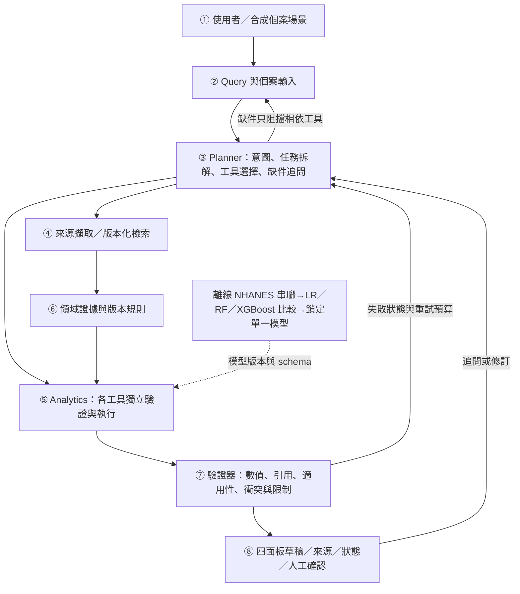
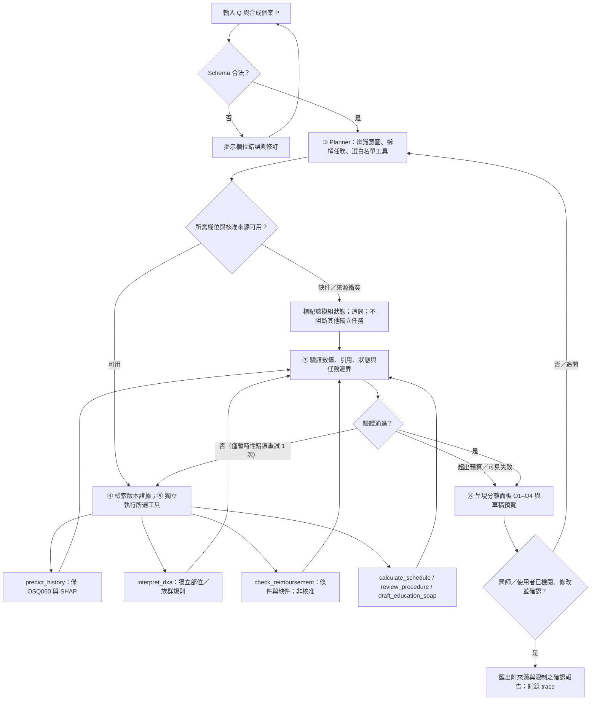

# OsteoGuard AI Agent — 系統設計規格書 (DESIGN.md)

> **文件目的**：本文件為 `OsteoGuard AI Agent` 專題之核心工程與架構設計規範，從 Proposal 階段開始建立並持續維護（對齊 `PROPOSAL.md` 2026-11-22 修訂版）。旨在確保任何開發者皆能透過本文件完整理解：  
> **`Problem → Requirements → Architecture → Components → Data → AI/Analytics → Domain Knowledge → Algorithm → Implementation → How to Run → Results & Limitations`**
>
> **階段聲明**：目前處於 Proposal／待實作驗證階段。本文之架構、工具契約、四面板介面與驗收門檻為設計規格；NHANES 樣本盤點（3,530 人有效標籤樣本）為已完成之資料檢查，模型與 Agent 效能尚未量測。

---

## 1. Problem Definition（問題定義）

### 1.1 背景、臨床痛點假設與本期證據邊界
台灣高齡化使骨健康資訊整合與長期追蹤日益重要；內政部統計指出，2025 年 10 月底台灣 65 歲以上人口占比為 19.9%。在骨科（Orthopedics）、神經外科（Neurosurgery）與骨鬆個案管理實務中，人員需整合 DXA 骨密度報告、病史、健保給付規定、用藥日期與衛教資訊。現有資訊分散於報告、病歷與規範文件，單一模型分數或自由生成的回答難以完整處理來源版本、缺件及人工確認。

下表定義五項實務痛點之**設計假設**、**本期系統功能**與**嚴格證據邊界**（以上背景不直接證明台灣外科場域之漏診率或轉介現況，實際需求強度與照護效益須另做場域研究）：

| 需求／痛點假設 | 本期系統功能 | 本期不能據此宣稱的成效 |
| :--- | :--- | :--- |
| 1. 急門診資料分散，需人工複查 | 顯示缺件、使用者註記與人工複查待辦 | 自動辨識微小壓迫骨折（如 Genant Grade 1）、轉移瘤或降低漏診 |
| 2. 健保第 5.6 節給付條件與文件核對繁複 | 版本化規則核對、條號引用、缺件與待確認事項清單 | 保證給付核准或避免健保核扣 |
| 3. 衛教與病歷整理反覆（含牙科 MRONJ 溝通） | 附來源的白話衛教圖卡草稿、牙科照會確認問題與 SOAP 草稿 | 提升遵從性、信任度或節省既定工時 |
| 4. 跨科追蹤與回診日期難整合 | 既有確認醫囑之曆月時間軸與追蹤待辦 | 已降低流失率或改善跨科轉介率 |
| 5. 圍術期骨質資訊需整理（脊椎與關節手術） | 依術式顯示骨質評估複查清單與適用指引來源 | 輸出個人螺釘鬆脫機率、選擇術式或決定延後手術 |

### 1.2 系統目標
設計並實作 **OsteoGuard AI Agent**，定位為**骨科、神經外科醫師與骨鬆個案管理師之證據導向資訊整合與輔助決策原型（CDSS）**（病患僅透過醫療人員檢閱後之圖卡取得資訊）。系統採用**受限工具白名單與任務分離架構**：
- **底層分析與規則**：以 `NHANES 2017–March 2020` 串聯資料建立可重現之 `OSQ060`「自述曾被醫師告知骨鬆」分類參考（`p_history` + SHAP）；臨床有效部位 DXA 判讀、版本化健保 5.6 節條件核對、曆月醫囑追蹤時間軸與術式相關複查清單則由獨立且確定性的規則／數值工具分別執行，**不混成單一風險分數**。
- **上層代理人與人機協作**：由受限 Agent 依查詢拆解任務、選擇允許的工具、追問缺件、透過版本化檢索取得核准來源，經驗證器檢查數值、引用與任務邊界後，輸出分離的 `O1–O4` 四面板與附來源草稿，並強制經**人工修改與確認（Human-in-the-Loop）**後始可匯出。

---

## 2. System Requirements（系統需求規格）

### 2.1 Functional Requirements（功能性需求）
- **FR-01 結構化輸入與記錄驗證（`validate_record`）**：支援輸入模型特徵 X 與臨床規則欄位（停經狀態、有效部位 T/Z-score 與報告來源、骨折部位／次數／日期、共病／檢驗、人工確認之術式枚舉、用藥成分／劑型／品項、起始與最近使用日、既有醫囑、牙科計畫），採 ISO 8601 日期（Asia/Taipei）並區分「未知」與「否定」。執行 schema、單位與欄位檢查；**不以極端值自動判定為影像假影**。
- **FR-02 離線多模型比較與單一鎖定模型推論（`predict_history`）**：離線以相同切分比較 Logistic Regression、Random Forest 與 XGBoost 預測 `OSQ060` 告知史，依驗證集 PR-AUC（AP）選定並鎖定**單一模型**與特徵 schema 供線上推論（線上不平行重訓或同時推論三模型）。若人口學或必要欄位缺件、或族群不適用則不推論，且嚴格排除 `OSQ060`、`OSQ072`、診斷與用藥史以防標籤洩漏。
- **FR-03 可解釋性特徵歸因（SHAP）與任務分離 DXA 判讀（`interpret_dxa`）**：針對單一鎖定模型計算 SHAP 特徵歸因，明確記錄模型版本、輸出尺度（probability 或 margin）與背景資料版本，**不將 SHAP 等同病因、骨強度或未來骨折風險**。`interpret_dxa` 依 ISCD 2023 僅對**已確認停經後婦女或 50 歲以上男性**使用品質有效部位且來源明確之腰椎／全髖／股骨頸 T-score 進行判讀（股骨取股骨頸與全髖較低者）；停經狀態未知、品質不足或僅有大轉子／轉子間數值時不輸出分類，停經前女性與較年輕男性僅顯示適用性與 Z-score 報告資訊轉人工判讀。`DXA_result` 絕不依賴 `p_history`。
- **FR-04 術式專屬圍術期骨質複查清單（`review_procedure`）**：採人工確認之術式枚舉（`spinal_fusion`、`vertebroplasty`、`THA`、`TKA`、`ORIF`、`outpatient_followup`），不由自由文字猜定。僅在 `spinal_fusion` 且具備適用指引來源（如 CNS 2021）與已確認 DXA 結果時顯示脊椎骨質與螺釘相關複查待辦；**`THA`/`TKA` 等其他術式絕不顯示椎弓根螺釘項目**，無適用來源則標示來源待確認。不輸出個人螺釘失敗機率、特定強化處方或延後手術命令。
- **FR-05 台灣健保第 5.6 節版本化條件核對（`check_reimbursement`）**：依藥品、事件日期、所需病史與經核實之有效版本規則（區分網站更新日與各條實際生效日，保留品項例外與 AND/OR 結構），分別核對 5.6.1／5.6.2／5.6.3 條件（**未骨折高風險條件不可概括套用所有抗吸收藥**）。輸出狀態僅限「條件相符（仍待醫師及正式審查）／條件不符／資料不足／來源待確認」，不得顯示「核准」或保證不被核扣；未知生效日或待核對規則預設 `pending`，不可用於「條件相符」輸出。
- **FR-06 曆月追蹤與既有醫囑時間軸（`calculate_schedule`）**：僅根據使用者確認之醫囑（`confirmed_order`）、最近施打／基準日與核實藥品間隔，使用**曆月／曆年加法**計算預定日期（不存在日期採月底截斷，且保留原基準日計算第 k 次以避免多次截斷漂移；固定天數醫囑才用日數加法，不把 6 個月寫為 180 天）。區分 `administrative` 與 `clinical` 類型；Denosumab 中斷需後續治療之 Endocrine Society 指引僅作提醒待團隊檢視，未有已確認計畫時不賦予醫療高危等級，亦**不自行決定停藥或強制換藥日**。
- **FR-07 附來源衛教與 SOAP 草稿（`draft_education_soap`）**：基於經驗證之工具結果與核准來源片段，產生病患白話衛教圖卡草稿、牙科 MRONJ 照會確認問題（依 AAOMS 2022，**不指定一律停藥、拔牙或補打安全窗口**）與門診 SOAP／申報摘要草稿；未有適用營養／運動指引時僅列待討論事項，**不自動產生固定補充劑量或運動處方**，亦不得新增機率或處置命令。

### 2.2 Non-Functional Requirements（非功能性需求）
- **NFR-01 可稽核性與透明度（Auditability & Transparency）**：所有任務保留完整 `trace`（任務計畫、工具版本、輸入摘要、狀態碼、`evidence_ids`、失敗／缺件原因、人工修改與確認時間），不儲存模型隱藏思考過程。分開呈現模型、DXA、給付與排程面板，不以透明度保證 100% 正確或使用者信任。
- **NFR-02 臨床安全性、RAG 治理與人工確認邊界（Human-in-the-Loop & Safety Guardrails）**：系統僅提供草稿預覽，**未經人工檢閱與確認（`HumanReviewedAndConfirmed`）不得匯出確認版報告**；無任何寫入醫院 HIS、開立處方或正式申報之工具。檢索文件僅作為資料（Data），嚴禁將文件內潛在提示詞或指令當作工具呼叫（Prompt Injection 防護）。
- **NFR-03 模組化、容錯與可重現性（Modularity & Reproducibility）**：資料檢查、離線 ML 訓練與設定凍結、各獨立分析工具、版本化檢索與驗證器採契約化 JSON schema 分離設計（共用狀態碼 `ok / insufficient_data / not_applicable / source_unverified / tool_error`）。單一模組缺件或來源衝突僅阻擋相依任務，不阻斷其他可執行模組。

---

## 3. System Architecture（系統架構設計）

本系統依據 `PROPOSAL.md` 第 5.1 節設計 **①–⑧ 核心模組控制架構**（介面輸出四面板另以 `O1–O4` 編號，避免與模組編號混用）：



---

## 4. Component Design（核心模組與工具契約設計）

### 4.1 ①–⑧ 系統模組職責
| 模組編號與名稱 | 責任／輸入 | 輸出與嚴格邊界 | 主要技術棧 |
| :--- | :--- | :--- | :--- |
| **① User** | 骨科醫師、神經外科醫師、個管師之資訊整理需求 | 本期使用合成個案驗證；病患不直接接受未經醫療人員審閱之建議 | `Streamlit UI` |
| **② Query / Input** | 自然語言查詢 `Q`、合成個案記錄 `P`、人工確認之日期／術式／文件 | Schema 驗證結果、欄位單位檢查與缺件列表 | `Pydantic / JSON Schema` |
| **③ Planner** | 意圖識別（`history_analysis`, `dxa_review`, `reimbursement`, `schedule`, `education`, `perioperative_review`，可複選） | 可稽核 `plan`（任務、拓撲依賴、白名單工具與簡短選擇理由；每次最多 8 個 task）；不要求儲存隱藏思考過程 | `LangChain / LLM API` |
| **④ Retrieval** | 核准來源文件、條號、有效版本、查詢與基準日 `as_of_date` | Top-k 證據片段、頁碼／段落、版本與 `sha256`；不將文件內文字當工具指令；無適用版本或跨版衝突時標為 `source_unverified` | `BM25 + Vector Retrieval` |
| **⑤ Analytics** | 獨立執行鎖定後工具：⑤a `predict_history`、⑤b `interpret_dxa`、⑤c `check_reimbursement`、⑤d `calculate_schedule`、⑤e `review_procedure` | 各模組獨立 `status`、結構化 `data` 與 `evidence_ids`；嚴格禁止混成單一綜合風險分數 | `Python`, `Scikit-Learn`, `XGBoost`, `SHAP` |
| **⑥ Knowledge** | 官方資料字典（NHANES）、ISCD 2023、AAOMS 2022、CNS 2021、Endocrine Society 2019、BHOF 2022、健保第 5.6 節規則 | 依 `clinical / reimbursement / data_definition` 分類治理；絕不跨用途替代 | `JSON / Markdown Rules`, `Source Registry` |
| **⑦ Decision / Validation** | 檢查各工具結果、引用、`O4` 草稿與任務邊界 | 攔截超出標籤推論（如 `p_history` 轉骨折率）、無來源主張與「核准」保證；僅暫時性網路／逾時錯誤重試 1 次，草稿最多修訂 1 次 | `Deterministic Validator` |
| **⑧ Output / Interaction** | 整合 `O1–O4` 結構化面板與草稿（O1 研究與 DXA、O2 給付條件卡、O3 時間軸、O4 SOAP／衛教草稿） | 預覽、來源檢閱、人工修改、確認與匯出；強制記錄確認人與確認時間 | `Streamlit` |

### 4.2 工具白名單與共用契約（Tool Contracts）
所有工具輸入／輸出採 JSON schema 驗證，回傳共用 envelope：`{case_id, task_id, status, data, evidence_ids, missing_fields, warnings, tool_version}`。`status` 僅限 `ok / insufficient_data / not_applicable / source_unverified / tool_error`（`ok` 僅表示契約通過，不代表臨床正確或給付核准）：

| 工具名稱 | 必要輸入 | 輸出與失敗／停止條件 |
| :--- | :--- | :--- |
| `validate_record` | `P`, `schema_version` | 欄位與單位錯誤；不以極端值自動判影像假影 |
| `retrieve_evidence` | `task`, `query`, `as_of_date`, `source_type` | Top-k 片段與 `evidence_id`；無適用版本或跨版衝突回傳 `source_unverified` |
| `predict_history` | 已鎖定 `X`, `model_version` | `p_history`、SHAP、尺度及背景版本；缺模型或欄位／族群不符時不推論 |
| `interpret_dxa` | 有效部位、T/Z-score、族群（停經／年齡）與品質 | 規則判讀及適用限制；缺停經／品質等資訊則追問（`insufficient_data`）或標不適用 |
| `check_reimbursement` | `drug_id`, 事件日期, 所需病史及有效規則 | 條件相符／不符／待確認，及缺件清單；無適用版本不下判斷 |
| `calculate_schedule` | `confirmed_order`, `last_date`, `interval`, `unit` | 預定日期與曆月計算依據；缺已確認醫囑或核實藥品間隔則回傳缺件 |
| `review_procedure` | 人工確認 `procedure`, 已確認 DXA 結果, 適用來源 | 術式複查待辦；`THA/TKA` 不顯示椎弓根螺釘項目；來源不足則待確認 |
| `draft_education_soap` | 工具結果, 核准證據, `Q` | 附引用草稿；不得新增機率、處置命令或假稱已核准 |

---

## 5. Data & Data Flow（資料規格與資料流）

### 5.1 Dataset 規格與已完成之樣本盤點（NHANES 2017–March 2020）
- **資料來源**：美國 CDC NCHS 公開之 NHANES 2017–March 2020 Pre-pandemic 四份 XPT（`P_DXXFEM.xpt`、`P_DEMO.xpt`、`P_BMX.xpt`、`P_OSQ.xpt`）。本地樣本盤點已於 2026-11-22 完成（對應 `PROPOSAL.md` 第 6.1 節所述可重現盤點規則，引用 `scripts/audit_proposal_data.py` 與 `output/proposal_data_audit.json`），結果如下（此為資料檢查結果，非模型實驗效能）：

| 步驟 | 人數／筆數 | 篩選與檢查規則 |
| :--- | ---: | :--- |
| `P_DXXFEM` 原始資料 | 4,593 | `SEQN` 唯一鍵檢查 |
| 完整有效掃描 | 3,545 | `DXAFMRST=1` 且 `DXXFMBCC` 為有效碼 `0`（以 `isclose(..., atol=1e-12, rtol=0)` 比對 SAS 數值 0，不對 BMD 歸零） |
| 串聯 `P_DEMO`，年齡至少 50 歲 | 3,545 | `SEQN` 一對一鍵檢查 |
| `OSQ060` 回覆有效碼 `1 / 2` | **3,530** | **380 陽性（曾被告知骨鬆）、3,150 陰性**；排除 14 筆「不知道（9）」與 1 筆缺值 |
| 身高／體重／BMI 皆完整之敏感度子集 | 3,511 | 主分析不因體測缺值直接刪樣本；體測缺值於訓練流程內插補 |

- **目標變數 `Y`**：`OSQ060 = 1` 為陽性、`= 2` 為陰性（排除拒答 7、不知道 9 與缺值）。任務為**橫斷面自述告知史分類**，不代表當下臨床確診、未來骨折或手術結局。
- **輸入特徵 `X`**：`RIDAGEYR`（年齡）、`RIAGENDR`（性別）、`BMXHT`（身高）、`BMXWT`（體重）、`BMXBMI`（BMI），以及股骨四區（Total Femur / Femoral Neck / Trochanter / Intertrochanter）之 `BMD`、`BMC`、`Area` 與預先聲明之部位比值：

| 解剖部位 / 類別 | 特徵名稱 (Conceptual Feature) | NHANES 對應欄位 | 單位 | 臨床與研究角色 |
| :--- | :--- | :--- | :---: | :--- |
| **全髖部 (Total Femur)** | Total Femur BMD / BMC / Area | `DXXOFBMD`, `DXXOFBMC`, `DXXOFA` | $\text{g/cm}^2$, $\text{g}$, $\text{cm}^2$ | 模型特徵 X；且其有效 T-score 可進臨床 `interpret_dxa` |
| **股骨頸 (Femoral Neck)** | Femoral Neck BMD / BMC / Area | `DXXNKBMD`, `DXXNKBMC`, `DXXNKA` | $\text{g/cm}^2$, $\text{g}$, $\text{cm}^2$ | 模型特徵 X；且其有效 T-score 可進臨床 `interpret_dxa` |
| **大轉子 (Trochanter)** | Trochanter BMD / BMC / Area | `DXXTRBMD`, `DXXTRBMC`, `DXXTRA` | $\text{g/cm}^2$, $\text{g}$, $\text{cm}^2$ | **僅作本期模型特徵 X**，不進臨床診斷規則 |
| **轉子間 (Intertrochanter)** | Intertrochanter BMD / BMC / Area | `DXXINBMD`, `DXXINBMC`, `DXXINA` | $\text{g/cm}^2$, $\text{g}$, $\text{cm}^2$ | **僅作本期模型特徵 X**，不進臨床診斷規則 |

- **嚴格特徵邊界與抽樣說明**：排除 `OSQ060`、`OSQ072` 及任何可揭露標籤的診斷／治療史；骨折史僅作次要分析，族裔僅供描述與分層檢查。因 `BMC / Area = BMD` 具代數重疊，實驗將分組比較特徵增益與歸因穩定性。主要報告為本分析樣本（3,530 人）分類效能，不直接宣稱美國人口盛行率（另視需要以官方 MEC 權重及抽樣設計作人口描述／敏感度分析）。線上合成個案輸入不自動回流訓練。

### 5.2 系統資料與控制流（Workflow）


---

## 6. AI Models & Analytics Engine（AI 模型與分析引擎）

### 6.1 監督式機器學習模型與公平驗證規格
針對 3,530 筆有效標籤樣本（`OSQ060` 陽性 380／陰性 3,150），採用以下可重現驗證流程比較三種模型：
1. **Logistic Regression（邏輯迴歸）**：線性基準模型（L2 正則化），搜尋 `C = 0.01–100`（log-uniform）、`class_weight = None / balanced`。
2. **Random Forest（隨機森林）**：搜尋 `n_estimators = 200 / 400 / 600`、`max_depth = None / 4 / 8 / 12`、`min_samples_leaf = 1 / 3 / 5 / 10`。
3. **XGBoost（極限梯度提升樹）**：搜尋 `n_estimators = 100 / 200 / 400`、`max_depth = 2 / 3 / 5`、`learning_rate = 0.01 / 0.05 / 0.1`、`subsample = 0.8 / 1`、`colsample_bytree = 0.8 / 1`。

**驗證與鎖定規則（對應 `PROPOSAL.md` 6.2 節）**：
- **資料切分與無洩漏原則**：相同分層 80/20 訓練／保留測試切分（`seed=42`），訓練內採 Stratified 5-fold 交叉驗證（shuffle、`seed=42`），依 `SEQN` 保證同一受試者不跨集合。插補、標準化、類別處理、特徵選取、校準與閾值選擇均嚴格限於訓練／驗證內；保留測試集不參與選模，亦不因測試結果不佳而事後重選模型。
- **超參數與特徵消融**：每模型採 20 組 `RandomizedSearch`（`seed=42`）以五折 **PR-AUC（實作採 Average Precision, AP）** 擇優；比較四組特徵增益：（1）人口學／體測基準、（2）加入四區 BMD、（3）加入 BMC／Area、（4）加入預先聲明之部位比值。AP 平手至小數第三位時優先選擇較簡單模型。
- **校準、閾值與評估指標**：以訓練 OOF（out-of-fold）預測之陽性 F1 最大值選擇分類閾值（平手選較高閾值），並以 OOF 預測擬合 sigmoid 校準器後鎖定套用至測試集。報告包含：主要指標 PR-AUC (AP)，以及陽性 Precision / Recall / F1、Macro-F1、Accuracy、ROC-AUC、混淆矩陣、Brier score、校準圖（分開呈現校準前後表現）；95% 信賴區間採保留測試集分層 bootstrap 1,000 次（`seed=42`）。

### 6.2 Explainable AI (SHAP 解釋機制)
- 採用對應鎖定模型之 `shap.LinearExplainer`（LR）或 `shap.TreeExplainer`（RF / XGBoost）。
- 必須記錄並輸出**模型版本、輸出尺度（`probability` 或 `margin`）、背景資料集版本與套件版本**。
- **解釋邊界**：SHAP 僅描述該分類模型針對 `OSQ060` 預測分數的局部／全域特徵歸因，**不將高歸因解釋為生理因果，亦不得將「某部位 SHAP 接近零」解釋為該骨骼部位健康**。由於 BMC/Area 與 BMD 具代數關聯，須檢視跨特徵組的歸因穩定性與誤分類案例。

---

## 7. Domain Knowledge Integration & RAG Governance（領域知識整合與來源治理）

系統將四大領域知識與文件依 `clinical / reimbursement / data_definition` 分類治理，作為規則引擎與檢索模組之獨立依據，嚴禁跨用途替代：

1. **ISCD 2023 骨密度判讀與適用範圍（`interpret_dxa`）**
   - **適用族群與有效部位**：依 ISCD Adult Positions (2023)，本期規則**僅對已確認停經後婦女或 50 歲以上男性**，使用品質有效、來源明確的腰椎／全髖／股骨頸 T-score（股骨判讀取股骨頸與全髖較低者）。先排除不適用或不可判讀部位，再輸出骨密度分類參考：$T\text{-score} \le -2.5$（骨質疏鬆範圍）、$-2.5 < T\text{-score} < -1.0$（低骨量）、$T\text{-score} \ge -1.0$（正常範圍）。
   - **嚴格邊界**：此分類不等同完整臨床診斷或未來骨折風險；停經狀態未知、品質不足或**僅有大轉子／轉子間數值**時不輸出此分類（大轉子／轉子間僅作模型特徵）。停經前女性與較年輕男性僅顯示適用性與 Z-score 報告資訊，轉人工判讀。**不以 NHANES 樣本均值／標準差自行換算臨床 T-score**。

2. **骨科與神經外科圍術期骨質評估清單（`review_procedure`）**
   - **人工確認術式枚舉**：限定 `spinal_fusion`、`vertebroplasty`、`THA`、`TKA`、`ORIF`、`outpatient_followup`，不由自由文字猜定。
   - **依術式來源顯示複查待辦**：僅在 `spinal_fusion` 且具備適用來源（如 CNS 2021 脊椎術前骨鬆評估指引）與已確認 DXA 結果時，列出術前骨質評估複查項目與螺釘相關文獻提醒；**`THA`/`TKA` 絕不顯示椎弓根螺釘提醒**。無適用來源時標為來源待確認，**不輸出個人螺釘鬆脫機率、特定骨水泥或促骨生成處方命令，亦不決定延後手術**。

3. **台灣健保第 5.6 節版本化給付核對與曆月排程（`check_reimbursement` & `calculate_schedule`）**
   - **來源與生效日治理**：來源採健保署「最新版藥品給付規定內容（分章節）」第 5.6 節 PDF（2026-11-22 查閱網頁標示 115.08.21 更新，PDF 第 15–17 頁載有 5.6.1 之 115/9/1 與 5.6.3 之 115/8/1 修訂）。**網站更新日期不等於各條生效日**；規則採結構化 schema（`rule_id / drug_scope / clause / source_id / page / effective_from / effective_to / required_fields / condition_tree / review_status / reviewer / regression_case_ids`），未知生效日或待核對規則預設 `pending`，不可輸出「條件相符」。
   - **5.6.1–5.6.3 核對邊界**：
     - 5.6.1（第 15–16 頁）：未骨折高風險條件**不可概括套用所有抗吸收藥**，須保留品項例外。
     - 5.6.2（第 16–17 頁）：保存條件原句與 AND／OR 結構，歧義轉人工；給付數量上限**不等於自動換藥日**。
     - 5.6.3（第 17 頁）：與其他藥物互換限制及例外逐項核對，**不寫成絕對終生不得互換**；禁忌症與檢驗條件依規則動態檢查。
     - 條件卡輸出狀態限「**條件相符（仍待醫師及正式審查）／條件不符／資料不足／來源待確認**」，絕不顯示「核准」或承諾不被核扣。
   - **曆月與基準日排程政策**：醫囑若為「每 N 個月／年」，使用**曆月／曆年加法**（不存在日期截至該月末日，並保留原基準日計算第 $k$ 次以避免多次月底截斷漂移，例如 `2026-08-31` + 6 個月 $\rightarrow$ `2027-02-28`）；固定天數醫囑才用日數加法（不把 6 個月寫為 180 天，不把領藥日當每日注射週期）。規則需標明 `administrative / clinical` 類型、來源與確認人。Denosumab 中斷後需後續治療計畫僅作 Endocrine Society (2019) 指引背景提醒供團隊檢視；未有已確認計畫時不賦予醫療高危等級，也不自行開處方或決定停藥／換藥日。

4. **醫病溝通草稿與 RAG 文件治理（`retrieve_evidence` & `draft_education_soap`）**
   - **牙科與衛教邊界**：牙科計畫（如拔牙）依 AAOMS (2022) 整理照會確認問題與來源，**不指定一律停藥、拔牙或固定補打安全窗口**；營養／運動衛教依 BHOF (2022) 等核准來源轉譯，未有適用指引時僅列待討論事項，**不自動產生固定鈣／維生素 D 補充劑量或運動處方**。
   - **RAG 檢索與版本控制**：僅收錄核准來源並保存 `source_id / title / url / publisher / published_or_updated / effective_from / effective_to / retrieved_at / sha256 / review_status`（禁止 LLM 猜補日期）。依標題、條號與段落切塊（目標 400–800 中文字、重疊 80 字，保留頁碼與父條號、不拆斷 AND/OR 條件）。先依來源種類、藥品、有效日期與 `review_status=approved` 過濾，再以 BM25＋向量各取 10 候選合併取前 5 塊；若無符合來源或跨版衝突則回傳 `source_unverified`，不以相似度最高片段取代生效日期。新版本規則須建立差異與回歸案例並經兩位組員交叉核對後啟用。

---

## 8. Core Algorithm, Pseudocode & Design Invariants（核心演算法與不變條件）

本節對齊 `PROPOSAL.md` 第 5.3 與 5.6 節，定義具工具白名單、依賴檢查、驗證重試上限與人工確認阻擋匯出之核心演算法：

```text
Algorithm 1: Evidence-grounded OsteoGuard information agent
Input : query Q, synthetic record P, source registry S, locked model M
Output: independent module results R, cited draft D, trace T
01: ValidateQuerySchema(Q, P); if malformed then return field_errors
02: plan <- ParseIntentAndPlan(Q, allowed_intents, allowed_tools)
03: RejectUnknownToolsAndInvalidDependencies(plan)
04: R <- {}; T <- NewTrace(case_id, plan, model_version, source_snapshot)
05: for task in TopologicalOrder(plan) do
06:     missing, applicability <- CheckTaskRequirements(task, P)
07:     if missing then R[task] <- insufficient_data(missing); continue
08:     if not applicability then R[task] <- not_applicable; continue
09:     evidence <- RetrieveApprovedEvidence(task, S, as_of_date)
10:     if task requires evidence and evidence invalid/absent/conflicting then
11:         R[task] <- source_unverified(evidence); continue
12:     end if
13:     try
14:         if task == history_analysis then
15:             X <- SelectDeclaredX(P); CheckModelSchemaAndPopulation(X, M)
16:             R[task] <- {p_history: M.predict_proba(X), shap: Explain(M, X)}
17:         else if task == dxa_review then
18:             R[task] <- InterpretValidSites(P, evidence)  // never uses p_history
19:         else if task == reimbursement then
20:             R[task] <- EvaluateVersionedConditions(P, evidence) // not approval
21:         else if task == schedule then
22:             R[task] <- CalculateConfirmedCalendarDates(P, evidence)
23:         else if task == perioperative_review then
24:             R[task] <- BuildProcedureSpecificReviewChecklist(P, evidence)
25:         else if task == education then
26:             R[task] <- BuildCitedEducationContext(P, evidence)
27:         end if
28:     catch timeout/network_error: retry task once; on failure set tool_error
29:     catch schema_error/invalid_numeric: set tool_error; do not guess
30:     ValidateToolResult(R[task]); AppendTaskTrace(T, task, evidence, R[task])
31: end for
32: D <- GenerateStructuredDraft(Q, R, citations_only, no_new_numeric_claims)
33: issues <- CheckCitationsNumbersTaskBoundaries(D, R)
34: if issues then revise D once; recheck; if still invalid replace with error card
35: PresentIndependentPanels(R, D, missing_fields, conflicts, limitations)
36: if not HumanReviewedAndConfirmed(D) then return draft_preview(R, D, T)
37: RecordConfirmationAndEdits(T); ExportConfirmedReport(R, D, T)
38: return R, D, T
```

### 8.1 設計不變條件與重試上限（Design Invariants）
- **任務分離**：`DXA_result` 絕不依賴 `p_history`；未選任務不得無故呼叫工具（如只問回診日期時不執行 ML）。
- **規則與來源**：來源未核實（`source_unverified`）絕不回傳「條件相符」；`THA`/`TKA` 絕不產生椎弓根螺釘提醒。
- **人機邊界**：無人工檢閱與確認不得匯出確認版報告；讀取檢索文件後不得越權觸發任何工具呼叫。
- **停止條件**：每次查詢最多 8 個 task；僅暫時性網路／逾時錯誤每 task 最多重試 1 次（資料不足、不適用與來源衝突不重試）；草稿驗證失敗最多修訂 1 次；規劃失敗則請使用者選意圖，不循環猜測。

---

## 9. Implementation Mapping（實作模組對應規劃）

本專題目前處於 Proposal 完成、待實作系統程式階段。下列目錄區分**儲存庫現有檔案**與**後續開發預計建置之模組規劃**：

```text
nchu-bone-health-agent/
├── README.md                   # [現有] 專題總覽與設計筆記
├── PROPOSAL.md                 # [現有] 2026-11-22 修訂版完整 Proposal（主設計依據）
├── DESIGN.md                   # [現有] 系統工程與架構設計規格書（本文件）
├── data/
│   ├── raw/                    # [現有] NHANES 2017–2020 原始 XPT（P_DXXFEM, P_DEMO, P_BMX, P_OSQ）
│   └── processed/              # [規劃] 串聯清理後之 3,530 筆有效標籤資料與分割檔
├── scripts/                    # [規劃] 資料盤點（PROPOSAL 引用 audit_proposal_data.py）與實驗腳本
├── src/
│   ├── schemas.py              # [規劃] 工具輸入輸出 JSON schema、共用 envelope 與狀態碼
│   ├── data_processor.py       # [規劃] NHANES 串聯、品質碼 isclose 檢查、特徵工程與切分
│   ├── ml_models.py            # [規劃] 離線 LR/RF/XGBoost 五折調參、OOF 校準與單一模型鎖定
│   ├── explainability.py       # [規劃] SHAP 歸因計算與尺度／背景版本紀錄
│   ├── tools.py                # [規劃] 8 個白名單工具（dxa, reimbursement, schedule, procedure 等）
│   ├── retrieval.py            # [規劃] 版本化來源 Registry、sha256 驗證與 BM25+向量檢索
│   ├── validator.py            # [規劃] 數值、引用、適用性與任務邊界檢查器
│   └── agent.py                # [規劃] Planner、拓撲排程與草稿生成（無 HIS 寫入工具）
├── tests/                      # [規劃] 單元測試與 24 個預寫合成案例驗收測試（A01–D06）
├── output/                     # [現有/規劃] 提案 PDF/PPTX；後續存放 audit JSON、模型圖表與驗收紀錄
└── app.py                      # [規劃] Streamlit 四面板（O1–O4）預覽、修改與人工確認介面
```

---

## 10. How to Run（環境建置與執行方式）

*(註：目前處於 Proposal 與架構設計階段，以下為後續實作完成後之標準化建置與執行流程規劃)*

### 10.1 環境需求與安裝（Installation）
```bash
# 1. 複製專案儲存庫
git clone <YOUR_GITHUB_REPO_URL>
cd nchu-bone-health-agent

# 2. 建立並啟動 Python 虛擬環境 (建議 Python 3.10+)
python -m venv venv
source venv/bin/activate   # Windows: venv\Scripts\activate

# 3. 安裝必要套件 (Pandas, NumPy, Scikit-Learn, XGBoost, SHAP, Streamlit, LangChain, OpenAI)
pip install -r requirements.txt
```

### 10.2 設定環境變數
```bash
cp .env.example .env
# 於 .env 檔案中填入您的 API Key 與設定（並固定記錄模型版本與隨機種子）
```

### 10.3 執行資料盤點、模型訓練與啟動系統（規劃流程）
```bash
# Step 1: 重建 NHANES 3,530 筆有效標籤樣本盤點與前處理
python scripts/audit_proposal_data.py

# Step 2: 執行離線五折交叉驗證、三模型比較與鎖定單一模型
python -m src.ml_models

# Step 3: 執行 24 個合成案例驗收測試與不變條件檢查
pytest tests/

# Step 4: 啟動 OsteoGuard AI Agent Streamlit 四面板介面（O1–O4）
streamlit run app.py
```

---

## 11. Evaluation, Expected Results & Limitations（驗證規劃、預期結果與系統限制）

### 11.1 實驗與功能驗收規劃（Evaluation Plan）
1. **第一階段：NHANES 模型訓練與消融比較**
   - 產出樣本流程圖、缺值／類別分布、四組特徵消融與三模型（LR / RF / XGBoost）比較表（欄位：`model / feature_set / validation_AP / test_AP / Recall / F1 / Brier / CI`）、PR／ROC 曲線、校準圖（校準前後）、SHAP 歸因與誤分類分析。目前數值尚待實作與凍結設定後量測，不預填效能。
2. **第二階段：Agent 內部功能驗收（24 個預寫合成案例）**
   - 四類情境各 6 例（實作前凍結輸入、來源快照、預期工具／狀態／數值、禁止結論與人工確認條件）：
     - **A 類（模型／DXA，A01–A06）**：完整可推論、只問 DXA、缺模型必要欄位、族群不適用、DXA 與 `p_history` 不一致、無效品質碼。
     - **B 類（健保給付，B01–B06）**：版本內條件相符、條件不符、缺事件日期、來源跨版衝突、藥品不在規則範圍、檢索／網路逾時。
     - **C 類（追蹤日期，C01–C06）**：一般日期、月底 + 1 月、月底 + 6 月（含範例 `S03`：`2026-08-31` + 6 月 $\rightarrow$ `2027-02-28`）、閏日 + 1 年、缺已確認週期、非法／未來的歷史日期。
     - **D 類（草稿／術式，D01–D06）**：一般衛教、牙科計畫、`THA/TKA` 排除螺釘提醒、脊椎融合但圍術期來源未核實、文件含工具指令注入（Prompt Injection）、未確認匯出與人工修改。
   - **量測指標與驗收門檻（未達成前不得稱通過）**：24 例全部執行；**工具路由正確率 $\ge 22/24$**；**端到端通過率 $\ge 22/24$**；**數值／日期預寫項目 100% 一致**；**關鍵引用 100% 可由片段支持**。任一混合 `OSQ060` 與骨折風險、無來源假稱核准、未確認匯出或讀取文件後越權呼叫工具皆屬**阻斷缺陷**，須修正並重跑回歸集。
   - **基準比較與穩定性**：在相同工具、來源與輸入下，比較（1）固定工作流、（2）無檢索 LLM 草稿（不進入實際給付判斷）、（3）受限 Agent；固定 API 模型版本與生成設定，每條件每例重複執行 3 次（共 72 次執行），報告總通過率與單例 3 次皆通過之穩定性，並經兩位組員交叉核對（不稱專家標準答案）。
3. **第三階段：模擬臨床情境展示**
   - 由組員以合成案例操作四面板 `O1–O4`、檢視 `trace`、失敗案例與人工確認流程。期末不安排專業人員回饋，不將組員扮演情境角色當成臨床驗證。

### 11.2 系統限制與未來展望（Limitations & Future Work）
1. **資料集與標籤限制**：`OSQ060` 為橫斷面自述告知史，可能受受試者記憶與就醫差異影響；NHANES 為美國人口資料，尚未有台灣本土臨床世代外部驗證，因此線上模型僅作研究參考展示，不推論骨折或內固定結局。
2. **無臨床試驗與場域效益證據**：本期無影像辨識（不自動辨識微小壓迫骨折或轉移瘤）、無手術結局預測模型、未串接正式醫院 HIS／健保申報系統，亦未進行臨床專業人員回饋、實際工時節省、核扣率或病患遵從性／照護成效量測。
3. **未來方向**：後續若欲邁向實際場域應用，須先取得本土前瞻性臨床世代資料、影像標註與跨院外部驗證，並於符合醫療法規與資訊安全審查下進行正式工作流評估。
