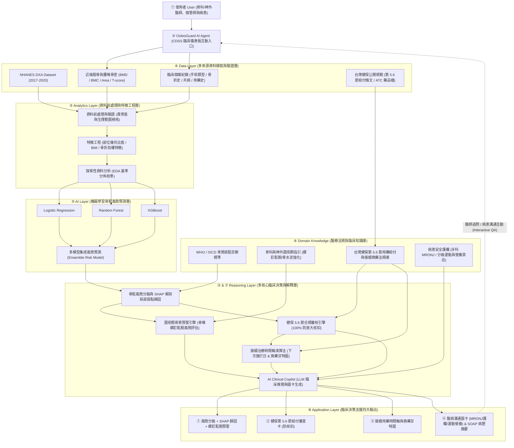
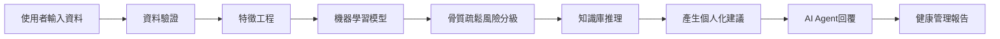

# OsteoGuard AI Agent — 系統設計規格書 (DESIGN.md)

> **文件目的**：本文件為 `OsteoGuard AI Agent` 專題之核心工程與架構設計規範，從 Proposal 階段開始建立並持續維護。旨在確保任何開發者皆能透過本文件完整理解：  
> **`Problem → Requirements → Architecture → Components → Data → AI/Analytics → Domain Knowledge → Algorithm → Implementation → How to Run → Results & Limitations`**

---

## 1. Problem Definition（問題定義）

### 1.1 背景與臨床痛點
骨質疏鬆症是超高齡社會中高盛行卻嚴重被低估的慢性骨病。若跳脫「開刀與併發症」的單一維度，骨科（Orthopedics）與神經外科（Neurosurgery）醫師在門診、急診、行政申報與醫病溝通等全方位場景中，長期面臨以下五大實務痛點：
1. **急診與初診「隱形漏診與誤判」**：高周轉率下，急門診常規 X 光平片常因腸氣遮蔽、骨質稀疏或微小壓迫變形（Genant Grade 1 wedge fracture）被誤判為單純肌肉拉傷；且少數惡性腫瘤轉移之病理性骨折（Pathologic fracture）極易在門診 2–3 分鐘內誤當一般骨折，錯失腫瘤黃金期。
2. **健保適應症地雷與放大核扣風險**：衛福部健保署《藥品給付規定》第 5.6 節對促骨生成劑與抗骨流失劑之用藥順序、年限上限與換藥規定極其繁瑣。外科醫師非內科專科，常因漏測特定項目（如肌酸酐、血鈣）或加簽程序疏失，遭健保整筆放大核扣處分。
3. **繁重門診衛教與「恐懼拔牙（MRONJ）」停藥潮**：骨鬆平時無痛感，患者多抗拒長期針劑；尤其遇到洗牙或拔牙時，常被牙醫一句「打針會下巴爛掉（顎骨壞死）」嚇退而擅自停藥。醫師門診反覆花 5–10 分鐘口沫衛教，耗損龐大心力但遵從性依然低下。
4. **「只看一次的過路客」造成醫院經營與病患流失**：大量慢性背痛或輕度骨折病患在外科只看一次拿止痛藥即離開，無法建立長期追蹤；且院內跨科轉介流程破碎，轉介至新陳代謝科成功率低於兩成，流失長程慢性病管理價值。
5. **圍術期內固定失敗與多部位數據整合困難**：近端股骨與腰椎多部位 DXA（BMD/BMC/Area）不易快速整合；缺乏自動化警示提醒醫師何時需術前先打促骨生成藥物或術中採用骨水泥強化螺釘，導致脊椎融合後椎弓根螺釘鬆脫（Pedicle Screw Loosening）風險上升。

### 1.2 系統目標
設計並實作 **OsteoGuard AI Agent（骨科與神經外科骨鬆個案管理智慧代理人）**，專為**骨科與神經外科醫師**打造，結合 **NHANES 臨床骨密度資料分析**、**可解釋性機器學習模型（LR / RF / XGBoost + SHAP）** 與 **台灣健保規範及臨床安全知識庫（LangChain + LLM API）**，打造一套具備「急門診漏診防火牆、健保法規安全守門員、病患可視化溝通圖卡、圍術期螺釘鬆脫預警，以及跨科長程接續治療排程」的端到端臨床決策支援系統（CDSS）。

---

## 2. System Requirements（系統需求規格）

### 2.1 Functional Requirements（功能性需求）
- **FR-01 門診快速輸入與多源資料驗證（Clinical Case Input & Validation）**：支援骨科與神外醫師於 15 秒內輸入個案基本資料、預計手術類型、DXA 骨密指標（BMD/BMC/Area）、骨折與健保共病史，以及用藥紀錄；自動檢核生理合理性與 DXA 假影。
- **FR-02 特徵工程與多模型預測（Feature Engineering & ML Prediction）**：自動計算跨部位幾何比值特徵與 BMI，呼叫預訓練之 Logistic Regression、Random Forest 與 XGBoost 進行骨質疏鬆風險預測與等級判定。
- **FR-03 可解釋性 AI 分析（Explainable AI - SHAP）**：針對個別病例推論計算 SHAP 特徵貢獻度，繪製局部弱點長條圖，向醫師與病患標示推升骨折風險的核心解剖部位（如股骨頸 vs. 大轉子）。
- **FR-04 骨科與神外圍術期螺釘鬆脫預警（Perioperative Screw Loosening Warning）**：針對預計接受脊椎融合內固定或人工關節置換之骨鬆個案，自動觸發椎弓根螺釘鬆脫與內固定失敗高風險預警，建議術前先期促骨生成或術中骨水泥螺釘強化。
- **FR-05 台灣健保第 5.6 節用藥合規審核（Taiwan NHI Section 5.6 Compliance Check）**：比對健保署公開之 5.6.1～5.6.3 給付條款，自動判別第一線抗骨流失劑（含未骨折高危初級預防）與第二線促骨生成劑適應症，提示漏驗項目，防範整筆放大核扣。
- **FR-06 長程接續治療時間軸與換藥甘特圖（Sequential Therapy & Drug Switch Gantt）**：視覺化標示目前療程進度、預計下次施打日期（含 Prolia 逾期斷藥反彈紅色警報），以及 Evenity（12 個月）/ Forteo（2 年）到期強制換藥期程。
- **FR-07 AI Clinical Copilot 與病患溝通圖卡生成（Clinical Copilot & Patient Cards）**：結合牙科拔牙 MRONJ 安全護欄、分級運動與鈣/維生素 D 指南，一鍵生成病患看得懂的白話骨折圖卡，並匯出門診 SOAP 結構化病歷摘要。

### 2.2 Non-Functional Requirements（非功能性需求）
- **NFR-01 可解釋性與透明度（Explainability）**：每一項風險判定皆須附上 SHAP 特徵依據與 WHO 準則來源，法規判定須具體指明健保條號與判準，拒絕黑箱推論。
- **NFR-02 臨床安全性與法律邊界（Clinical Safety & Legal Guardrails — Human-in-the-Loop）**：依據《醫師法》與《醫療法》，AI 絕不直接無授權寫入醫院法定電子病歷，而是扮演「病歷輔助草擬者（Clinical Drafting Scribe）」，自動產出結構化健保加簽審查理由草稿，供主治醫師過目審核後一鍵帶入並親自數位簽章；對高骨折風險者強制過濾高衝擊運動與脊椎過度彎曲動作；拔牙前啟動 MRONJ 照會護欄；明確標示本系統為輔助決策支援工具（CDSS），不取代臨床醫師獨立處方與手術決策權。
- **NFR-03 模組化與可維護性（Modularity & Maintainability）**：資料前處理、ML 模型、SHAP 解釋、健保法規引擎、用藥甘特圖演算法與前端介面採高內聚低耦合設計，便於法規更新與跨科模組擴充。

---

## 3. System Architecture（系統架構設計）

本系統採用六層式架構（Data Layer、Analytics Layer、AI Layer、Domain Knowledge、Reasoning Layer、Application Layer），並嚴格對應 Domain AI Agent 之 **①–⑧ 核心功能模組**：



---

## 4. Component Design（核心模組設計）

| 模組編號與名稱 | 負責職責 (Responsibilities) | 輸入 (Input) | 輸出 (Output) | 使用技術 (Tech Stack) |
| :--- | :--- | :--- | :--- | :--- |
| **① & ② User & Agent Interface** | 提供骨科與神外醫師快速錄入個案、呈現四合一 CDSS 儀表板與多輪問答互動 | 個案 DXA 數值、預計手術、骨折史、用藥時程、追問提問 | 結構化決策面板、SHAP 圖表、用藥甘特圖、病歷摘要 | `Streamlit`, `Python` |
| **④ Data Layer** | 管理 NHANES 2017–2020 股骨常模資料庫與衛福部健保署公開用藥法規資料檔 | `P_DXXFEM` 原始資料檔、健保第 5.6 節條文、ATC 藥物檔 | 基準統計常模、臨床特徵向量、法規結構字典 | `Pandas`, `NumPy`, `JSON` |
| **⑤ Analytics Layer** | 執行無效掃描過濾（4,593 $\rightarrow$ 3,545）、異常值檢核、幾何衍生比值計算與標準化 | 原始 DXA 特徵與個案生理數值 | 清理後之特徵矩陣 $X_{\text{feat}}$ | `Pandas`, `Scikit-Learn` |
| **⑤ AI Layer** | 封裝 LR、RF 與 XGBoost 三大分類模型，輸出骨質疏鬆風險機率與綜合分級 | 特徵向量 $X_{\text{feat}}$ | 預測機率 $P_{\text{risk}}$ 與交叉驗證指標 | `Scikit-Learn`, `XGBoost` |
| **⑥ Domain Knowledge** | 結構化儲存 WHO 診斷準則、脊椎融合內固定生物力學、健保 5.6 節條文、MRONJ 與運動營養指引 | 風險等級、手術類型、共病、用藥名稱與施打日期 | 對應之法規條文、手術警示閾值、牙科護欄與處方規則 | `Markdown/JSON Rules`, `LangChain` |
| **③ & ⑦ Reasoning Layer** | 多核心臨床推理引擎：執行 SHAP 特徵歸因、螺釘鬆脫預警、健保 5.6 節核對與換藥排程排定 | 模型機率、SHAP 值、領域知識庫、臨床輸入個案 | 螺釘鬆脫警報、健保審核結論、換藥時間節點、病歷摘要 | `SHAP`, `LangChain`, `OpenAI API` |
| **⑧ Application Layer** | 整合呈現四大臨床決策面板：1.風險與手術預警、2.健保審查卡、3.換藥甘特圖、4.病患圖卡與問答 | Reasoning Layer 輸出之結構化評估物件 | 視覺化 CDSS 儀表板、SOAP 病歷匯出檔、病患衛教單 | `Streamlit` |

---

## 5. Data & Data Flow（資料規格與資料流）

### 5.1 Dataset 規格：NHANES 2017–2020 DXA Femur Dataset
- **資料來源**：美國 CDC NCHS 公開之 NHANES 2017–March 2020 Pre-pandemic Examination Data (`P_DXXFEM`)。
- **樣本規模**：總受試者 **4,593 人**，篩選完成有效雙能量 X 光股骨掃描者共 **3,545 筆**。
- **核心特徵欄位對應（Feature Schema）**：

| 解剖部位 / 類別 | 特徵名稱 (Conceptual Feature) | NHANES 對應欄位範例 | 單位 | 臨床與物理意義 |
| :--- | :--- | :--- | :---: | :--- |
| **全髖部 (Total Femur)** | Total Femur BMD / BMC / Area | `DXXOFBMD`, `DXXOFBMC`, `DXXOFA` | $\text{g/cm}^2$, $\text{g}$, $\text{cm}^2$ | 反映近端股骨整體骨量與巨觀承重結構強度 |
| **股骨頸 (Femoral Neck)** | Femoral Neck BMD / BMC / Area | `DXXNKBMD`, `DXXNKBMC`, `DXXNKA` | $\text{g/cm}^2$, $\text{g}$, $\text{cm}^2$ | WHO 診斷黃金基準部位；皮質骨薄，為髖部骨折最關鍵預測指標 |
| **大轉子 (Trochanter)** | Trochanter BMD / BMC / Area | `DXXTRBMD`, `DXXTRBMC`, `DXXTRA` | $\text{g/cm}^2$, $\text{g}$, $\text{cm}^2$ | 臀中肌與臀小肌附著處，反映海綿骨代謝與側向跌倒衝擊耐受力 |
| **轉子間 (Intertrochanter)** | Intertrochanter BMD / BMC / Area | `DXXINBMD`, `DXXINBMC`, `DXXINA` | $\text{g/cm}^2$, $\text{g}$, $\text{cm}^2$ | 連接股骨頸與股骨幹之應力傳導區，骨量佔全髖部比例最高 |

### 5.2 資料處理管線（Data Pipeline Flow）

1. **離線訓練資料流（Offline Training Pipeline）**：載入 NHANES 原始資料（4,593 筆） $\rightarrow$ 篩選有效掃描狀態（3,545 筆） $\rightarrow$ 依據 WHO 基準與股骨幾何特徵建立風險預測標籤 $\rightarrow$ 特徵工程與標準化 $\rightarrow$ K-Fold 交叉驗證訓練 LR / RF / XGBoost $\rightarrow$ 匯出最佳模型權重與 TreeSHAP Explainer。
2. **線上推論資料流（Online CDSS Inference Pipeline）**：醫師輸入個案 DXA 數值、預計手術、骨折史、共病與歷史用藥 $\rightarrow$ 資料與生理假影驗證 $\rightarrow$ 幾何比值與加權特徵計算 $\rightarrow$ ML 模型推論與 SHAP 局部歸因 $\rightarrow$ 圍術期螺釘鬆脫風險預警 $\rightarrow$ 台灣健保第 5.6 節合規核對 $\rightarrow$ 接續治療時間軸與換藥甘特圖排程 $\rightarrow$ LangChain + LLM 知識推理 $\rightarrow$ 輸出四大臨床決策面板與互動問答。

---

## 6. AI Models & Analytics Engine（AI 模型與分析引擎）

### 6.1 監督式機器學習模型（Supervised ML Models）
為兼顧預測準確度與臨床基準比較，系統實作三種模型：
1. **Logistic Regression（邏輯迴歸）**：作為線性 Baseline，使用 L2 正則化處理多部位 BMD/BMC/Area 之間的共線性，提供可直觀解釋的勝算比（Odds Ratio）。
2. **Random Forest（隨機森林）**：利用 Bootstrap Aggregating (Bagging) 與隨機特徵子空間建立多棵決策樹，有效降低高維共線性特徵的變異數（Variance）。
3. **XGBoost（極限梯度提升樹）**：透過二階泰勒展開與正則化目標函數逐步擬合殘差，捕捉不同部位骨骼密度與面積之間的非線性交互作用，作為系統主力高精準度預測器。

### 6.2 Explainable AI (SHAP 解釋機制)
- 採用 `shap.TreeExplainer`（針對 RF/XGBoost）與 `shap.LinearExplainer`（針對 LR）。
- **全域解釋（Global Interpretability）**：產出 SHAP Summary Plot，驗證模型在整體 NHANES 資料集上是否最重視 `Femoral Neck BMD` 與 `Total Femur BMD`。
- **局部解釋（Local Interpretability）**：針對單一使用者計算各特徵的 SHAP 值 $\phi_i$，挑選出前三大風險推升因子（Top Risk Contributors），並轉為結構化文字注入 LLM Agent 的 Prompt 中，使 Agent 能向使用者具體解釋其骨骼弱點部位。

---

## 7. Domain Knowledge Integration（領域知識整合）

系統將四大臨床法規與醫療知識模組化，作為 Reasoning Layer 的多軌推理依據與安全護欄：

1. **WHO / ISCD 骨質疏鬆診斷標準與生物力學評估（WHO Criteria & Biomechanics）**
   - 正常（Normal）：$T\text{-score} \ge -1.0$；骨量減少（Osteopenia）：$-2.5 < T < -1.0$；骨質疏鬆症（Osteoporosis）：$T \le -2.5$；嚴重骨鬆（Severe）：$T \le -2.5$ 且合併 $\ge 1$ 處脆弱性骨折。
   - **最低部位原則（Lowest Site Rule）**：以股骨頸、全髖部或腰椎之最低 T-score 作為基準，結合 BMC 與 Bone Area 解釋幾何結構弱點。

2. **骨科與神經外科圍術期內固定指引（Orthopedic & Neurosurgical Perioperative Guidelines）**
   - **椎弓根螺釘鬆脫（Pedicle Screw Loosening）風險評估**：針對預計進行脊椎融合術或關節置換且 $T\text{-score} \le -2.5$ 之個案，自動提示內固定鬆脫高風險。
   - **圍術期強化對策**：提供術前 1–3 個月先期使用促骨生成劑（Anabolic Agent）之評估建議，或提示於手術中採用骨水泥強化螺釘（Cement Augmentation）與皮質骨軌道螺釘（CBT Screw）。

3. **台灣健保第 5.6 節骨鬆用藥給付與接續換藥法規庫（Taiwan NHI Section 5.6 & Sequential Therapy）**
   - **5.6.1 第一線抗骨吸收劑**（Prolia、Aclasta 等）：符合 $T \le -2.5$ 伴隨脊椎/髖部骨折；或骨少伴多處骨折；或符合未骨折之高危三大共病（RA、胰島素糖尿病、長期使用類固醇）。
   - **5.6.2 / 5.6.3 第二線促骨生成劑**（Forteo、Evenity）：符合 $T \le -3.0$ 伴隨 $\ge 2$ 處骨折，或使用抗流失劑滿 12 個月仍發生新骨折；自動檢驗心血管禁忌症（Evenity 禁忌症：一年內心肌梗塞/腦中風）。
   - **接續治療（Sequential Therapy）換藥規則**：Evenity 上限 12 個月、Forteo 上限 2 年，期滿必須強制轉換為抗流失劑；Prolia 逾期超過 30 天未施打（>7 個月）觸發反彈性骨折高危警訊。

4. **醫病溝通與病患安全護欄（Patient Communication & Safety Guardrails）**
   - **牙科拔牙 MRONJ 護欄**：近期 3 個月內有拔牙或植牙計畫者，提供抗骨鬆用藥暫緩期與牙科照會安全指引，消除病患恐慌與非必要停藥。
   - **分級運動與營養安全**：高骨折風險者**嚴格禁止高衝擊跳躍與脊椎過度彎曲扭轉**；推薦安全防跌肌力平衡訓練；每日鈣 1,000–1,200 mg 與維生素 D 800–1,000 IU 基礎代謝指引。

---

## 8. Core Algorithm & Pseudocode（核心演算法）

```text
Algorithm 1: OsteoGuard Clinical Decision Support Agent for Orthopedics & Neurosurgery
Input : Patient Record P = {Demographics, Surgery_Type, DXA_Sites, Fracture_History, Comorbidities, Med_History}
        Trained Models M = {M_LR, M_RF, M_XGB}, Reference Stats D_ref
        Domain Rules KB = {KB_WHO, KB_Surgery_Screws, KB_NHI_5_6, KB_MRONJ_Exercise}
Output: Clinical CDSS Report R_cdss {Risk_Tier, SHAP_Plots, Screw_Alert, NHI_Status, Switch_Gantt, Patient_Card}

01: Receive clinical case input P and physician query Q
02: // Stage 1: Clinical Data & Image Validation
03: is_valid, msg <- ValidateClinicalAndDXAInput(P, D_ref)
04: if not is_valid then return PromptPhysicianCorrection(msg)
05: 
06: // Stage 2: Feature Engineering
07: X_feat <- ComputeGeometricAndClinicalFeatures(P)  // Site ratios, BMC/Area, BMI, weighted fracture index
08: 
09: // Stage 3: ML Inference & SHAP Explainability
10: p_lr  <- M_LR.predict_proba(X_feat); p_rf <- M_RF.predict_proba(X_feat); p_xgb <- M_XGB.predict_proba(X_feat)
11: p_risk <- EvaluateEnsembleRisk(p_lr, p_rf, p_xgb)
12: shap_vals, weak_sites <- ComputeSHAPAttribution(M_XGB, X_feat)
13: who_tier, min_t_site  <- EvaluateWHOCriteria(P.DXA_Sites, KB_WHO)
14: final_tier            <- HarmonizeMLAndWHO(p_risk, who_tier)
15: 
16: // Stage 4: Orthopedic & Neurosurgical Perioperative Screw Warning
17: screw_alert <- null
18: if P.Surgery_Type in ["Spinal_Fusion", "Vertebroplasty"] and final_tier in ["Osteoporosis", "Severe"] then
19:     screw_alert <- GenerateScrewLooseningWarning(min_t_site, weak_sites, KB_Surgery_Screws)
20: end if
21: 
22: // Stage 5: Taiwan NHI Section 5.6 Reimbursement Compliance Verification
23: nhi_eval <- EvaluateNHISection56(P.T_score, P.Fracture_History, P.Comorbidities, P.Med_History, KB_NHI_5_6)
24: 
25: // Stage 6: Sequential Therapy Schedule & Medication Switch Gantt
26: next_dose_date, days_left <- CalculateNextDose(P.Med_History.Last_Date, P.Med_History.Drug_Name)
27: switch_schedule           <- ComputeSequentialTherapySwitch(P.Med_History.Start_Date, P.Med_History.Drug_Name)
28: 
29: // Stage 7: Patient Communication & Safety Guardrails (MRONJ & Exercise/Nutrition)
30: dental_mronj_guard <- CheckDentalExtractionSafety(P.Upcoming_Dental_Proc, P.Med_History, KB_MRONJ_Exercise)
31: exercise_plan      <- GenerateRiskStratifiedExercise(final_tier, P.Surgery_Type, KB_MRONJ_Exercise)
32: nutrition_plan     <- GenerateCalciumVitaminDPlan(final_tier, KB_MRONJ_Exercise)
33: 
34: // Stage 8: AI Clinical Copilot & Report Synthesis
35: prompt_ctx <- BuildCopilotPrompt(P, final_tier, weak_sites, screw_alert, nhi_eval, switch_schedule, dental_mronj_guard, exercise_plan, nutrition_plan, Q)
36: copilot_resp <- LangChain_OpenAI_Agent.invoke(prompt_ctx)
37: R_cdss <- SynthesizeCDSSPanels(copilot_resp, shap_vals, screw_alert, nhi_eval, switch_schedule, dental_mronj_guard)
38: RenderOnStreamlitDashboard(R_cdss)
39: return R_cdss
```

---

## 9. Implementation Mapping（實作模組對應規劃）

本專題預計採用以下標準化專案目錄結構，確保模組職責清晰且易於維護與交接：

```text
nchu-bone-health-agent/
├── README.md                   # 專題總覽、安裝與執行說明、待討論補充事項
├── PROPOSAL.md                 # 期中 Proposal 完整提案文件
├── DESIGN.md                   # 系統架構與工程設計規格書（本文件）
├── requirements.txt            # Python 套件相依性清單
├── .env.example                # 環境變數範本（如 OPENAI_API_KEY）
├── data/
│   ├── raw/                    # NHANES 2017-2020 原始資料集 (P_DXXFEM.XPT / CSV)
│   └── processed/              # 清理後之 3,545 筆有效掃描資料與常模統計檔
├── notebooks/
│   ├── 01_eda_and_cleaning.ipynb       # 資料探索 (EDA) 與前處理驗證
│   └── 02_model_training_shap.ipynb    # LR / RF / XGBoost 訓練、K-Fold 與 SHAP 分析
├── src/
│   ├── data_processor.py       # 資料驗證 (Data Validation) 與特徵工程 (Feature Engineering)
│   ├── ml_models.py            # 機器學習模型訓練、評估 (Accuracy/F1/ROC-AUC) 與推論介面
│   ├── explainability.py       # SHAP 特徵重要度計算與視覺化圖表生成
│   ├── surgical_advisor.py     # 骨科/神外圍術期椎弓根螺釘鬆脫預警模組
│   ├── nhi_engine.py           # 台灣健保第 5.6 節合規審查與接續換藥排程引擎
│   ├── knowledge_base/         # 領域法規與知識庫 (WHO 標準、健保條文、手術指引、MRONJ 與運動營養)
│   └── agent.py                # LangChain + LLM API 臨床推理、病歷摘要與衛教生成 Agent
├── models/                     # 序列化儲存之訓練後模型 (.pkl / .json)
└── app.py                      # Streamlit 互動式 Web 應用程式主程式
```

---

## 10. How to Run（環境建置與執行方式）

*(註：目前處於 Proposal 與架構設計階段，以下為標準化環境建置與執行流程規劃)*

### 10.1 環境需求與安裝（Installation）
```bash
# 1. 複製專案儲存庫
git clone <YOUR_GITHUB_REPO_URL>
cd nchu-bone-health-agent

# 2. 建立並啟動 Python 虛擬環境 (建議 Python 3.10+)
python -m venv venv
source venv/bin/activate   # Windows: venv\Scripts\activate

# 3. 安裝必要套件 (Pandas, NumPy, Scikit-Learn, XGBoost, SHAP, Streamlit, LangChain, OpenAI)
pip install -r requirements.txt
```

### 10.2 設定環境變數
```bash
cp .env.example .env
# 於 .env 檔案中填入您的 OpenAI API Key：
# OPENAI_API_KEY="sk-..."
```

### 10.3 執行資料處理、模型訓練與啟動系統
```bash
# Step 1: 執行 NHANES 資料清理與三大模型訓練 (產出評估指標與模型檔)
python -m src.ml_models

# Step 2: 啟動 OsteoGuard AI Agent Streamlit 互動平台
streamlit run app.py
```

---

## 11. Evaluation, Expected Results & Limitations（驗證規劃、預期結果與系統限制）

### 11.1 實驗驗證規劃（Evaluation Plan）
- **量化驗證**：於 NHANES 3,545 筆有效樣本上執行 **K-Fold Cross Validation**，系統性紀錄 Logistic Regression、Random Forest 與 XGBoost 之 **Accuracy、Precision、Recall、F1-Score、ROC-AUC**。
- **可解釋性與定性驗證**：透過 **SHAP 分析** 檢驗模型決策邏輯，並以 **Case Study（骨科與神外典型臨床情境）** 驗證 Agent 在四種真實場景之表現：
  1. 急診/門診 Genant Grade 1 微小壓迫骨折防漏篩檢；
  2. 台灣健保第 5.6 節 Evenity/Prolia 藥物申報與接續換藥防核扣審查；
  3. 門診病患拔牙恐慌停藥與 MRONJ 安全照會溝通圖卡生成；
  4. 脊椎融合術前骨質預警與骨水泥螺釘強化評估。

### 11.2 系統限制與未來展望（Limitations & Future Work）
1. **多來源資料融合之邊界**：底層監督式 ML 模型以 NHANES 3,545 筆 DXA 股骨指標為訓練主幹，門診個案之人口學（年齡/性別/BMI）、骨折病史與用藥紀錄則透過確定性規則引擎與推理層協同決策。未來可進一步整併 NHANES `P_DEMO` 與 `P_OSQ` 建立端到端多模態聯合預測模型。
2. **跨族群分佈差異（Domain Shift）**：NHANES 為美國人口常模，亞洲/台灣高齡族群之體型與基準骨密普遍偏小；系統目前採用 T-score 最低部位原則與幾何比例特徵進行校準，未來可直接導入台灣本土世代常模進行再校準。
3. **臨床決策輔助邊界聲明**：本系統為臨床決策支援系統（CDSS）與醫病溝通工具，所有輸出之健保判定與手術預警建議皆為輔助參考，不取代主治專科醫師之獨立臨床處方與手術決策權。
