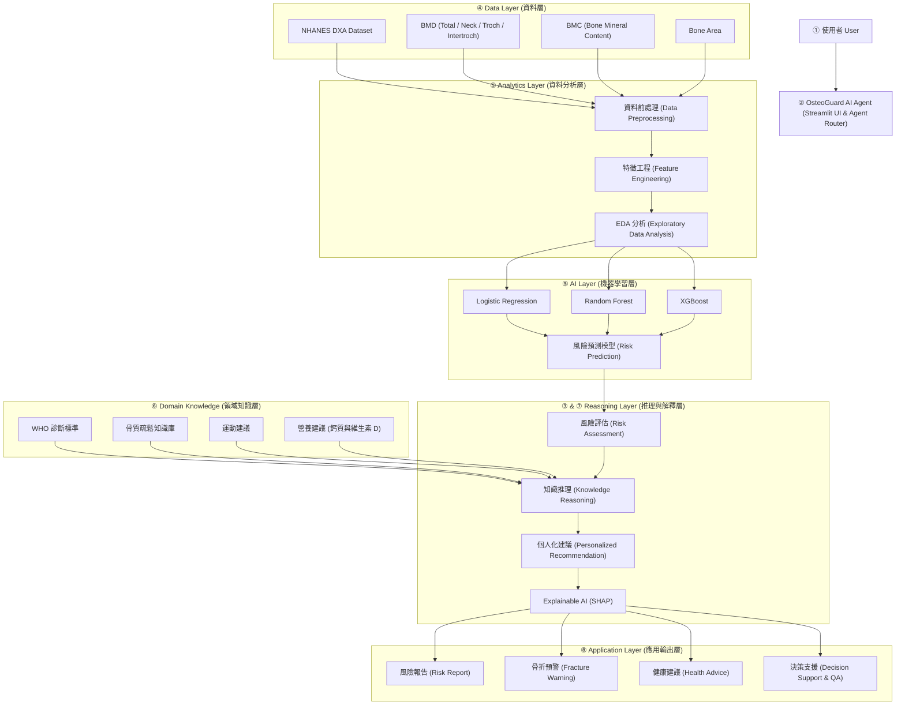
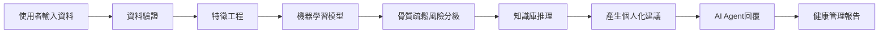

# OsteoGuard AI Agent — 系統設計規格書 (DESIGN.md)

> **文件目的**：本文件為 `OsteoGuard AI Agent` 專題之核心工程與架構設計規範，從 Proposal 階段開始建立並持續維護。旨在確保任何開發者皆能透過本文件完整理解：  
> **`Problem → Requirements → Architecture → Components → Data → AI/Analytics → Domain Knowledge → Algorithm → Implementation → How to Run → Results & Limitations`**

---

## 1. Problem Definition（問題定義）

### 1.1 背景與臨床痛點
骨質疏鬆症是高齡化社會中導致髖骨骨折、長期失能與死亡率上升的主要疾病。雖然雙能量 X 光吸光測定法（DXA, Dual-Energy X-ray Absorptiometry）是目前骨密度檢測的臨床黃金標準，但在實際預防醫學與健康管理場域中存在以下核心問題：
1. **專科判讀門檻高**：單次股骨 DXA 檢測包含全髖部（Total Femur）、股骨頸（Femoral Neck）、大轉子（Trochanter）、轉子間（Intertrochanter）等多部位之 BMD、BMC 與 Bone Area，多維度骨密度指標不易由非專科人員整合分析。
2. **民眾理解困難**：一般受試者面對檢測報告上的抽象數字與統計標準差，難以理解自身真正的骨折風險與脆弱解剖部位。
3. **缺乏個人化行動方案**：傳統健檢報告僅提供千篇一律的衛教警語，缺乏依據個人風險等級量身打造的運動處方與營養（鈣質、維生素 D）攝取建議。
4. **單一 AI 技術之侷限**：傳統機器學習分類器（ML Model）缺乏可解釋性與自然語言溝通能力；而單純的大型語言模型（LLM Chatbot）缺乏精確數值分析能力與臨床安全護欄，容易產生醫療幻覺。

### 1.2 系統目標
設計並實作 **OsteoGuard AI Agent（骨骼守護者智慧代理人）**，結合 **NHANES 臨床骨密度資料分析**、**可解釋性機器學習模型（LR / RF / XGBoost + SHAP）** 與 **骨質疏鬆醫療領域知識推理（LangChain + OpenAI API）**，打造一套具備風險預測、骨折預警、白話解釋與個人化運動營養建議的智慧醫療決策支援系統。

---

## 2. System Requirements（系統需求規格）

### 2.1 Functional Requirements（功能性需求）
- **FR-01 資料輸入與驗證（Data Input & Validation）**：支援使用者透過 Web 介面輸入或上傳股骨 DXA 檢測指標（BMD、BMC、Bone Area），並自動檢核數值完整性與生理合理性。
- **FR-02 特徵工程與多模型預測（Feature Engineering & ML Prediction）**：自動計算衍生骨骼結構特徵，並呼叫預訓練之 Logistic Regression、Random Forest 與 XGBoost 模型進行骨質疏鬆風險預測與分級。
- **FR-03 可解釋性 AI 分析（Explainable AI - SHAP）**：針對單一受試者的預測結果計算 SHAP 值，量化各解剖部位（如 Femoral Neck BMD vs. Total Femur BMD）對風險的正負向貢獻。
- **FR-04 骨質疏鬆風險分級與骨折預警（Risk Stratification & Fracture Warning）**：整合 ML 預測機率與 WHO 骨質疏鬆診斷標準，進行風險分級並針對高風險部位發出骨折預警。
- **FR-05 醫療知識庫推理與個人化建議生成（Domain Reasoning & Personalized Advice）**：結合骨鬆知識庫、分級運動建議與鈣/維生素 D 營養指引，生成符合安全邊界的個人化健康管理報告。
- **FR-06 智慧問答互動（Interactive AI Agent Q&A）**：提供多輪自然語言對話功能，解答使用者針對檢測報告、飲食替代方案與安全運動方式的追問。

### 2.2 Non-Functional Requirements（非功能性需求）
- **NFR-01 可解釋性與透明度（Explainability）**：每一項風險判定皆須附上 SHAP 特徵依據與 WHO 準則來源，拒絕無根據的黑箱結論。
- **NFR-02 醫療安全性（Clinical Safety Guardrails）**：對高骨折風險者嚴格過濾高衝擊運動建議，並明確標示「本系統為健康管理與決策支援工具，不取代專科醫師臨床診斷與處方」。
- **NFR-03 模組化與可重現性（Modularity & Reproducibility）**：資料處理、模型訓練、SHAP 解釋、Agent 推理與前端介面採解耦設計，確保實驗結果可完整重現。

---

## 3. System Architecture（系統架構設計）

本系統採用六層式架構（Data Layer、Analytics Layer、AI Layer、Domain Knowledge、Reasoning Layer、Application Layer），並對應 Domain AI Agent 之 **①–⑧ 核心功能模組**：



---

## 4. Component Design（核心模組設計）

| 模組編號與名稱 | 負責職責 (Responsibilities) | 輸入 (Input) | 輸出 (Output) | 使用技術 (Tech Stack) |
| :--- | :--- | :--- | :--- | :--- |
| **① & ② User & Agent Interface** | 提供使用者輸入 DXA 檢測數值、檢視視覺化圖表與進行智慧問答的互動前端 | 使用者 DXA 數值表單、自然語言提問 | 結構化風險報告、SHAP 圖表、互動對話回應 | `Streamlit`, `Python` |
| **④ Data Layer** | 讀取 NHANES 2017–2020 原始 XPT/CSV 檔案，管理 BMD、BMC、Bone Area 基準統計量 | `P_DXXFEM` 原始資料檔、使用者輸入特徵 | 結構化 DataFrame 與群體常模參數 | `Pandas`, `NumPy` |
| **⑤ Analytics Layer** | 執行無效掃描過濾（4,593 $\rightarrow$ 3,545）、缺失值插補/剔除、衍生特徵建構與分佈視覺化 | 原始 DXA 特徵矩陣 | 清理後之訓練/推論特徵向量 $X_{\text{feat}}$ | `Pandas`, `NumPy`, `Scikit-Learn` |
| **⑤ AI Layer** | 訓練與封裝三大分類模型（LR、RF、XGBoost），輸出骨質疏鬆風險機率與類別預測 | 特徵向量 $X_{\text{feat}}$ | 各模型預測機率 $P_{\text{risk}}$ 與交叉驗證指標 | `Scikit-Learn`, `XGBoost` |
| **⑥ Domain Knowledge** | 儲存結構化 WHO 骨鬆診斷準則、運動處方分級規則與每日鈣/維生素 D 營養攝取指南 | 風險等級查詢、特定骨骼部位弱點、使用者問題 | 對應之臨床準則條文、運動禁忌與營養知識片段 | `Markdown/JSON Knowledge Base`, `LangChain` |
| **③ & ⑦ Reasoning Layer** | 協調 ML 預測結果、計算 SHAP 特徵歸因，並結合領域知識透過 LLM 生成個人化建議 | 預測機率 $P_{\text{risk}}$、特徵向量、檢索之領域知識 | 含 XAI 解釋之結構化評估與運動/營養處方 | `SHAP`, `LangChain`, `OpenAI API` |
| **⑧ Application Layer** | 整合呈現四大終端應用功能：風險報告、骨折預警、健康建議、決策支援問答 | Reasoning Layer 輸出之結構化物件 | 視覺化儀表板、預警標籤、可下載/閱讀之衛教報告 | `Streamlit` |

---

## 5. Data & Data Flow（資料規格與資料流）

### 5.1 Dataset 規格：NHANES 2017–2020 DXA Femur Dataset
- **資料來源**：美國 CDC NCHS 公開之 NHANES 2017–March 2020 Pre-pandemic Examination Data (`P_DXXFEM`)。
- **樣本規模**：總受試者 **4,593 人**，篩選完成有效雙能量 X 光股骨掃描者共 **3,545 筆**。
- **核心特徵欄位對應（Feature Schema）**：

| 解剖部位 / 類別 | 特徵名稱 (Conceptual Feature) | NHANES 對應欄位範例 | 單位 | 臨床與物理意義 |
| :--- | :--- | :--- | :---: | :--- |
| **全髖部 (Total Femur)** | Total Femur BMD / BMC / Area | `DXXOFBMD`, `DXXOFBMC`, `DXXOFA` | $\text{g/cm}^2$, $\text{g}$, $\text{cm}^2$ | 反映近端股骨整體骨量與巨觀承重結構強度 |
| **股骨頸 (Femoral Neck)** | Femoral Neck BMD / BMC / Area | `DXXNKBMD`, `DXXNKBMC`, `DXXNKA` | $\text{g/cm}^2$, $\text{g}$, $\text{cm}^2$ | WHO 診斷黃金基準部位；皮質骨薄，為髖部骨折最關鍵預測指標 |
| **大轉子 (Trochanter)** | Trochanter BMD / BMC / Area | `DXXTRBMD`, `DXXTRBMC`, `DXXTRA` | $\text{g/cm}^2$, $\text{g}$, $\text{cm}^2$ | 臀中肌與臀小肌附著處，反映海綿骨代謝與側向跌倒衝擊耐受力 |
| **轉子間 (Intertrochanter)** | Intertrochanter BMD / BMC / Area | `DXXINBMD`, `DXXINBMC`, `DXXINA` | $\text{g/cm}^2$, $\text{g}$, $\text{cm}^2$ | 連接股骨頸與股骨幹之應力傳導區，骨量佔全髖部比例最高 |

### 5.2 資料處理管線（Data Pipeline Flow）

1. **離線訓練資料流（Offline Training Pipeline）**：載入 NHANES 原始資料（4,593 筆） $\rightarrow$ 篩選有效掃描狀態（3,545 筆） $\rightarrow$ 依據 WHO 基準定義目標風險標籤 $\rightarrow$ 特徵工程與標準化 $\rightarrow$ K-Fold 交叉驗證訓練 LR / RF / XGBoost $\rightarrow$ 匯出最佳模型權重與 SHAP Explainer。
2. **線上推論資料流（Online Agent Inference Pipeline）**：使用者輸入個人 DXA 數值 $\rightarrow$ 資料範圍驗證 $\rightarrow$ 特徵工程轉換 $\rightarrow$ ML 模型推論與 SHAP 計算 $\rightarrow$ 風險分級與 WHO 規則對齊 $\rightarrow$ LangChain + OpenAI API 知識庫推理 $\rightarrow$ 輸出個人化報告與互動問答。

---

## 6. AI Models & Analytics Engine（AI 模型與分析引擎）

### 6.1 監督式機器學習模型（Supervised ML Models）
為兼顧預測準確度與臨床基準比較，系統實作三種模型：
1. **Logistic Regression（邏輯迴歸）**：作為線性 Baseline，使用 L2 正則化處理多部位 BMD/BMC/Area 之間的共線性，提供可直觀解釋的勝算比（Odds Ratio）。
2. **Random Forest（隨機森林）**：利用 Bootstrap Aggregating (Bagging) 與隨機特徵子空間建立多棵決策樹，有效降低高維共線性特徵的變異數（Variance）。
3. **XGBoost（極限梯度提升樹）**：透過二階泰勒展開與正則化目標函數逐步擬合殘差，捕捉不同部位骨骼密度與面積之間的非線性交互作用，作為系統主力高精準度預測器。

### 6.2 Explainable AI (SHAP 解釋機制)
- 採用 `shap.TreeExplainer`（針對 RF/XGBoost）與 `shap.LinearExplainer`（針對 LR）。
- **全域解釋（Global Interpretability）**：產出 SHAP Summary Plot，驗證模型在整體 NHANES 資料集上是否最重視 `Femoral Neck BMD` 與 `Total Femur BMD`。
- **局部解釋（Local Interpretability）**：針對單一使用者計算各特徵的 SHAP 值 $\phi_i$，挑選出前三大風險推升因子（Top Risk Contributors），並轉為結構化文字注入 LLM Agent 的 Prompt 中，使 Agent 能向使用者具體解釋其骨骼弱點部位。

---

## 7. Domain Knowledge Integration（領域知識整合）

系統將四大醫療領域知識模組化，作為 Reasoning Layer 的推理依據與安全護欄：

1. **WHO 骨質疏鬆診斷標準（WHO Diagnostic Criteria）**
   - 正常（Normal）：$T\text{-score} \ge -1.0$
   - 骨量減少 / 骨質缺乏（Osteopenia）：$-2.5 < T\text{-score} < -1.0$
   - 骨質疏鬆症（Osteoporosis）：$T\text{-score} \le -2.5$
   - 嚴重骨質疏鬆症（Severe Osteoporosis）：$T\text{-score} \le -2.5$ 且合併一處以上脆弱性骨折。
   - *部位特異性規則*：優先檢視 Femoral Neck 與 Total Femur 之較低數值作為預警基準。

2. **骨密度與生物力學評估準則（BMD / BMC / Area Assessment Rules）**
   - 解釋 BMD（密度）、BMC（總礦物質量）與 Bone Area（骨骼截面積）的物理意義。
   - 針對特定解剖部位退化（例如：股骨頸單獨偏低 vs. 大轉子偏低）提供對應的生物力學風險說明。

3. **個人化運動處方建議庫（Risk-Stratified Exercise Prescription）**
   - **低/中風險（正常與輕度骨量減少）**：建議規律負重有氧運動（快走、慢跑、爬樓梯）搭配每周 2–3 次漸進式肌力阻抗訓練。
   - **高風險（骨質疏鬆與骨折預警）**：**嚴格禁止高衝擊跳躍與過度脊椎前彎/扭轉動作**；優先推薦低衝擊負重步行、坐姿/扶牆安全阻抗訓練、太極拳或單腳支撐（需扶物）等**防跌平衡訓練**，並強化居家防跌環境檢核。

4. **鈣質與維生素 D 營養建議庫（Calcium & Vitamin D Nutrition Guidelines）**
   - **鈣質（Calcium）**：建議 50 歲以上成人每日攝取 **1,000–1,200 mg**（優先由乳製品、板豆腐、深綠色蔬菜、小魚乾等天然飲食攝取；單次補充劑不超過 500 mg，每日總上限不超過 2,000–2,500 mg）。
   - **維生素 D（Vitamin D）**：建議每日攝取 **800–1,000 IU**，搭配適度日照與富含維生素 D 食物（鮭魚、鯖魚、黑木耳、雞蛋），以促進腸道鈣質吸收與維持肌肉功能（降低跌倒率）。

---

## 8. Core Algorithm & Pseudocode（核心演算法）

```text
Algorithm 1: OsteoGuard AI Agent Execution Pipeline
Input : User DXA Dictionary X_raw, User Question Q_user
Output: Agent Report Object R_out {risk_score, risk_level, fracture_alert, shap_plot, llm_report}

01: function RunOsteoGuardAgent(X_raw, Q_user):
02:     // Stage 1: Data Validation
03:     if not ValidateDXAInput(X_raw) then
04:         return RaiseValidationError("輸入之 BMD/BMC/Area 數值超出合理生理範圍或有缺漏")
05:     end if
06:     // Stage 2: Feature Engineering
07:     X_processed <- PreprocessAndEngineerFeatures(X_raw)
08:     // Stage 3: ML Model Inference & XAI
09:     prob_lr  <- Model_LR.predict_proba(X_processed)
10:     prob_rf  <- Model_RF.predict_proba(X_processed)
11:     prob_xgb <- Model_XGB.predict_proba(X_processed)
12:     shap_vals <- SHAP_Explainer.shap_values(X_processed)
13:     key_weak_sites <- ExtractTopNegativeContributors(X_raw, shap_vals)
14:     // Stage 4: Risk Stratification & Domain Knowledge Retrieval
15:     who_tier, fracture_alert <- EvaluateWHOCriteria(X_raw["Femoral_Neck_BMD"], X_raw["Total_Femur_BMD"])
16:     final_risk_level <- CombineMLAndWHORisk(prob_xgb, who_tier)
17:     domain_docs <- QueryKnowledgeBase(final_risk_level, key_weak_sites, Q_user)
18:     // Stage 5: LLM Reasoning & Personalized Prescription Generation
19:     system_prompt <- ConstructClinicalGuardrailPrompt(domain_docs, final_risk_level, fracture_alert)
20:     user_context  <- FormatPatientSummary(X_raw, prob_xgb, shap_vals, Q_user)
21:     llm_report    <- LangChain_OpenAI_Agent.invoke(system_prompt, user_context)
22:     // Stage 6: Package Output
23:     R_out <- {prob_xgb, final_risk_level, fracture_alert, shap_vals, llm_report}
24:     return R_out
```

---

## 9. Implementation Mapping（實作模組對應規劃）

本專題預計採用以下標準化專案目錄結構，確保模組職責清晰且易於維護與交接：

```text
nchu-bone-health-agent/
├── README.md                   # 專題總覽、安裝與執行說明、待討論補充事項
├── PROPOSAL.md                 # 期中 Proposal 完整提案文件
├── DESIGN.md                   # 系統架構與工程設計規格書（本文件）
├── requirements.txt            # Python 套件相依性清單
├── .env.example                # 環境變數範本（如 OPENAI_API_KEY）
├── data/
│   ├── raw/                    # NHANES 2017-2020 原始資料集 (P_DXXFEM.XPT / CSV)
│   └── processed/              # 清理後之 3,545 筆有效掃描資料與常模統計檔
├── notebooks/
│   ├── 01_eda_and_cleaning.ipynb       # 資料探索 (EDA) 與前處理驗證
│   └── 02_model_training_shap.ipynb    # LR / RF / XGBoost 訓練、K-Fold 與 SHAP 分析
├── src/
│   ├── data_processor.py       # 資料驗證 (Data Validation) 與特徵工程 (Feature Engineering)
│   ├── ml_models.py            # 機器學習模型訓練、評估 (Accuracy/F1/ROC-AUC) 與推論介面
│   ├── explainability.py       # SHAP 特徵重要度計算與視覺化圖表生成
│   ├── knowledge_base/         # 醫療領域知識庫文件 (WHO 標準、運動處方、鈣與維生素 D 指引)
│   └── agent.py                # LangChain + OpenAI API 知識庫推理與個人化建議 Agent
├── models/                     # 序列化儲存之訓練後模型 (.pkl / .json)
└── app.py                      # Streamlit 互動式 Web 應用程式主程式
```

---

## 10. How to Run（環境建置與執行方式）

*(註：目前處於 Proposal 與架構設計階段，以下為標準化環境建置與執行流程規劃)*

### 10.1 環境需求與安裝（Installation）
```bash
# 1. 複製專案儲存庫
git clone <YOUR_GITHUB_REPO_URL>
cd nchu-bone-health-agent

# 2. 建立並啟動 Python 虛擬環境 (建議 Python 3.10+)
python -m venv venv
source venv/bin/activate   # Windows: venv\Scripts\activate

# 3. 安裝必要套件 (Pandas, NumPy, Scikit-Learn, XGBoost, SHAP, Streamlit, LangChain, OpenAI)
pip install -r requirements.txt
```

### 10.2 設定環境變數
```bash
cp .env.example .env
# 於 .env 檔案中填入您的 OpenAI API Key：
# OPENAI_API_KEY="sk-..."
```

### 10.3 執行資料處理、模型訓練與啟動系統
```bash
# Step 1: 執行 NHANES 資料清理與三大模型訓練 (產出評估指標與模型檔)
python -m src.ml_models

# Step 2: 啟動 OsteoGuard AI Agent Streamlit 互動平台
streamlit run app.py
```

---

## 11. Evaluation, Expected Results & Limitations（驗證規劃、預期結果與系統限制）

### 11.1 實驗驗證規劃（Evaluation Plan）
- **量化驗證**：於 NHANES 3,545 筆有效樣本上執行 **K-Fold Cross Validation**，系統性紀錄 Logistic Regression、Random Forest 與 XGBoost 之 **Accuracy、Precision、Recall、F1-Score、ROC-AUC**。
- **可解釋性與定性驗證**：透過 **SHAP 分析** 檢驗模型決策邏輯，並以 **Case Study（臨床個案研究）** 驗證 Agent 針對不同風險層級所生成的運動與營養建議是否合乎臨床指引。

### 11.2 系統限制與未來展望（Limitations & Future Work）
1. **資料集特徵範圍限制**：目前初版聚焦於 NHANES `P_DXXFEM` 股骨 DXA 內部指標（BMD、BMC、Bone Area）；未來可進一步串接 NHANES 人口學（`P_DEMO` 年齡、性別、族裔）與身體測量（`P_BMX` BMI）資料表，提升個體化校正精準度。
2. **跨族群分佈差異（Domain Shift）**：NHANES 為美國人口常模，直接應用於亞洲/台灣高齡族群時可能存在體型與基準骨密差異；未來可導入台灣本土健檢常模進行 T-score 基準校正。
3. **非醫療診斷聲明**：本系統定位為健康風險評估與預防醫學衛教決策支援工具，所有高風險骨折預警皆需轉介臨床專科醫師進行最終診斷與藥物處置。
