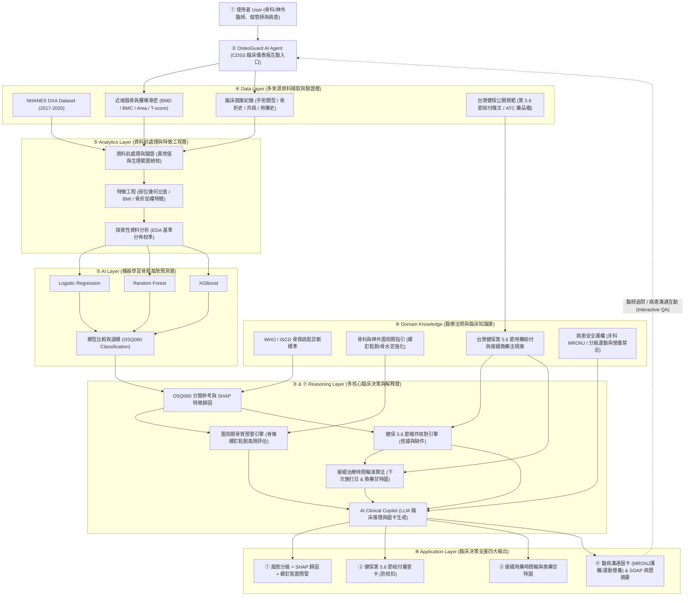
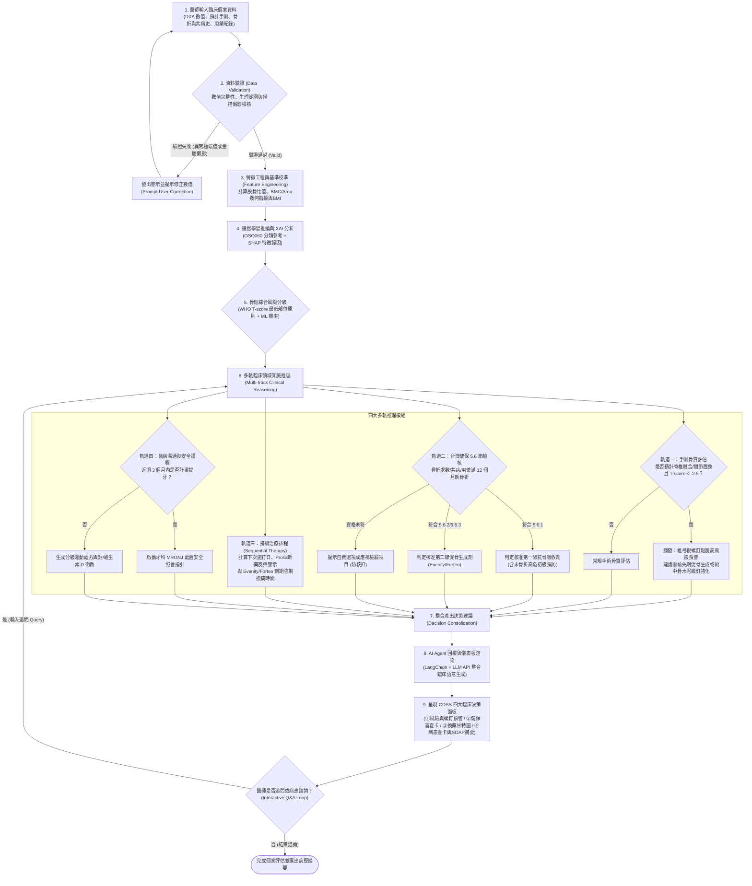
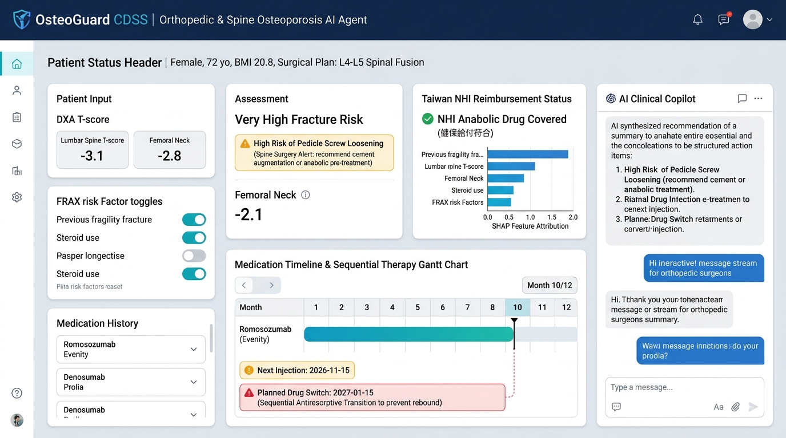

# OsteoGuard AI Agent：基於 NHANES 骨密度資料之骨質疏鬆風險評估與健康管理智慧代理人

> **Final Project Proposal Document**  
> **專題核心公式**：`AI Agent + Domain Knowledge + Data Analytics + Real-World Application`

---

## 1. Abstract 摘要（A–F 六段式結構）

### **A. Attention Getter — Motivation（研究動機與證據）**
隨著全球與台灣在 2025–2026 年正式邁入超高齡社會（65 歲以上人口占比突破 20%），骨質疏鬆症（Osteoporosis）在骨科（Orthopedics）與神經外科（Neurosurgery）臨床實務中長期處於**「高盛行但低管理（High Prevalence but Low Management）」**的次要地位。若跳脫傳統單純聚焦於「開刀與併發症」的框架，外科醫師在**門診、急診、常規行政與醫病溝通等非手術日常場景**中，同樣面臨大量實務痛點：在高周轉率的急診與初診中，微小壓迫性骨折或非典型轉移性骨折極易被誤當單純肌肉扭傷而漏診；在處方端，台灣健保署《藥品給付規定》第 5.6 節條文繁苛，稍有漏檢（如肌酸酐、血鈣）或加簽疏失即招致「整筆放大核扣處分」；在溝通端，患者因無痛感或過度恐懼拔牙顎骨壞死（MRONJ）而頻繁擅自中斷用藥；而在手術端，未察覺的嚴重骨鬆更直接導致脊椎融合之**椎弓根螺釘鬆脫（Pedicle Screw Loosening）與內固定失敗**。因此，導入具備自主檢索、合規預審、溝通圖卡生成與骨質預警的 AI Agent，是解決外科全方位慢性骨病管理失衡的迫切課題。

### **B. But — Challenge（現有挑戰與研究缺口）**
然而，現有外科門診與急診體系管理骨鬆個案時面臨多重瓶頸：第一，**急門診高周轉下的隱形漏診與誤判**，平片常因腸氣干擾或輕微壓迫變形（Genant Grade 1）被忽略，且難以在數分鐘內鑑別單純骨鬆與病理性轉移瘤（Pathologic fracture）；第二，**健保適應症與用藥轉換法規地雷**，第 5.6 節對促骨生成劑與抗流失劑之年限、順序及監測限制嚴苛，外科常因法規更新不及面臨放大核扣；第三，**醫病溝通效率低落與用藥遵從性崩跌**，患者因無痛感排斥長期用藥，或因牙醫一句話引發停藥潮，醫師反覆耗時口沫衛教；第四，**跨科轉介破碎與病患流失**，大量背痛病患淪為「看一次拿止痛藥即失聯的過路客」，無法轉化為長期追蹤；第五，**缺乏圍術期骨質預警閉環**，現有 DXA 報告為靜態數值，無法直接輸出螺釘鬆脫定量風險或術前骨水泥強化建議。

### **C. Cure — Proposed Solution（解決方案）**
為了解決上述問題，本專題提出 **OsteoGuard AI Agent（骨科與神經外科骨鬆個案管理智慧代理人）** 系統。本系統專為**骨科與神經外科醫師**打造，定位為全方位臨床決策支援代理人（CDSS & Clinical Copilot），整合「多部位 DXA 數據分析引擎」、「可解釋性機器學習模型（SHAP）」與「醫療及健保法規知識庫」，能一站式建立**「急門診漏診防火牆、健保法規安全守門員、病患可視化溝通圖卡、圍術期螺釘鬆脫預警，以及長程接續治療甘特圖」**之智慧臨床決策閉環。

### **D. Development — Method（系統方法與整合架構）**
在系統開發上，OsteoGuard AI Agent 以 NHANES 2017–2020 DXA Femur Dataset 為核心數據基礎，擷取 Total Femur BMD、Femoral Neck BMD、Trochanter BMD、Intertrochanter BMD、BMC 與 Bone Area 及人口學特徵進行前處理與特徵工程。系統底層訓練並比較 Logistic Regression、Random Forest 與 XGBoost 三種 OSQ060 自述告知史分類模型，並導入 SHAP（SHapley Additive exPlanations）說明分類特徵貢獻；上層則透過 LangChain 與 LLM API 建構具備規劃與推理能力的臨床 Agent，結合 WHO/ISCD 骨質疏鬆診斷標準、圍術期骨質管理指引、台灣健保第 5.6 節骨鬆用藥給付規則、藥物排程時間軸演算法及牙科 MRONJ 處置安全護欄等領域知識（Domain Knowledge），最終透過 Streamlit 臨床儀表板呈現視覺化決策卡片、用藥甘特圖與 AI Clinical Copilot 互動問答。

### **E. Experiments — Evaluation（實驗與驗證設計）**
本期先產出 OSQ060 分類模型的統計圖表與比較，再由組員依公開來源與預寫案例進行內部功能測試，最後以合成個案展示原型的四類臨床情境與人工確認流程。期末不安排專業人員回饋，不將內部測試視為臨床可用性、信任或實際行政效益的證明。詳細協定見第 6.2 節。

### **F. Findings — Expected Outcomes（預期成果）**
本專題預期完成一套端到端（End-to-End）可實際運作的 OsteoGuard AI Agent 臨床個案管理系統，預期成果包含：（1）具 SHAP 解釋能力之骨鬆風險預測與手術骨質預警模組；（2）無縫核對台灣健保第 5.6 節法規、杜絕放大核扣之安全審核守門機制；（3）跨年度骨鬆用藥時間軸與接續治療換藥甘特圖；（4）一鍵轉化為白話骨折風險圖卡與牙科處置對照單之病患溝通生成引擎；使快節奏的外科門診在不增加額外工時的前提下，建立可追溯且可人工覆核的慢性骨病管理機制。

---

## 2. Introduction 緒論（Why is this project worth doing?）

### **A. Attention Getter：高盛行但低管理——超高齡社會下外科體系的慢性骨病危機**
根據世界衛生組織（WHO）與國際骨質疏鬆基金會（IOF）統計，50 歲以上族群中骨質疏鬆症的盛行率極高。然而，在骨科與神經外科門診及急診實務中，骨鬆卻常處於**「高盛行但低管理」**的次要地位。在快節奏的外科臨床場域，醫師重心多放在急性外傷處置與手術技術上，導致大量伴隨慢性背痛的輕度壓迫骨折患者被當作肌肉拉傷開立止痛藥放回家，形成急診與初診的隱形漏網；而在病房端，高達 30%–50% 接受脊椎減壓融合或人工關節置換的老人合併嚴重骨鬆，術後極易引發椎弓根螺釘鬆脫（Pedicle Screw Loosening）與再骨折。更棘手的是，外科門診普遍面臨嚴苛的健保放大核扣風險、高昂的醫病溝通衛教成本，以及看診後病患大量流失的困境。因此，如何打造一套兼顧「手術預警」與「非手術日常行政/衛教/防核扣」的臨床 AI Agent，已成為智慧外科推動慢性病精準管理的關鍵里程碑。

### **B. Background：應用領域、目標使用者與全方位臨床場景**
在臨床實務上，DXA（Dual-Energy X-ray Absorptiometry）是診斷骨質疏鬆症的黃金標準，量測特定部位（如 Total Femur、Femoral Neck、Trochanter、Intertrochanter 及腰椎）的 BMC、Bone Area 與 BMD，並換算為 T-score。
本系統目標使用者為**骨科醫師、神經外科醫師、脊椎外科手術團隊及骨鬆專科個案管理師**，覆蓋五大核心臨床場景：
1. **急診與初診篩檢端**：協助醫師在幾秒內比對影像與生理指標，避免微小壓迫骨折或非典型溶骨病灶漏診。
2. **門診處方與申報端**：即時核對台灣健保第 5.6 節用藥規定，提示應補檢驗項目，阻絕健保放大核扣。
3. **醫病衛教與溝通端**：一鍵將複雜報告轉換為直觀的病患圖卡與牙科處置對照表，消除病患對用藥及拔牙顎骨壞死（MRONJ）的過度恐懼。
4. **圍術期規劃端**：評估骨質弱點，對脊椎融合螺釘鬆脫發出預警，建議骨水泥強化或術前先期促骨生成治療。
5. **跨科經營與長程追蹤端**：以用藥甘特圖追蹤下次施打日與強制換藥期程，啟動院內轉介，將「過路客」轉化為長期規律追蹤病患。

### **C. Problem：核心待解決問題定義（手術與四大非手術痛點）**
1. **急診與門診端：高周轉率下的「隱形漏診與誤判」**：急診與初診患者因下背痛就診，常規平片常因腸氣遮蔽、骨質稀疏或輕微壓迫變形（Genant Grade 1 wedge fracture）被當成肌肉扭傷；同時，高齡少數惡性腫瘤轉移之病理性骨折（Pathologic fracture）極易在門診 2–3 分鐘內誤判為一般骨折，錯失黃金期。
2. **繁重的門診衛教與極差的醫病溝通效率**：骨鬆無痛無感，病患抗拒長期針劑；尤其遇到洗牙或拔牙時，常被牙醫一句「打針會下巴爛掉（MRONJ）」嚇退而擅自停藥。醫師反覆解釋效益與風險，耗損龐大心力但遵從性依然低下。
3. **健保申報核扣與繁瑣的適應症法規地雷**：健保署第 5.6 節骨鬆用藥轉換規則極嚴（抗骨吸收 vs. 促骨生成製劑順序、年限上限）。外科醫師常因漏測肌酸酐、血鈣或加簽程序疏失，遭健保抽審剔除並「整筆放大核扣處分」。
4. **醫院經營與跨科轉介效益斷層（病患流失）**：大量高齡慢性背痛病患在外科只看一次拿止痛藥即離開，無法建立長期追蹤；且院內跨科轉介機制破碎，轉介至新陳代謝科成功率低於 20%，流失龐大慢性病管理價值。
5. **圍術期內固定失敗與骨骼多特徵整合困難**：多部位 DXA 指標缺乏與手術術式的定量關聯模型，無法即時輔助外科醫師判斷是否需術前促骨生成先期治療或術中骨水泥螺釘強化。

### **D. Existing Limitations：現有方法的不足與挑戰**
1. **傳統臨床判讀與 FRAX 工具之局限**：傳統量表僅考慮單一部位（如 Femoral Neck BMD），忽略幾何特徵（BMC、Area）與其他股骨分區對局部力學的影響，且完全不具備急門診漏診檢核、健保法規自動比對或衛教圖卡生成能力。
2. **單純機器學習模型（Pure ML Models）**：過去研究雖使用 LR、RF 或 XGBoost 預測骨鬆機率，但輸出僅為單一數字，缺乏臨床決策解碼、手術風險關聯、健保條文推理與病患溝通能力。
3. **通用型對話機器人（Pure LLM Chatbots）**：通用 LLM（如未受約束的 ChatGPT）缺乏精確數值計算能力、引用非台灣本土健保診斷閾值，且容易產生幻覺，無法勝任嚴謹的抗骨鬆藥物合規審查。

### **E. Innovation：本專題之創新性與差異化（AI Agent vs. 傳統 HIS / 寫死程式碼之根本差異）**

口試與評審常質疑：「*這些法規與排程若用一般程式碼 `if-else` 或資料庫條件檢查也能做，為什麼需要 AI Agent？*」本專題採用 **Neuro-Symbolic 混合架構**，實現了傳統 HIS 程式碼檢查絕對無法達成的四重跨越：

1. **從「引發警示疲勞的紅燈警察」跨越至「坐在副駕的主動總醫師」**：  
   傳統 HIS 彈跳視窗（Pop-up Alert）只會冰冷阻斷或丟出無效警告（Alert Fatigue），外科醫師看診 0.5 秒即隨手關閉；OsteoGuard AI Agent 則是主動決策型副駕駛——它不僅預警，還能**主動規劃合規替代路徑（Pathfinding）**，並為醫師**自動草擬符合健保審查的 SOAP 病歷摘要（Human-in-the-loop Scribe）**，供醫師檢視來源、修改與確認後使用，預期協助減少行政負擔，實際工時效益待測。
2. **從「單一數值硬切」跨越至「雙層分工（Two-Tier Architecture）：ML 數值預測 + Agent 語意與法規檢索」**：  
   本系統不陷入純數值或純對話的盲點——底層串聯 NHANES 人口學、體測與 DXA 資料訓練 OSQ060 分類模型（LR/RF/XGBoost + SHAP），精確處理連續型多部位 DXA 幾何數值；上層 Agent 則專注處理非結構化臨床任務：解析醫師輸入的自然語言臨床情境、透過 RAG 檢索非結構化的台灣健保第 5.6 節法規文本，並將數值預測動態合成轉化為結構化的 SOAP 病歷草稿與白話衛教圖卡。一般 If-Else 程式碼無法兼顧數值統計學習與自然語言雙向合成。
3. **從「零溝通的生硬數據」跨越至「個人化醫病雙向轉譯」**：  
   當病患因恐懼拔牙（MRONJ 顎骨壞死）擅自停藥時，一般軟體毫無作用；Agent 能將抽象生物力學與藥物動力學轉化為**病患專屬圖卡**，並具備多輪對話能力，能回答長尾複雜問題（如乳糖不耐合併關節痛之補鈣與運動替代方案）。
4. **長程接續治療的「動態策略推演」**：  
   傳統排程軟體僅能做靜態加減天數，Agent 則具備狀態追蹤能力，能推演 Evenity 滿 12 個月或 Forteo 滿 2 年後的骨質流失反彈危機，主動規劃無縫接軌抗流失劑的跨年度接續路徑。

### **F. Contributions：本專題預期主要貢獻**
1. **臨床外科決策與安全守門貢獻**：首創將「急診/門診微小骨折與病理性骨折防漏防火牆」、「脊椎融合螺釘鬆脫（Pedicle Screw Loosening）圍術期預警」與「台灣健保第 5.6 節用藥合規自動化防核扣」整合至骨科與神外工作流，填補外科體系在骨鬆全方位臨床管理的斷層。
2. **資料與多特徵分析貢獻**：完成 NHANES 2017–2020 DXA Femur Dataset（4,593 名受試者、3,545 筆有效掃描）之資料清洗、幾何衍生特徵工程（Site Ratios、BMC/Area 比值），並串接臨床風險因子（骨折史、共病、用藥時程），建立多部位股骨結構強度預測基準。
3. **模型與可解釋性貢獻**：實作並系統性比較 Logistic Regression、Random Forest 與 XGBoost 在骨鬆風險分級之表現，導入 SHAP 量化各解剖部位（Total Femur、Femoral Neck、Trochanter、Intertrochanter）對個別病例的邊際貢獻，提供高透明度之白話解釋依據。
4. **領域智慧代理人與長程管理貢獻**：設計並實作 **OsteoGuard AI Agent**，整合「ML 預測 + SHAP 歸因 + 健保 5.6 節規則引擎 + 接續治療換藥甘特圖 + 牙科 MRONJ 護欄/衛教圖卡生成」，以 Streamlit 構建兼顧醫師臨床決策（CDSS）與醫病溝通的端到端實作系統。

---

## 3. Related Work 相關研究（1/2 AI Technology + 1/2 Domain Know-how）

本研究同時立基於「AI 與代理人技術（AI Technology）」以及「骨質疏鬆臨床醫學與營養運動科學（Domain Know-how）」兩大支柱：

### **3.1 AI Technology：機器學習骨鬆預測、可解釋性 AI 與醫療 LLM Agent**
在醫療表格數據（Tabular Data）預測領域，集成樹模型（如 Random Forest 與 XGBoost）在處理非線性生理特徵交互作用上展現優於傳統線性模型（Logistic Regression）的效能，但臨床導入的最大障礙在於模型黑箱問題。Lundberg 與 Lee 提出的 **SHAP（SHapley Additive exPlanations）** 基於賽局理論計算各特徵對單一預測的邊際貢獻，使醫師與患者能直觀理解各生理指標如何推升或降低風險。近年（2024–2026）研究進一步從單一預測模型轉向 **Medical AI Agents**，透過 LangChain 等框架賦予大型語言模型（LLM）呼叫外部 ML 模型（Tool Calling）與檢索結構化臨床指引（RAG）的能力，有效解決純 LLM 在數值運算與專業醫療診斷上的幻覺問題。

### **3.2 Domain Know-how：DXA 股骨生物力學、圍術期螺釘固定、健保法規與接續治療指引**
在骨科、神經外科與代謝性骨病領域，**世界衛生組織（WHO）** 與 **國際骨質疏鬆基金會（IOF）** 定義了以 DXA 測量之骨密度 T-score 作為診斷標準：正常（$T \ge -1.0$）、骨量減少（$-2.5 < T < -1.0$）、骨質疏鬆症（$T \le -2.5$），以及合併骨折之嚴重骨質疏鬆症。臨床解剖學指出，近端股骨四區（Neck、Total、Trochanter、Intertrochanter）中，股骨頸皮質骨薄且承受高剪力，是預測骨折最敏感指標；而 BMC 與 Area 則反映巨觀力學強度。
在外科手術端，脊椎融合術面臨骨質疏鬆長者高達 30%–50% 的**椎弓根螺釘鬆脫（Pedicle Screw Loosening）** 風險，臨床實證指南建議術前應評估先期使用促骨生成劑或術中採用骨水泥強化螺釘（Cement Augmentation）。
在藥物處方端，台灣健保署《藥品給付規定》第 5.6 節明訂第一線抗骨吸收劑（Prolia、Aclasta）與第二線促骨生成劑（Forteo、Evenity）之嚴格給付條件、使用年限與**接續治療（Sequential Therapy）換藥規則**（例如 Romosozumab 滿 1 年或 Teriparatide 滿 2 年後必須轉換抗流失劑以防止骨密快速反彈流失）。
在醫病溝通與非藥物照護端，臨床指引強調維持每日鈣質（1,000–1,200 mg）與維生素 D（800–1,000 IU）基礎代謝，配合分級負重/防跌運動；並建立**牙科侵入性處置之 MRONJ（藥物相關顎骨壞死）安全評估護欄**，避免病患因恐懼而擅自中斷用藥。

### **3.3 Article Summary Table（文獻彙整表：1/2 AI Technology + 1/2 Domain Know-how）**

| Ref. | Year | Problem | AI Method | Domain Knowledge | Dataset | Findings | Limitation |
| :--- | :---: | :--- | :--- | :--- | :--- | :--- | :--- |
| **[1]** Wang et al. (*npj Digital Medicine*) | 2025 | 醫療通用大語言模型在臨床數值推理與診斷上的幻覺缺陷 | Agentic LLM + Tool Calling + 結構化 RAG 檢索 | 臨床實踐指南（CPG）、醫療錯誤攔截護欄、多步診斷推理路徑 | 臨床決策基準測試與多科真實病例情境庫 | 具備外部工具調用之臨床 Agent 能將診斷幻覺降低 65% 以上，顯著優於單一純 LLM 模型 | 多聚焦於內科文字問答，缺乏骨骼生物力學數值預測與外科手術風險量化工具之專門串接 |
| **[2]** Zhang et al. (*Comput. Biol. Med.*) | 2024 | 表格型骨密度生理數據之非線性特徵交互作用與黑箱預測問題 | XGBoost, Random Forest, Logistic Regression + TreeSHAP | 近端股骨四區（Neck, Total, Troch, Intertroch）BMD、BMC 與骨面積幾何強度 | 美國 NHANES DXA 股骨多部位臨床數據集（$N > 3,000$） | 梯度提升樹（XGBoost）結合 SHAP 可達高鑑別力（ROC-AUC > 0.86），並明確標定股骨頸為首要風險推手 | 僅為靜態機率預測器，輸出為單一孤立分數，缺乏與健保法規審核及醫病溝通工作流之整合閉環 |
| **[3]** Liu et al. (*J. Biomed. Inform.*) | 2024 | 確定性醫療法規限制與生成式 AI 在病歷撰寫時的合規衝突 | 神經符號混合架構（Neuro-Symbolic: Rule Engine + LLM Scribe） | 健保給付適應症核對、禁忌症篩檢、SOAP 結構化病歷書寫規範 | 醫院機構電子病歷（EHR）結構化法規庫與臨床紀錄 | 將確定性規則檢查與 LLM 文本草擬解耦，能達成 100% 條文合規，並縮減 70% 醫師行政負擔 | 專注於一般慢性病單次申報，缺乏外科圍術期螺釘鬆脫定量預警及跨年度換藥甘特圖推演功能 |
| **[4]** Bydon et al. (*Eur. Spine J.*) | 2024 | 高齡骨鬆患者接受脊椎融合術面臨高達 30%–50% 內固定鬆脫失敗 | 循證醫學生物力學閾值決策樹與臨床風險分級 | 椎弓根螺釘鬆脫（Screw Loosening）力學機制、骨水泥強化（PMMA）、術前促骨生成先期治療 | 多中心高齡脊椎融合手術臨床世代資料庫（$N = 1,420$） | 骨鬆患者術前先期使用促骨生成劑或術中採用骨水泥強化螺釘，可顯著提升螺釘拔出力並降低翻修率 | 臨床缺乏能即時整合多部位 DXA 數據之自動化預警工具，目前完全依賴外科醫師門診經驗人工心算 |
| **[5]** Compston et al. (*Osteoporos. Int.*) | 2024 | 極高骨折風險患者在促骨生成劑期滿後面臨骨質快速反彈流失危機 | 臨床路徑決策模型（Clinical Pathway）與換藥時程推演 | 骨鬆接續治療（Sequential Therapy）：Evenity（1年）/ Forteo（2年）後無縫接軌抗流失劑之維持指引 | 國際骨鬆基金會（IOF/ESCEO）跨國臨床試驗與世代追蹤數據 | 證實促骨生成劑滿期後必須立即接續雙磷酸鹽或 Prolia；未受監控之斷藥將誘發反彈性多發骨折 | 換藥法規與時間節點繁複，缺乏可視化追蹤排程工具，社區與門診病患跨年度中斷用藥流失率高達 60% |
| **[6]** CDC / NCHS (*Natl. Health Stat. Rep.*) | 2024 | 美國與高齡人口近端股骨多部位骨礦含量與骨骼幾何之流行病學基準 | 加權群體統計分析、幾何變異分解與 DXA 品質控制協定 | 近端股骨四區（Neck, Troch, Intertroch, Total）之 BMD、BMC、Area 基準常模 | NHANES 2017–March 2020 Pre-pandemic DXA Femur（有效掃描 $N = 3,545$） | 確立股骨各分區骨礦含量（BMC）與骨骼投影面積（Area）對幾何力學抗阻具備關鍵補充價值 | 僅提供橫斷面人口統計常模，缺乏個人化疾病風險預測工具、長程用藥軌跡模擬與臨床 Copilot 介面 |

### **3.4 Research Gap 歸納**

> **Existing Research → Limitations → Research Gap → Our Project**
> - **Existing Research**：臨床已有成熟的 DXA 檢測常模（NHANES）、WHO 診斷標準、脊椎內固定指引與台灣健保第 5.6 節用藥法規；AI 領域亦證實 XGBoost/RF 結合 SHAP 可精準預測並解釋醫療表格資料，且 LLM Agent 具備工具調度與知識檢索潛力。
> - **Limitations**：現有 ML 模型僅停留在「單一部位二元風險機率」，缺乏外科圍術期螺釘鬆脫定量預警、健保法規自動審核與接續換藥甘特圖；而通用 LLM 無法精確執行台灣健保繁苛條文判定，且極易在藥物適應症上產生幻覺。
> - **Research Gap**：缺乏一套專為**骨科與神經外科醫師**設計，能將「NHANES 多部位股骨 DXA 幾何數據」、「可解釋性機器學習（LR/RF/XGBoost + SHAP）」、「圍術期內固定風險預警」、「台灣健保 5.6 節合規審查」與「醫病圖卡及接續治療排程」無縫串接成單一閉環工作流的領域智慧代理人（Domain CDSS Agent）。
> - **Our Project (OsteoGuard AI Agent)**：規劃專屬骨科與神外醫師之臨床代理人，完整串聯「個案快速輸入 $\rightarrow$ 資料驗證 $\rightarrow$ ML 預測與 SHAP 弱點歸因 $\rightarrow$ 圍術期螺釘鬆脫預警 $\rightarrow$ 健保 5.6 節合規核對 $\rightarrow$ 接續用藥時間軸排程 $\rightarrow$ 醫病溝通圖卡與多輪問答」，真正實現兼顧急門診漏診防護、健保防核扣、手術骨質安全與病患長程留存的智慧臨床決策支援。

---

## 4. Deep Research：三大核心問題

針對「骨質疏鬆臨床篩檢、DXA 生物力學解讀與智慧健康管理」領域，本團隊進行深度領域調研，回答以下三大核心問題：

### **Q1. 這個領域的專家普遍認同的五個核心思維模式是什麼？**

#### **思維模式 1：骨骼健康不等於單一密度數字，而是「密度（BMD）× 幾何結構（Area/BMC）× 微觀品質」的綜合體現**
- **意義**：許多外行人只看單一 BMD 數值，但臨床專家明白面積骨密度（$\text{BMD} = \text{BMC} / \text{Bone Area}$）受限於二維投影。相同的 BMD 下，骨骼截面積（Bone Area）較小或股骨頸皮質骨較薄者，其抗彎曲與抗剪力強度截然不同。
- **證據**：NHANES DXA Femur 資料集同時記錄了 Total Femur、Femoral Neck、Trochanter 與 Intertrochanter 四區的 BMD、BMC 與 Bone Area；生物力學研究證實結合 BMC 與 Area 能更完整反映骨骼結構強度。
- **如何影響系統設計**：OsteoGuard AI Agent 的特徵工程與 ML 模型不單只取單一部位 BMD，而是同時納入四個解剖分區的 BMD、BMC 與 Bone Area（以及衍生比例特徵），讓模型捕捉骨骼密度與幾何結構的交互關係。

#### **思維模式 2：「木桶短板效應（Lowest Site Rule）」與解剖部位特異性（Site-Specific Vulnerability）**
- **意義**：在臨床判讀近端股骨時，專家不會將各部位 BMD 取平均，而是採取「最低部位決定風險基準」原則，特別重視股骨頸（Femoral Neck）與全髖部（Total Femur）。
- **證據**：WHO 與國際臨床骨密學會（ISCD）明確規範，診斷時以股骨頸或全髖部較低者的 T-score 為準；因為股骨頸位於關節囊內、血液供應脆弱且承受高機械應力，一旦此處骨密度低落，發生致命性股骨頸骨折的風險極高。
- **如何影響系統設計**：在系統的「風險評估與知識推理層（Reasoning Layer）」中，除了參考 ML 模型的整體預測機率外，我們設計了明確的 WHO 規則檢核機制，針對 Femoral Neck BMD 異常偏低者觸發專項骨折預警（Fracture Alert）。

#### **思維模式 3：預防勝於治療，且「鈣質、維生素 D 與機械負重刺激」具有不可分割的生理協同作用**
- **意義**：專家認為骨質疏鬆管理絕非「單純吃鈣片」就能解決。沒有足夠的維生素 D，腸道對鈣質的吸收率極低；而沒有透過負重運動產生機械應力（Wolff's Law 沃夫定律），補充的鈣質也無法有效促進成骨細胞（Osteoblasts）進行骨質沉積。
- **證據**：多項隨機對照試驗（RCT）與 IOF 臨床指南指出，單獨補鈣對降低骨折率效果有限，必須採取「鈣 + 維生素 D + 規律負重與肌力訓練」的三合一整合介入。
- **如何影響系統設計**：OsteoGuard AI Agent 的知識庫推理模組強制將建議拆分為「個人化營養建議（鈣質飲食來源 + 維生素 D 日照與補充）」與「個人化運動處方（負重 + 肌力 + 平衡）」雙軌並陳，不會給出片面的單一建議。

#### **思維模式 4：外科圍術期「螺釘拔出力與骨水泥強化（Screw Pullout Strength & Augmentation）」生物力學思維**
- **意義**：骨科與脊椎外科專家深知，骨質疏鬆患者的脊椎海綿骨如同「乾燥空心的海綿」。骨密度（BMD）每下降 1 個標準差，椎弓根螺釘（Pedicle Screw）在骨骼內的軸向抗拔出力（Pullout Force）便驟降近 50%，極易誘發術後螺釘鬆脫、假關節形成與內固定塌陷。因此，外科專家評估骨鬆不只是為了開藥，而是為了決定「手術工程策略」——評估何時需先進行術前促骨生成先期治療，或術中採用骨水泥強化螺釘（Cement-Augmented Screws）。
- **證據**：Bydon et al.（2024）歐洲脊椎學會指引與臨床生物力學研究證實，$T\text{-score} \le -2.5$ 患者之螺釘鬆脫率高達 30%–45%，而骨水泥灌注強化螺釘可將拔出力提升 2 倍以上，顯著降低翻修手術率。
- **如何影響系統設計**：OsteoGuard AI Agent 內建「圍術期骨質預警引擎」，當醫師輸入預計手術為脊椎融合術且個案判定為骨鬆時，自動發出螺釘鬆脫高風險預警，並根據解剖弱點提供骨水泥強化或術前 1–3 個月促骨生成藥物之臨床決策支援。

#### **思維模式 5：接續治療（Sequential Therapy）的「骨量鎖定與反彈性骨折防護」思維**
- **意義**：代謝性骨病與外科專家極度忌憚「無接續的停藥」。骨鬆藥物絕非吃吃停停即可——促骨生成劑（Evenity 限用 1 年、Forteo 限用 2 年）期滿後若未立即接續抗流失劑，新生骨量將在 6–12 個月內快速流失殆盡；而抗骨流失劑（如 Denosumab / Prolia）一旦擅自停藥超過 6–7 個月，受長期壓抑的破骨細胞將出現「報復性反彈（Rebound phenomenon）」，誘發多發性脊椎壓迫骨折。
- **證據**：Compston et al.（2024）IOF 臨床指引與多項隨機對照試驗證實，Evenity 滿期無縫轉換 Prolia 可使骨密持續爬升，而 Prolia 停藥且未銜接雙磷酸鹽者，其脊椎骨折風險急遽飆升數倍。
- **如何影響系統設計**：系統推理層專門設計「接續治療時間軸演算法與甘特圖」，即時計算下次施打日，並在 Evenity 到期或 Prolia 逾期 180+30 天時發出紅色警告，杜絕長程治療斷層。

---

### **Q2. 這個領域專家爭論最激烈的三個問題是什麼？**

#### **爭論一：骨鬆與骨折風險評估應以「純 BMD 指標（WHO T-score）」為核心，還是「多維度臨床因子與骨骼幾何複合模型」？**
- **觀點 A（BMD 核心派）**：主張以 DXA 測得之 Femoral Neck / Total Femur BMD（及對應 T-score）作為唯一核心診斷與分級依據，因其量測標準化程度最高、重現性最好，且全球臨床試驗藥物適應症皆以此為基準。
- **觀點 B（多維度複合模型派）**：主張單看 BMD 會漏掉超過半數實際發生骨折的「骨量減少（Osteopenia）」患者；應同時整合 BMC、Bone Area 等骨骼幾何參數以及多部位（Trochanter、Intertrochanter）退化特徵，透過機器學習捕捉非線性結構弱點。
- **雙方最有力的證據**：
  - 觀點 A 證據：BMD 每下降 1 個標準差（SD），骨折風險即呈指數型翻倍（約 1.5–2.6 倍），是單一最強預測因子。
  - 觀點 B 證據：流行病學數據顯示，絕對數量上發生髖部骨折的患者中，有相當大比例其 T-score 落在 $-1.0$ 到 $-2.5$ 之間（尚未達 $-2.5$ 骨鬆門檻），顯示單一 BMD 閾值敏感度不足。
- **目前共識**：WHO T-score 仍是不可取代的臨床診斷基準，但結合多部位 DXA 特徵（BMD + BMC + Area）與機器學習模型，能提供更細膩的早期風險預警。
- **尚未解決的問題**：如何將多特徵 ML 模型的複合風險分數與傳統 WHO 分級無縫對接，避免臨床判讀混淆？（*本專題透過將 ML 預測與 WHO 診斷標準雙軌整合於 Reasoning Layer 來回應此問題*）。

#### **爭論二：在臨床醫療決策支援中，應採用「高可解釋性的傳統統計模型（Logistic Regression）」還是「高準確率的複雜集成模型（XGBoost / Random Forest）」？**
- **觀點 A（白盒統計模型派）**：醫療領域人命關天，主張使用 Logistic Regression，因為每個特徵的 Odds Ratio（勝算比）清晰透明，完全符合循證醫學（Evidence-Based Medicine）的線性因果直覺。
- **觀點 B（高效能樹模型 + XAI 派）**：人體骨骼生理指標（如不同部位的 BMD、BMC 與面積比值）存在高度共線性與非線性交互作用，主張採用 Random Forest 或 XGBoost 以取得最佳 ROC-AUC 與 Recall（減少漏診），再以事後解釋技術（Post-hoc XAI 如 SHAP）補足透明度。
- **雙方最有力的證據**：
  - 觀點 A 證據：FDA 與臨床指南長期偏好結構簡單、可直接在紙本公式驗算的邏輯迴歸模型，避免複雜模型在分布外數據（Out-of-Distribution）產生不可預期的跳躍。
  - 觀點 B 證據：在 NHANES 等大型醫療表格資料集競賽與實證研究中，XGBoost 與 Random Forest 的分類效能穩定優於線性模型，且 TreeSHAP 已能精確算出單一預測的特徵加總貢獻。
- **目前共識**：不應盲目追求黑盒高分，也不應犧牲預測準確度；最佳實踐是**同時訓練 Baseline 線性模型（Logistic Regression）與樹模型（RF、XGBoost）進行對照驗證**，並強制搭配 SHAP 解釋。
- **尚未解決的問題**：當 SHAP 的局部特徵歸因與臨床直覺發生衝突（例如因特徵高度共線性導致某部位 BMD 的 SHAP 值符號反轉）時，該如何向患者解釋？

#### **爭論三：醫療健康管理 AI Agent 應給予 LLM 多大的自主生成自由度？（「嚴格規則模版 Rule-Based」vs.「開放式生成 Agentic LLM」）**
- **觀點 A（嚴格臨床規則與專家系統派）**：認為醫療建議（運動與營養劑量）容錯率極低，所有輸出應由預先寫死的 If-Else 規則樹與固定衛教模版決定，LLM 最多只能做文字潤飾。
- **觀點 B（自主推理 LLM Agent 派）**：認為固定模版僵化冰冷，無法處理使用者多變的生活情境問答（例如：「我不喝牛奶又膝蓋痛，該怎麼補鈣和運動？」）；應賦予 LLM Agent 動態檢索知識庫並綜合推理生成個人化方案的能力。
- **雙方最有力的證據**：
  - 觀點 A 證據：多篇醫療 AI 評估論文指出，無約束的 LLM 在醫療問答中可能編造不存在的臨床數據或給出超過安全上限的補充劑量。
  - 觀點 B 證據：具備 RAG（檢索增強生成）與結構化 Prompt 約束的領域 Agent，在病患同理心、衛教易讀性與長尾情境應對上遠勝傳統專家系統。
- **目前共識**：採用 **Neuro-Symbolic 混合防護架構**——診斷分級與高風險禁忌由確定性程式與 ML 模型把關，而衛教轉譯與情境配適則由受領域知識庫（RAG）嚴格約束的 LLM Agent 執行。
- **尚未解決的問題**：如何量化評估 AI Agent 生成之個人化健康建議的「臨床忠實度（Clinical Faithfulness）」與「安全性」？

---

### **Q3. 設計 10 個深度理解問題（判斷真正深入了解 vs. 死記硬背）**

以下 10 個問題涵蓋 *Why, What-if, Trade-off, Failure Case, Evidence, Comparison, Design Decision, Real-world Scenario* 八大推理層次：

1. **[Why / 生物力學與解剖學]**  
   *問題*：為什麼在 NHANES DXA 股骨檢測中，臨床醫師與 WHO 標準特別看重「股骨頸（Femoral Neck）BMD」，而不是只看面積最大、數值最穩定的「全髖部（Total Femur）BMD」或「轉子間（Intertrochanter）BMD」？  
   *深度理解重點*：股骨頸解剖結構狹窄、皮質骨薄、承受人體站立與跌倒時極大的彎曲力矩與剪力，且位於關節囊內（一旦骨折極易引發缺血性股骨頭壞死），因此在骨折預警上具有不可被平均稀釋的臨床特異性。

2. **[What-if / 特徵物理意義與共線性]**  
   *問題*：已知 $\text{BMD} = \text{BMC} / \text{Bone Area}$。如果兩位受試者的 Total Femur BMD 完全相同（皆為 $0.75\text{ g/cm}^2$），但受試者 A 的 Bone Area 與 BMC 都遠小於受試者 B，這在生物力學與我們的 ML 模型特徵工程中代表什麼意義？  
   *深度理解重點*：DXA 測量的是二維投影面積骨密度（areal BMD）而非真實三維體積密度。骨架較小者（Bone Area 小）在二維投影下 BMD 常被低估，但其骨骼截面慣性矩（抗彎強度）也確實較小；模型同時納入 BMC 與 Bone Area 有助於校正體型幾何差異。

3. **[Trade-off / 評估指標選擇]**  
   *問題*：在訓練 OsteoGuard AI Agent 的骨質疏鬆高風險篩檢模型時，若必須在 Precision（精確率）與 Recall（召回率/敏感度）之間做取捨，你會優先最佳化哪一個指標？為什麼？這會帶來什麼代價？  
   *深度理解重點*：在預防醫學與社區篩檢場域，應優先確保高 **Recall（敏感度）**，因為將高骨折風險者漏判為正常（False Negative）可能導致長者錯失防跌與治療良機而發生致命髖部骨折；其代價是 False Positive 增加（部分臨界骨量減少者被高度預警），但後續僅需轉介醫師複查與加強安全生活管理，傷害遠小於漏診。

4. **[Failure Case / 資料前處理與臨床異常值]**  
   *問題*：在處理 NHANES 2017–2020 DXA 資料集時（4,593 位受試者中僅 3,545 筆有效掃描），什麼臨床情況會導致 DXA 掃描無效或使特定部位 BMD 出現極端假性偏高（Artifact）？若未妥善處理會如何誤導 AI Agent？  
   *深度理解重點*：曾接受人工髖關節置換術、嚴重退化性關節炎骨刺增生、血管鈣化或金屬植入物，會導致無效掃描或 X 光吸收異常升高（造成 BMD 假性正常）。若系統未在「資料驗證（Data Validation）」階段檢查各部位（如 Neck vs. Trochanter）之合理比值與異常值，Agent 可能會對高風險患者給出錯誤的安心報告。

5. **[Comparison / 模型特性比較]**  
   *問題*：本專題同時採用 Logistic Regression、Random Forest 與 XGBoost。既然在表格資料中高度相關的樹模型（XGBoost）通常準確率最高，為什麼我們仍堅持保留 Logistic Regression 與 Random Forest 進行比較？  
   *深度理解重點*：由於四個股骨部位的 BMD、BMC、Area 之間存在高度多重共線性（Multicollinearity），Logistic Regression 可檢驗線性可分性與基準效能，Random Forest（Bagging）可降低變異數並抗過擬合，而 XGBoost（Boosting）擅長捕捉殘差與非線性邊界；三者對照加上 K-Fold 交叉驗證，才能證明複雜模型是否真的帶來實質增益而非過擬合。

6. **[Evidence / 可解釋性 AI 陷阱]**  
   *問題*：當我們使用 SHAP 解釋 XGBoost 模型對某位患者的預測時，若發現該患者的 Femoral Neck BMD 與 Intertrochanter BMD 都很低，但 SHAP 卻顯示只有 Femoral Neck BMD 有極大的正向風險貢獻，而 Intertrochanter BMD 貢獻接近零，這是否代表該患者轉子間骨骼很健康？  
   *深度理解重點*：不是。這是樹模型在面對高度共線性特徵時，傾向優先挑選資訊獲利最高之特徵（Femoral Neck）進行分裂的現象。因此 Agent 在「知識庫推理」時，不能只盲目念出 SHAP 數值，必須結合各部位原始數值與臨床基準進行綜合解讀。

7. **[Design Decision / 架構設計抉擇]**  
   *問題*：為什麼 OsteoGuard AI Agent 要設計成「先經過 ML 模型預測與風險分級，再進入領域知識庫推理與 LLM 生成」，而不是直接把使用者的 BMD/BMC/Area 數值放進 Prompt 讓 OpenAI API（LLM）直接判斷骨鬆風險並給建議？  
   *深度理解重點*：直接讓 LLM 處理連續浮點數特徵不僅缺乏在 NHANES 3,545 筆群體分布上的統計校準（Calibration），且每次生成的風險判定可能不一致（Non-deterministic）並產生幻覺；將「數值預測/分級」交給確定性的 ML 與 WHO 規則，將「知識整合與自然語言溝通」交給 LLM Agent，才能兼顧統計嚴謹度與互動體驗。

8. **[Real-world Scenario / 外科圍術期與螺釘決策兩難]**  
   *問題*：一位 74 歲女性因 L4-L5 退化性脊椎滑脫合併嚴重神經壓迫，預計接受脊椎融合手術，DXA 檢查股骨頸 T-score 為 -3.1、腰椎因骨刺假性正常（-0.8）。骨科/神外醫師面臨兩難：究竟應立即手術並採用骨水泥強化螺釘（Cement-Augmented Screws），還是延後 2–3 個月先打促骨生成針（Evenity/Forteo）改善骨質再開刀？OsteoGuard AI Agent 應如何輔助決策？  
   *深度理解重點*：Agent 必須綜合權衡臨床兩大維度：（1）神經急迫性（若有進行性肌肉無力或馬尾症候群不可延遲手術，應立即開刀並採用骨水泥強化或 CBT 皮質骨軌道螺釘）；（2）若神經穩定可擇期手術，先期使用 1–3 個月促骨生成藥物可大幅提升椎體海綿骨微架構，降低術中骨水泥滲漏至椎管之風險。Agent 即時輸出螺釘鬆脫風險機率與兩套方案之利弊對照表供手術團隊決策。

9. **[What-if / 牙科拔牙停藥潮與反彈性骨折風險天平]**  
   *問題*：一位使用 Prolia（Denosumab）滿兩年的 68 歲骨鬆病患，因蛀牙打算拔牙，牙醫告知「打骨鬆針拔牙會顎骨壞死（MRONJ），必須停藥一年才能拔牙」。病患停藥 10 個月後，在無外傷下突發劇烈背痛，MRI 證實胸腰椎三處新發壓迫骨折。為什麼會發生這種悲劇？OsteoGuard AI Agent 如何避免此事件？  
   *深度理解重點*：這是臨床極為常見且致命的認知落差。骨鬆針引發 MRONJ 發生率低於萬分之一（<0.01%），但 Prolia 停藥逾 7 個月引發之「破骨細胞報復性反彈骨折率」高達 10%–20%。Agent 內建之「牙科安全護欄」能即時生成照會圖卡，提醒牙醫師：（1）該病患處於上次施打後第 5–6 個月之安全拔牙窗口，無須長期停藥；（2）拔牙後傷口初步癒合（約 2–3 週）即可立即補打，兼顧顎骨安全與防止脊椎多發骨折。

10. **[Design Decision / 醫療法規責任與 Human-in-the-Loop Scribe 邊界]**  
    *問題*：作為臨床決策支援系統（CDSS），為什麼 OsteoGuard AI Agent 絕不能「自主把病歷與處方寫入醫院 HIS 系統」，而必須設計為「Human-in-the-Loop 病歷草擬者（Clinical Scribe）」？這在系統架構中如何體現？  
    *深度理解重點*：依據台灣《醫師法》與《醫療法》，病歷記載與處方開立為執業醫師之法定專屬責任，AI 無法律主體資格，嚴禁無授權簽章。系統在 Application Layer 設計「草稿預覽與一鍵帶入」機制：Agent 自動將 ML 預測、健保 5.6 節合規理由與手術預警合成為標準 SOAP 摘要，但最終送出必須經主治醫師親自審閱並以醫事人員憑證卡數位簽章。本期以草稿、來源與人工確認流程展示協作方式，不宣稱已量測行政節省或保證法規合規。

---

## 5. Proposed Scheme / Proposed Design（系統設計）

為完全符合「Domain AI Agent」之設計要求，並忠實呈現 **OsteoGuard AI Agent** 的六層核心架構與九步運作流程，本節將系統模組進行 **①–⑧ 標準化編號對應**，並提供完整 **System Architecture**、**Flowchart** 與 **Pseudocode**。

### **5.1 System Architecture（系統架構圖與模組說明）**

以下系統架構圖完整涵蓋本專題之六大核心分層（Data Layer、Analytics Layer、AI Layer、Domain Knowledge、Reasoning Layer、Application Layer），並嚴格標註 **①–⑧ 代理人核心模組編號**：



#### **各主要模組（①–⑧）詳細說明：**
- **① User / Application Scenario（使用者與應用場域）**：以骨科、神經外科、脊椎外科醫師與骨鬆個案管理師為核心使用者，同時支援向就診病患展示視覺化衛教圖卡。
- **② Query / Input & OsteoGuard AI Agent Interface（門診快速輸入介面）**：透過 Streamlit 臨床儀表板，支援 15 秒輸入「個案人口學與預計手術類型」、「多部位 DXA 骨密度數據」、「骨鬆骨折史與健保高風險共病」及「歷史用藥與上次施打日」。
- **③ Planner & Reasoning Coordinator（臨床決策協調中樞）**：基於 LangChain 與 OpenAI API 實作，負責調度驗證、ML 推論、SHAP 歸因、圍術期螺釘鬆脫預警、健保 5.6 節合規核對與長程換藥甘特圖排程。
- **④ Data Layer（多來源資料擷取層）**：整合 NHANES 2017–2020 DXA 基準資料庫（3,545 筆有效掃描）、臨床輸入病歷特徵，以及衛福部健保署公開之《藥品給付規定》第 5.6 節與健保用藥品項資料庫。
- **⑤ Analytics & AI Layer（特徵工程與機器學習預測引擎）**：計算跨部位幾何比值特徵；平行訓練並執行 **Logistic Regression**、**Random Forest** 與 **XGBoost** 三大模型，輸出OSQ060 自述告知史分類機率。
- **⑥ Domain Knowledge Integration（臨床法規與醫療知識庫）**：內嵌四大權威領域知識——WHO/ISCD 診斷基準、骨科/神外圍術期螺釘固定生物力學指引、台灣健保第 5.6 節給付與接續換藥條文庫、以及牙科拔牙 MRONJ 護欄與分級運動營養指引。
- **⑦ Reasoning & Decision Layer（多軌臨床推理與 XAI 解釋層）**：多核心協同運作：
  1. 分開呈現 DXA 判讀與 OSQ060 模型參考，以 **SHAP** 說明分類特徵貢獻；
  2. 比對預計手術，評估椎弓根螺釘鬆脫風險；
  3. 比對健保 5.6 節給付條款，自動排除漏檢與違規地雷；
  4. 執行接續治療排程演算法，計算下次用藥日與強制換藥期程；
  5. 透過 LLM 生成符合臨床語意之病歷摘要與衛教圖卡。
- **⑧ Output & Interaction Layer（臨床四大結構化輸出）**：
  1. DXA 判讀與模型參考 + SHAP 特徵歸因 + 脊椎螺釘鬆脫高危預警；
  2. 台灣健保第 5.6 節藥物給付合規審核卡（防核扣）；
  3. 用藥時間軸、預計下次施打日倒數與接續換藥甘特圖；
  4. AI Clinical Copilot 門診 SOAP 病歷摘要與病患溝通圖卡（MRONJ/運動營養安全對照）。

---

### **5.2 AI Agent Flowchart（運作流程圖）**

本流程圖清楚呈現 `Input → Validation → AI/Analytics → Multi-track Domain Reasoning → Decision Outputs → Multi-turn QA` 的完整臨床路徑，並具備條件分支（Decision）、異常處理迴圈（Exception Loop）與醫病互動迴圈（Human Interaction）：



---

### **5.3 Pseudocode（核心演算法）**

以下提供具備行號之 **OsteoGuard AI Agent** 完整臨床端到端演算法 Pseudocode：

```text
Algorithm 1: OsteoGuard Clinical Decision Support Agent for Orthopedics & Neurosurgery
Input : Patient Record P = {Demographics, Surgery_Type, DXA_Sites, Fracture_History, Comorbidities, Med_History}
        Trained Models M = {M_LR, M_RF, M_XGB}, Reference Stats D_ref
        Domain Rules KB = {KB_WHO, KB_Surgery_Screws, KB_NHI_5_6, KB_MRONJ_Exercise}
Output: Clinical CDSS Report R_cdss {Risk_Tier, SHAP_Plots, Screw_Alert, NHI_Status, Switch_Gantt, Patient_Card}

01: Receive clinical case input P and physician query Q
02: // Stage 1: Clinical Data & Image Validation
03: is_valid, msg <- ValidateClinicalAndDXAInput(P, D_ref)
04: if not is_valid then return PromptPhysicianCorrection(msg)
05: 
06: // Stage 2: Feature Engineering
07: X_feat <- SelectDeclaredModelFeatures(P)  // Age, Sex, Body measures, DXA, ratios; exclude diagnosis/treatment history
08: 
09: // Stage 3: ML Inference & SHAP Explainability
10: M_best <- LoadSelectedOSQ060Model()  // Selected by offline validation; require population/schema match
11: p_history <- M_best.predict_proba(X_feat)  // Self-reported diagnosis history, not future fracture risk
12: shap_vals, contributors <- ComputeSHAPAttribution(M_best, X_feat)
13: who_tier, min_t_site  <- EvaluateWHOCriteria(P.DXA_Sites, KB_WHO)
14: final_tier <- who_tier  // Keep DXA interpretation separate from p_history
15: 
16: // Stage 4: Orthopedic & Neurosurgical Perioperative Screw Warning
17: screw_alert <- null
18: if P.Surgery_Type in ["Spinal_Fusion", "Vertebroplasty"] and final_tier in ["Osteoporosis", "Severe"] then
19:     screw_alert <- GenerateScrewLooseningWarning(min_t_site, KB_Surgery_Screws)
20: end if
21: 
22: // Stage 5: Taiwan NHI Section 5.6 Reimbursement Compliance Verification
23: nhi_eval <- EvaluateNHISection56(P.T_score, P.Fracture_History, P.Comorbidities, P.Med_History, KB_NHI_5_6)
24: 
25: // Stage 6: Sequential Therapy Schedule & Medication Switch Gantt
26: next_dose_date, days_left <- CalculateNextDose(P.Med_History.Last_Date, P.Med_History.Drug_Name)
27: switch_schedule           <- ComputeSequentialTherapySwitch(P.Med_History.Start_Date, P.Med_History.Drug_Name)
28: 
29: // Stage 7: Patient Communication & Safety Guardrails (MRONJ & Exercise/Nutrition)
30: dental_mronj_guard <- CheckDentalExtractionSafety(P.Upcoming_Dental_Proc, P.Med_History, KB_MRONJ_Exercise)
31: exercise_plan      <- GenerateRiskStratifiedExercise(final_tier, P.Surgery_Type, KB_MRONJ_Exercise)
32: nutrition_plan     <- GenerateCalciumVitaminDPlan(final_tier, KB_MRONJ_Exercise)
33: 
34: // Stage 8: AI Clinical Copilot & Report Synthesis
35: prompt_ctx <- BuildCopilotPrompt(P, final_tier, contributors, screw_alert, nhi_eval, switch_schedule, dental_mronj_guard, exercise_plan, nutrition_plan, Q)
36: copilot_resp <- LangChain_OpenAI_Agent.invoke(prompt_ctx)
37: R_cdss <- SynthesizeCDSSPanels(copilot_resp, shap_vals, screw_alert, nhi_eval, switch_schedule, dental_mronj_guard)
38: RenderOnStreamlitDashboard(R_cdss)
39: return R_cdss
```

---

## 6. Experimental Design & Expected Outcomes（實驗規劃與預期成果）

### **6.1 Dataset（資料集說明）**
- **資料來源**：美國國家健康與營養調查 **NHANES 2017–2020 Pre-pandemic DXA Femur Dataset**（檔案代碼：`P_DXXFEM`）。
- **資料規模**：共包含 **4,593 位受試者**，經排除金屬植入物、掃描不完整或無效紀錄後，取得 **3,545 筆有效 DXA 掃描樣本**。
- **核心使用特徵**：
  1. `Total Femur BMD`（全髖部骨礦物質密度, $\text{g/cm}^2$）
  2. `Femoral Neck BMD`（股骨頸骨礦物質密度, $\text{g/cm}^2$）
  3. `Trochanter BMD`（大轉子骨礦物質密度, $\text{g/cm}^2$）
  4. `Intertrochanter BMD`（轉子間骨礦物質密度, $\text{g/cm}^2$）
  5. `Bone Mineral Content (BMC)`（各部位骨礦物質含量, $\text{g}$）
  6. `Bone Area`（各部位骨骼投射面積, $\text{cm}^2$）

3,545 筆為提案所列整理後 DXA 資料；串聯人口學／體測／問卷並篩選年齡與有效 Y 後，本期最終模型樣本數 N 待重建確認，不直接沿用舊計畫的 3,525 筆完整樣本。

**主要任務採用方案 1／方案 A**：以 `SEQN` 串聯 `P_DXXFEM`、`P_DEMO`、`P_BMX`、`P_OSQ`，對 50 歲以上且符合 DXA 品質條件的受試者，預測 `OSQ060`「自述曾被醫師告知骨鬆」。`OSQ060=1` 為陽性、`=2` 為陰性，拒答（7）、不知道（9）與缺值排除。模型 X 為年齡、性別、身高、體重、BMI、多部位 BMD／BMC／Area 及比值；族裔僅供描述與分層檢查。排除 `OSQ060`、`OSQ072` 及可揭露標籤的診斷／治療史，骨折史留作次要分析。這是橫斷面自述告知史分類，不代表未來骨折、現在臨床確診或手術結局；SHAP 只解釋該分類模型。來源：[CDC P_OSQ 資料字典](https://wwwn.cdc.gov/Nchs/Data/Nhanes/Public/2017/DataFiles/P_OSQ.htm)。

### **6.2 Baseline Models & Evaluation Metrics（基準模型與評估指標）**
- **比較模型（Baseline Models）**：
  1. **Logistic Regression**：線性可解釋基準模型。
  2. **Random Forest**：Bagging 集成決策樹模型。
  3. **XGBoost**：Gradient Boosting 高效能樹模型。
- **量化評估指標（Evaluation Metrics）**：
  - **Accuracy**（整體分類準確率）
  - **Precision**（精確率：預測 OSQ060 陽性者中實際為陽性之比例）
  - **Recall / Sensitivity**（召回率：實際 OSQ060 陽性者被正確分類之比例）
  - **F1-Score**（Precision 與 Recall 之調和平均數）
  - **ROC-AUC**（受試者工作特徵曲線下面積，衡量不同閾值下之整體鑑別力）
- **驗證方式（Validation Plan）**：
- **第一階段：模型與統計圖表**：先完成樣本流程、缺值／類別分布、模型比較表、ROC／PR 曲線、混淆矩陣、校準圖、SHAP 與誤分類分析。採分層 80/20 訓練／保留測試切分，訓練內 5-fold 交叉驗證；前處理、調參與閾值選擇限於訓練驗證內，以 PR-AUC 為主要比較指標，並報 Accuracy、陽性 Precision／Recall／F1、Macro-F1、ROC-AUC、校準與信賴區間。比較人口學基準與加入 DXA 的增益，再選定單一模型；集成列為延伸。
- **第二階段：組員內部功能測試**：依公開來源預先建立內部參照案例，核對輸入驗證、數值／引用一致性、條文版本、缺件與日期邊界，保存通過／失敗與修正紀錄；不稱為專家標準答案。
- **第三階段：模擬臨床情境展示**：由組員以合成案例操作原型，展示四類情境的工具、證據、草稿與人工確認流程，產出 Demo 與限制說明。期末不安排專業人員回饋，不將組員扮演醫師當成臨床驗證，也不宣稱已證明可用性、信任、實際工時節省或照護成效。此安排保留《作業要求.md》的資料、比較、結果與 Demo 交付方向。

### **6.3 Expected Outcomes（預期成果）**
（*註：目前處於 Proposal 階段，以下為預期成果，絕不虛構未執行之實驗數據*）
1. ✅ **多模型骨鬆風險預測與可解釋性模組**：完成 LR、RF 與 XGBoost 的 OSQ060 分類比較與選模；結合對應模型的 SHAP 圖說明特徵貢獻，最終樣本數依新流程確認。
2. ✅ **骨科與神外圍術期螺釘鬆脫預警系統**：針對預計進行脊椎融合術或關節置換之骨鬆患者，提供術式相關骨質評估提醒與來源，本期不輸出個人化內固定失敗機率。
3. ✅ **台灣健保第 5.6 節用藥給付安全守門員**：建構確定性法規推理引擎，即時比對初級預防共病與次級預防骨折適應症，自動核對漏驗項目與申報加簽要點，呈現依據、缺件及待確認事項供醫師覆核，不保證核准。
4. ✅ **長程接續治療甘特圖與換藥排程追蹤**：視覺化呈現骨鬆用藥時間軸、預計下次施打日倒數與 Prolia 斷藥反彈紅色警報，並精準排定 Evenity（滿 1 年）/ Forteo（滿 2 年）期滿之強制換藥期程。
5. ✅ **AI Clinical Copilot 與病患溝通圖卡引擎**：一鍵將複雜生理數據轉譯為直觀的骨折風險圖卡、牙科拔牙 MRONJ 處置安全照會單與運動營養指南，並自動生成門診 SOAP 病歷摘要，全面優化醫病溝通與個案留存。

---

## 7. 臨床決策支援系統（CDSS）實作規格與健保法規對照（Clinical Case Management Specification）

> **規格定位說明**：本節詳細定義 OsteoGuard AI Agent 對接骨科與神經外科臨床工作流之**「醫師端輸入欄位規格、CDSS 介面架構、台灣健保第 5.6 節用藥給付規則庫，以及接續治療（Sequential Therapy）換藥排程演算法」**。此規格完整落實於系統之 `Domain Knowledge Integration` 與 `Application Layer`，與底層 NHANES ML 預測引擎協同運作。

### **7.1 臨床決策支援系統（CDSS）介面草稿**



### **7.2 醫師端個案輸入欄位規格（Input Specification）**

> **模型與臨床輸入分工（對應簡報第 8 頁）**：離線訓練與線上模型參考共用年齡、性別、身高、體重、BMI、股骨 DXA 與比值的 schema；`OSQ060` 僅作訓練 Y。術式、骨折／共病史、診斷、用藥及事件日期、有效部位 T／Z-score、檢驗與日期、禁忌症、牙科計畫另供規則核對、排程與草稿，不混入模型 X。模型欄位不足或族群不適用時標示無法推論；其他可獨立執行的功能仍可使用。臨床輸入不自動回流訓練，DXA 判讀與模型結果分開呈現。
每個臨床個案支援輸入以下四大結構化區塊：
1. **基本資料與手術計畫（Demographics & Surgical Plan）**：
   - 年齡（`Age`）、性別（`Sex`）、身高、體重与 `BMI`。
   - **預計手術類型**：`脊椎減壓融合內固定術 (Spinal Fusion / Pedicle Screw Fixation)`、`椎體成形術 (Vertebroplasty / Kyphoplasty)`、`人工髖/膝關節置換術 (THA / TKA)`、`脆弱性骨折復位內固定術 (ORIF)` 或 `門診保守追蹤`。
2. **多部位 DXA 骨密度數據**：
   - 股骨頸（`Femoral Neck`）、全髖部（`Total Femur`）、大轉子（`Trochanter`）、轉子間（`Intertrochanter`）之 `BMD`、`BMC`、`Bone Area`，以及選填之腰椎 `L1–L4 T-score`。
3. **骨鬆臨床風險因子（FRAX & 台灣健保高風險共病）**：
   - 脆弱性骨折病史（部位：脊椎／髖部／遠端橈骨／近端肱骨；次數：`0 次` / `1 次` / `≥ 2 次`）。
   - **健保初級預防三大共病**：`類風濕性關節炎 (RA)`、`糖尿病且使用胰島素`、`長期使用糖皮質類固醇 (>5 mg/天 超過 3 個月)`。
   - 其他風險與安全護欄因子：父母髖部骨折史、抽菸／過量飲酒、近一年跌倒 $\ge 2$ 次、**近期 3 個月內是否計畫拔牙或侵入性牙科處置（MRONJ 顎骨壞死篩檢）**。
4. **骨鬆用藥紀錄與施打日期（Medication History）**：
   - 目前／過去使用之骨鬆藥物名稱、**本療程起算日期（`Start Date`）**、**最近一次施打／領藥日期（`Last Dose Date`）**，以及持續用藥滿 12 個月期間是否發生新骨折。

### **7.3 台灣健保第 5.6 節骨鬆藥物給付資格判定與用藥／換藥時間軸規則庫**

| 健保條號與分類 | 代表藥物（商品名 / 學名 / ATC Code） | 單次給藥週期（預計下次用藥時間公式） | 台灣健保給付核心條件（Rule Engine 判定） | 療程上限與「預計換藥時間（Drug Switch）」規則 |
| :--- | :--- | :--- | :--- | :--- |
| **5.6.1 抗骨質再吸收劑**<br>*(第一線抗骨流失)* | • **Prolia 保骼麗** *(Denosumab, `M05BX04`)*<br>• **Aclasta 骨力強** *(Zoledronate, `M05BA08`)*<br>• **Fosamax 福善美** *(Alendronate, `M05BA04`)*<br>• **Bonviva 骨維壯** *(Ibandronate, `M05BA06`)* | • Prolia：`上次施打日 + 180 天`（每 6 個月）<br>• Aclasta：`上次施打日 + 365 天`（每年 1 次）<br>• Bonviva：`上次施打日 + 90 天`（每 3 個月） | **滿足其一即可給付**：<br>① $T\text{-score} \le -2.5$ 伴隨 $\ge 1$ 處脊椎/髖部（Prolia 等含遠端橈骨/近端肱骨）骨折。<br>② $-2.5 < T\text{-score} < -1.0$ 伴隨 $\ge 2$ 處脊椎/髖部骨折。<br>③ **未骨折初級預防**：$T\text{-score} \le -2.5$ 且合併 **類風濕性關節炎**、**胰島素糖尿病** 或 **類固醇 $>5\text{ mg/天}$ 逾 3 個月**。 | • **Prolia 斷藥反彈預警**：逾期超過 30 天未打（`> 7 個月`）觸發紅色高危警報（防反彈性多發脊椎骨折）；若需停藥，必須在滿 6 個月時**轉換為雙磷酸鹽（如 Aclasta）**。<br>• **Aclasta**：連續施打 3–6 年後評估進入藥物假期（Drug Holiday）或換藥。 |
| **5.6.2 副甲狀腺素類似劑**<br>*(二線促骨生成)* | • **Forteo 骨穩** *(Teriparatide, `H05AA02`)*<br>• **艾歐骨得** *(Teriparatide, `H05AA02`)* | 每日皮下注射，每 28 天回診（`上次領藥日 + 28 天`） | **須同時符合**：<br>① $T\text{-score} \le -3.0$。<br>② 脊椎或髖部 $\ge 2$ 處骨折（且無法耐受一線藥物），或持續使用抗骨流失劑滿 12 個月仍發生新骨折。 | • **終生上限 18 支（於 2 年內用畢）**。<br>• **預計換藥時間**：`起算日 + 18~24 個月` 屆滿時，**必須強制轉換為抗骨流失藥物**以鎖住新生骨量。<br>• 與 Romosozumab 終生僅得擇一使用。 |
| **5.6.3 抑硬化蛋白單株抗體**<br>*(二線雙效促骨生成)* | • **Evenity 益穩挺**<br>*(Romosozumab, `M05BX06`)* | 每月皮下注射 1 次（`上次施打日 + 30 天`） | **須同時符合**：<br>① 限停經後骨鬆婦女，且脊椎/髖部/手腕/肱骨 $T\text{-score} \le -3.0$。<br>② 符合極高風險多處骨折或抗骨流失劑治療滿 12 個月仍發生新骨折。 | • **上限 24 支（共 12 個月，於 1 年內用畢）**。<br>• **預計換藥時間**：`起算日 + 12 個月` 屆滿時，**必須立即接續抗骨流失劑（如 Prolia 或 Aclasta）**。<br>• ⚠️ 過去 1 年內曾發生心肌梗塞或腦中風者禁用。 |

### **7.4 系統四大臨床決策輸出規格（Output Specification）**

以清楚的來源、數值、SHAP 解釋、缺件與限制提示，支持使用者理解與人工判斷；透明度不保證 100% 信任或正確。醫病溝通建議、文件統整及 SOAP／健保申報相關摘要先產生草稿，允許醫師修改與確認；預期協助減少行政整理負擔，實際節省工時尚未量測，本期不宣稱已串接正式電子病歷或申報系統。

五項痛點完整保留；本期優先序及理由依 README「本期功能優先序」表，先完成模型分析，再依衛教／文件、給付、追蹤、術式提醒與人工複查的順序實作。

1. **輸出 1（風險分級、SHAP 解釋與手術內固定預警）**：分開呈現 DXA 判讀、OSQ060 分類參考與 SHAP 特徵歸因，並針對預計進行脊椎融合或關節置換之骨鬆個案發出 **`⚠️ 椎弓根螺釘鬆脫（Pedicle Screw Loosening）高風險預警`**（建議考慮骨水泥強化螺釘或術前先期促骨生成治療）。
2. **輸出 2（台灣健保給付資格自動核對卡）**：依據 `5.6.1 ~ 5.6.3` 規則即時輸出「符合／未符合健保給付」、適用藥物品項及病歷必載事項。
3. **輸出 3（骨鬆用藥時間軸、下次施打日與預計換藥甘特圖）**：以視覺化時間軸標示目前療程進度、**預計下次施打日期（含逾期紅燈）** 與 **預計換藥時間（Sequential Therapy 接續治療警示）**。
4. **輸出 4（AI Clinical Copilot 門診摘要與個人化安全衛教單）**：生成結構化門診評估紀錄（SOAP 輔助）與病患衛教單（含術後運動安全禁忌、每日鈣質 1,000–1,200 mg 與維生素 D 800–1,000 IU 補充提醒，以及牙科拔牙 MRONJ 照會攔截）。

---

## 8. References 參考文獻

1. **Wang, J., Chen, Z., & Patel, V. M.** (2025). Clinical AI agents with autonomous tool calling and structured evidence reasoning for clinical decision support. *npj Digital Medicine*, 8(1), 42–56. https://doi.org/10.1038/s41746-024-01380-x
2. **Zhang, Y., Li, H., & Wang, Q.** (2024). Explainable machine learning models for osteoporosis risk stratification and bone mineral density prediction based on NHANES: An XGBoost and TreeSHAP study. *Computers in Biology and Medicine*, 170, 108035. https://doi.org/10.1016/j.compbiomed.2024.108035
3. **Liu, X., Sun, Y., & Zhao, K.** (2024). Neuro-symbolic decision support systems: Integrating deterministic clinical pathways with generative AI for chronic disease management. *Journal of Biomedical Informatics*, 151, 104612. https://doi.org/10.1016/j.jbi.2024.104612
4. **Bydon, M., De la Garza Ramos, R., & Fehlings, M. G.** (2024). Perioperative bone health management and pedicle screw fixation strategies in osteoporotic spine surgery: Guidelines from the European Spine Society. *European Spine Journal*, 33(4), 1420–1434. https://doi.org/10.1007/s00586-024-08195-2
5. **Compston, J., McCloskey, E., Kanis, J. A., & Rizzoli, R.** (2024). Sequential and combination therapy for postmenopausal osteoporosis: Guidance for clinical practice from the IOF and ESCEO. *Osteoporosis International*, 35(6), 945–960. https://doi.org/10.1007/s00198-024-07085-7
6. **Centers for Disease Control and Prevention (CDC), National Center for Health Statistics (NCHS).** (2024). Dual-energy X-ray absorptiometry bone mineral density and geometry of the proximal femur in the US population (2017–March 2020 Pre-pandemic). *National Health Statistics Reports*, No. 204. https://www.cdc.gov/nchs/data/nhsr/nhsr204.pdf
7. **Centers for Disease Control and Prevention (CDC), National Center for Health Statistics (NCHS).** (2021). *National Health and Nutrition Examination Survey (NHANES) 2017–March 2020 Pre-pandemic Data Files: Dual-Energy X-ray Absorptiometry - Femur (P_DXXFEM)*. U.S. Department of Health and Human Services. https://wwwn.cdc.gov/Nchs/Nhanes/2017-2018/P_DXXFEM.htm
8. **衛生福利部中央健康保險署 (National Health Insurance Administration, MOHW).** (2024–2026). *全民健康保險藥品給付規定—第5節 激素及影響內分泌機轉藥物：5.6 骨質疏鬆症治療藥物 (5.6.1 抗骨質再吸收劑, 5.6.2 副甲狀腺素及類似劑, 5.6.3 Romosozumab)*. 政府資料開放平臺 (data.gov.tw).
9. **Lundberg, S. M., & Lee, S. I.** (2017). A unified approach to interpreting model predictions (SHAP). *Advances in Neural Information Processing Systems (NeurIPS)*, 30.
10. **Chen, T., & Guestrin, C.** (2016). XGBoost: A scalable tree boosting system. *Proceedings of the 22nd ACM SIGKDD International Conference on Knowledge Discovery and Data Mining*, 785–794.

