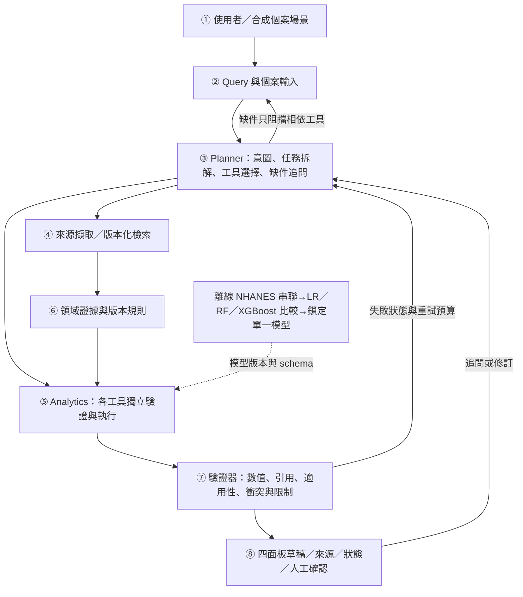
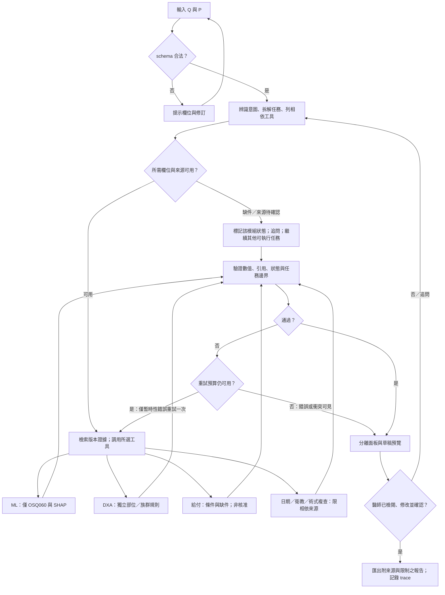

# OsteoGuard AI Agent：基於 NHANES 自述骨鬆告知史分類與來源支援之骨健康管理智慧代理人

> **Final Project Proposal Document | 修訂版 2026-11-22**<br/>
> **核心公式**：`AI Agent + Domain Knowledge + Data Analytics + Real-World Application`<br/>
> **階段**：Proposal／待實作驗證。本文的流程、介面與驗收門檻是設計規格；樣本盤點為已完成的資料檢查，模型與 Agent 效能尚未量測。

---

## 1. Abstract 摘要（A–F）

### A. Attention Getter — Motivation
台灣高齡化使骨健康資訊整合與長期追蹤日益重要。內政部統計指出，2025 年 10 月底台灣 65 歲以上人口占比為 19.9%。[10] 骨鬆照護涵蓋骨密度評估、治療追蹤與衛教，[14] 骨科及神經外科人員因此需要整合 DXA、病史、給付條件與用藥日期等資訊。

### B. But — Challenge
現有資訊分散於報告、病歷與規範文件；單一模型分數或自由生成的回答，難以完整處理來源版本、缺件及人工確認。DXA 判讀、自述骨鬆告知史與未來骨折／手術結局是不同任務，[4][5][7] 不宜合併成同一風險指標。

### C. Cure — Proposed Solution
本專題提出 **OsteoGuard AI Agent**，供骨科、神經外科醫師及個案管理人員使用，整合告知史分類參考、DXA 判讀、給付條件核對、用藥追蹤與衛教草稿，並提供術式相關的人工複查待辦。

### D. Development — Method
以 SEQN 串聯 NHANES 人口學、體測、股骨 DXA 與骨鬆問卷，訓練 LR、RF、XGBoost 預測 OSQ060「自述曾被醫師告知骨鬆」，以 **SHAP 特徵歸因方法**解釋分類。[2–4][7] 上層 Agent 依查詢選擇檢索、數值及規則工具，分別呈現模型、DXA 與給付結果，產生附來源且可人工修改的草稿。

### E. Experiments — Evaluation
資料盤點得到 3,530 人有效標籤樣本，預計採分層 80/20 保留測試集與訓練內五折驗證，比較三模型及特徵增益；主要指標為 PR-AUC（以 AP 計算），另報分類與校準指標。Agent 以 24 個預寫合成案例核對工具路由、來源、日期、例外及人工確認；內部測試不等於臨床驗證。

### F. Findings — Expected Outcomes
預期完成可重建的資料與模型比較、分離的研究／DXA 結果卡、版本化給付條件卡、追蹤時間軸及 SOAP／衛教草稿。系統提供依據、缺件與待確認事項，不由告知史模型輸出個人骨折或內固定失敗機率；實際工時、核扣及照護效益仍待後續研究，不作保證。

---

## 2. Introduction 緒論

### A. Attention Getter：問題的重要性與證據邊界
內政部 2025 年 10 月底統計顯示台灣 65 歲以上人口占比為 19.9%，提供高齡照護的研究背景。[10] NHANES 官方提供 50 歲以上受試者的股骨 DXA 及骨鬆問卷資料，可支持公開資料分析研究。[4][7] ISCD 區分骨密度診斷分類與骨折風險評估，支持系統把不同結果分開解釋。[5] 以上來源不證明台灣外科場域的漏診或轉介現況；這些工作流需求在本期視為設計假設，實際需求強度與照護效益須另做場域研究。

### B. Background：使用者、資料與本期範圍
主要使用者為骨科醫師、神經外科醫師與骨鬆個案管理師；病患透過醫療人員檢閱後的圖卡取得資訊。離線 NHANES 模型屬研究參考，未在台灣臨床族群外部驗證。線上輸入為合成個案，不自動回流訓練。股骨四區 BMD／BMC／Area 可用於模型研究；臨床 DXA 判讀只處理有來源、品質與適用族群資訊的有效部位 T／Z-score。

### C. Problem：五項需求與可驗證交付
| 需求／痛點假設 | 本期功能 | 本期不能據此宣稱的成效 |
| :--- | :--- | :--- |
| 急門診資料分散，需人工複查 | 顯示缺件、使用者註記與人工複查待辦 | 自動辨識微小壓迫骨折、轉移瘤或降低漏診 |
| 給付條件與文件核對繁複 | 版本化規則核對、條號、缺件與待確認事項 | 保證給付核准或避免核扣 |
| 衛教與病歷整理反覆 | 附來源的白話圖卡、SOAP 草稿 | 提升遵從性、信任或節省既定工時 |
| 跨科追蹤與回診日期難整合 | 既有醫囑日期時間軸、追蹤待辦 | 已降低流失率或改善轉介率 |
| 圍術期骨質資訊需整理 | 依術式顯示骨質評估複查清單與適用來源 | 個人螺釘鬆脫機率、選擇術式或決定延後手術 |

### D. Existing Limitations：依任務公平比較
1. **固定規則程式**適合閾值、條件與日期計算，但自然語言需求需額外解析與互動設計；規則仍是本系統的重要元件。
2. **表格模型**可分析既定 X 與 Y 的關聯，無法憑 OSQ060 標籤回答影像病灶、未來骨折或手術結果。較複雜模型是否優於 LR，須由同一驗證流程決定。
3. **生成式模型／檢索系統**可整理語意與資料，但引用、數值及任務完成仍需檢查。RAG 不保證正確，檢索不到、版本衝突及生成超出證據都須作為可見失敗狀態。[1][8]

### E. Innovation：Agent 的必要性與分工
本專題的整合貢獻在於讓 Agent 依查詢拆解任務、選擇允許的工具、追問缺件並組織證據；數值推論、DXA 閾值、給付條件與曆月日期由獨立程式處理。固定流程與 Agent 將用相同案例比較，確認動態路由是否有增益。此處不主張首創，也不概括否定既有 HIS 或規則系統。

### F. Contributions：預期貢獻與文章安排
1. 建立可重建之 NHANES 串聯、標籤與樣本流程，排除診斷／治療史洩漏。
2. 公平比較 LR／RF／XGBoost 與特徵增益，以 SHAP 說明 OSQ060 分類，不將歸因當作因果或骨折風險。
3. 定義具有工具契約、版本化檢索、模組分流與人工確認的領域 Agent。
4. 交付可追蹤的合成案例、模型結果及功能失敗紀錄。

第 3 節整理相關研究，第 4 節呈現深度研究，第 5 節說明架構與演算法，第 6 節定義實驗，第 7 節規定輸入輸出與規則治理，第 8 節列來源，第 9 節收束限制與交付。

---

## 3. Related Work（約 1/2 AI Technology＋1/2 Domain Know-how）

### 3.1 AI Technology
研究脈絡為表格分類、特徵歸因，再到可呼叫工具的互動任務。XGBoost 原始論文提供樹提升系統方法，SHAP 原始論文提供加性特徵歸因框架；兩者都不直接證明本專題 OSQ060 的效能。[2][3] MedAgentBench（2025）以虛擬 EHR 中的任務評估醫療 Agent，支持本專題採任務完成與錯誤紀錄，而非只評估語句流暢度。[1] ReAct 提供規劃與工具互動的設計參考，RAG 原始研究提供結合檢索與生成的技術基礎；兩者均非本系統的臨床有效性證據。[8][15]

與本題更接近的 Huang 等人（2025）以 NHANES 2005–2020 人口學及體測資料進行低骨密度分類，比較 LR、SVM、XGBoost、CatBoost，並使用 SHAP。[12] 該研究可作特徵基準、模型比較與解釋呈現的參考；其 Y 是低 BMD，不是 OSQ060，也不使用本專題同一資料週期，因此不直接沿用其效能或結論。

### 3.2 Domain Know-how
NHANES 文件規定股骨變數、掃描品質與問卷標籤意義。[4][7] ISCD 的診斷部位與適用族群約束供規則設計使用。[5] AAOMS MRONJ 立場文件提醒處置需依個案與證據判斷，因此本期產生牙科照會問題及來源，不提供一律停藥、拔牙或補打時點。[6] 接續治療以 Endocrine Society 原始臨床指引為背景，系統只提示處方團隊檢視既有計畫。[11] CNS 術前骨鬆評估指引可支持脊椎術前資料複查的需求，但不提供本原型的個人螺釘鬆脫機率。[13] BHOF 照護指引則供追蹤、風險溝通與營養／運動衛教內容的查核參考，實際適用性仍需醫師確認。[14] 台灣給付另依健保署條文及生效版本核對，與國外臨床指引分開。[9]

### 3.3 Article Summary Table
下表依研究用途分為 AI 技術四列與領域知識四列。方法論、實證研究、官方資料及專業指引分別標明，不將文獻效果當作本專題結果；Limitation 中的本題適用性是本組判讀。

| Ref. | Year | Problem | AI Method | Domain Knowledge | Dataset | Findings | Limitation |
| :--- | :--- | :--- | :--- | :--- | :--- | :--- | :--- |
| [1] Jiang et al., MedAgentBench | 2025（arXiv v2） | 靜態問答不足以評估互動任務 | 工具型 LLM Agent 評估 | EHR 任務與 FHIR 互動 | 虛擬 EHR；300 任務、100 病人設定（摘要） | 提供端到端任務評估框架 | 模擬環境，不能證明台灣骨科工作效益 |
| [2] Lundberg & Lee | 2017 | 如何解釋個別預測 | SHAP 加性歸因 | 非骨鬆專用 | 方法論與模型示例 | 統一特徵歸因框架 | 不證明因果或本題分類效能 |
| [3] Chen & Guestrin | 2016 | 樹提升系統的擴展性 | XGBoost | 非醫療專用 | 原文 ML 基準 | 提供可擴展的樹提升系統 | 不證明本題必勝 LR／RF |
| [12] Huang et al. | 2025 | 人口學／體測之低 BMD 篩檢 | LR、SVM、XGBoost、CatBoost＋SHAP | DXA 低骨密度分類 | NHANES 2005–2020；13,133 人 | 可用體測與人口學比較分類及歸因 | Y 為低 BMD，非 OSQ060；週期與特徵不同，不移植效能 |
| [4] CDC P_DXXFEM | 2021 | 股骨測量、品質與抽樣定義 | 無；官方資料文件 | BMD／BMC／Area 與品質碼 | NHANES 2017–March 2020 | 定義可用欄位與品質處理 | 橫斷面資料，不含本期手術結局 |
| [5] ISCD Adult Positions | 2023 | DXA 判讀與報告一致性 | 無；專業立場 | 有效部位、族群、T／Z-score | 非單一實驗資料集 | 區分骨密度分類與風險評估 | 不能把所有研究部位當診斷部位 |
| [6] Ruggiero et al., AAOMS | 2022 | MRONJ 評估與風險溝通 | 無；立場文件 | 藥物與口腔處置風險 | 文獻彙整，非本期案例庫 | 提供評估與溝通背景 | 不取代個案判斷，不作固定停藥／拔牙時點 |
| [13] Dimar et al., CNS | 2021 | 脊椎手術前骨鬆評估 | 無；系統性回顧與指引 | 術前骨質評估及相關術後事件 | 17 篇納入研究（摘要） | 支持術前骨鬆評估及選定介入的證據檢視 | 不提供本題個人化失敗模型，也不適用所有術式 |

### 3.4 Research Gap
- **Existing Research**：表格分類、歸因、工具型 Agent、DXA 判讀、牙科及圍術期指引，分別提供方法或領域依據。[1–8][12–15]
- **Limitations**：這些來源的研究任務、族群與結局不同，不能拼接成已驗證的個人化臨床預測器。
- **Research Gap（本專題範圍）**：需要一個可展示「任務辨識→來源及工具→獨立輸出→缺件／不確定性→人工確認」的骨健康資訊整合原型。此為整合設計需求，不宣稱已證明全球沒有類似系統。
- **Our Project**：以可重現的 OSQ060 分類與版本化規則為工具，建立受限 Agent、可追溯草稿與內部驗收案例。

---

## 4. Deep Research：三大核心問題

### Q1. 五個核心思維模式：意義、證據、設計影響

#### 1. 先界定標籤，才能界定模型能回答什麼
- **意義**：告知史、當下骨密度與未來事件不同；告知史可能反映受試者記憶與就醫歷程。
- **證據**：P_OSQ 明列 OSQ060 問題與回覆碼。[7，OSQ060]
- **設計影響**：輸出命名 `p_history`；不轉換成骨折、當下確診或手術失敗機率。

#### 2. 測量部位、族群與品質先於閾值
- **意義**：研究特徵不等同診斷部位；缺乏適用性資訊時不宜套規則。
- **證據**：ISCD 區分診斷部位與 T／Z-score 適用情境；NHANES 提供掃描品質欄位。[4][5]
- **設計影響**：DXA 工具檢查部位、品質、族群與報告來源；大轉子／轉子間只作本期模型特徵，不進診斷規則。

#### 3. 可解釋性與效能是分別驗證的主張
- **意義**：SHAP 描述模型分數，不代表病因或健康程度；重疊特徵可能改變歸因。
- **證據**：SHAP 的目標為模型預測解釋；XGBoost 是方法來源而非本題效能來源。[2][3]
- **設計影響**：比較特徵組、校準與誤分類；不以「某部位 SHAP 接近零」解釋為健康。

#### 4. 臨床、給付與行政排程各有不同依據
- **意義**：給付上限、治療建議與醫師指定日期不應共用一個強制換藥規則。
- **證據**：健保第 5.6 節屬給付文件；Endocrine Society 為臨床建議，管轄與用途不同。[9][11]
- **設計影響**：分開 `reimbursement_rule`、`clinical_evidence`、`confirmed_schedule`；排程不自行開處方或決定換藥。

#### 5. 風險溝通需保留不確定性與責任邊界
- **意義**：衛教文字流暢不代表正確；牙科與外科情境需人工判斷。
- **證據**：AAOMS 文件強調個別判斷；MedAgentBench 展示互動任務需獨立評量。[6][1]
- **設計影響**：每項關鍵主張有來源，無證據時標示待確認；草稿可修改，人工確認是匯出必要狀態。

### Q2. 三個重要專業爭論
以下為文獻啟發的設計取捨，不主張它們是經調查排名的「最激烈」爭論；「目前共識」僅在所引來源範圍內陳述，無共同來源者標本專題採行原則。

#### 爭論一：以 DXA 判讀為核心，或加入多特徵模型？
- **A**：標準化 DXA 規則可清楚說明分類依據。
- **B**：多特徵模型可研究不同量測與告知史之統計關聯。
- **證據**：ISCD 支持診斷分類與風險用途區分；CDC 資料有多部位測量與獨立問卷標籤。[4][5][7]
- **目前共識／採行原則**：維持任務分離，不將 OSQ060 機率混入 DXA 分級。
- **未解**：加入 DXA／比值對告知史分類是否有增益？需消融實驗與外部適用性研究。

#### 爭論二：選簡單 LR，或較複雜的 RF／XGBoost？
- **A**：LR 便於作為基準並檢查特徵尺度與係數。
- **B**：樹模型可研究非線性及交互關係，但需控制複雜度。
- **證據**：XGBoost 及 SHAP 原始方法支持比較模型與解釋的技術可行性，不支持預先宣判本資料勝者。[2][3]
- **目前共識／採行原則**：同一切分、相同搜尋預算，以驗證 PR-AUC 選模，平手時優先較簡單模型；這是本專題預註冊策略，非聲稱全領域一致共識。
- **未解**：小樣本陽性數、相關特徵與校準誤差如何影響模型穩定性？以重抽樣與誤分類分析檢查。

#### 爭論三：固定工作流，或讓 Agent 動態選工具？
- **A**：固定工作流便於測試與重現。
- **B**：Agent 可依自然語言任務選路徑、追問缺件及整合來源。
- **證據**：ReAct 提供工具互動方法；MedAgentBench 提供醫療互動任務的評估框架。[8][1]
- **目前共識／採行原則**：本專題採受限工具清單、可驗證輸出與人工確認，並比較固定流程；不宣稱 RAG 保證安全。
- **未解**：路由彈性是否提高完成率，或增加錯誤、延遲與成本？以相同案例和工具版本測量。

### Q3. 十個深度理解問題與判讀重點
1. **Why**：OSQ060 陽性和 T-score 達診斷閾值為何可能不同？<br/>
   **重點**：橫斷面告知史與現時測量不同，不能將不一致直接叫做模型漏診。[5][7]
2. **What-if**：BMD 相同而 BMC／Area 不同，是否能直接推算螺釘拔出力？<br/>
   **重點**：不能；本資料未提供個人內固定結局。比較額外特徵的統計增益，不把代理特徵當力學實驗。
3. **Trade-off**：提高 OSQ060 Recall 帶來什麼代價？<br/>
   **重點**：告知史假陽性可能增加；須連同 Precision、PR 曲線與校準判讀，不能將此宣稱為避免未來骨折。
4. **Failure Case**：掃描品質不合格或欄位缺失時如何處理？<br/>
   **重點**：依品質碼排除／標不可推論，不能憑插補修復無效 DXA；其他工具可獨立執行。[4]
5. **Comparison**：為何保留三模型與人口學基準？<br/>
   **重點**：分開檢查模型複雜度與 DXA 資訊增益，避免挑最佳測試結果作事後結論。
6. **Evidence**：SHAP 接近零能否代表該骨骼部位健康？<br/>
   **重點**：不能；歸因是模型內解釋，須註明輸出尺度與背景資料，不作因果解釋。[2]
7. **Design Decision**：使用者只問下次回診日期，是否仍執行 ML？<br/>
   **重點**：不必；Planner 選日期工具，欄位不足則追問，不增加無關推論。
8. **Real-world Scenario**：74 歲個案計畫脊椎融合，報告部位數值不一致，Agent 應如何回應？<br/>
   **重點**：依 CNS 來源列出部位、品質與適用的術前複查項。[13] 指引不等於個案處方；不提供螺釘失敗機率、特定強化手術或延後手術命令。
9. **What-if／Evidence**：使用 denosumab 的病患計畫拔牙，系統可否指定所有人停藥一年或固定補打日？<br/>
   **重點**：不可以；整理用藥／牙科資料、已確認醫囑及 AAOMS 來源，請處方與牙科團隊確認；不輸出無分層的機率或「安全窗口」。[6][11]
10. **Design Decision／Failure Case**：給付來源版本互相衝突，LLM 回答「核准」，人工未確認時可匯出嗎？<br/>
    **重點**：驗證器應拒絕該結論；標 `source_unverified`，保留 trace、缺件與修訂紀錄。確認前僅可預覽草稿，無 HIS／處方／申報寫入工具。

---

## 5. Proposed Scheme / Proposed Design

### 5.1 System Architecture：①–⑧ 元件與控制流程


| 模組 | 責任／輸入 | 輸出與邊界 |
| :--- | :--- | :--- |
| ① User | 醫師、個管師之資訊整理需求 | 本期使用合成個案，病患不直接接受未審閱建議 |
| ② Query/Input | 查詢 Q、個案 P、使用者確認的日期與文件 | schema 驗證、來源與缺件列表 |
| ③ Planner | 意圖 `history_analysis / dxa_review / reimbursement / schedule / education / perioperative_review`，可複選 | 可稽核 plan：任務、依賴、工具與簡短選擇理由；不要求儲存隱藏思考過程 |
| ④ Retrieval | 核准來源文件、條號、版本、查詢及日期 | 證據片段、頁碼／段落、版本、雜湊；不將文件內指示當工具命令 |
| ⑤ Analytics | ⑤a 單一鎖定 ML；⑤b DXA 規則；⑤c 給付；⑤d 日期；⑤e 術式複查 | 每模組獨立 status、資料與依據；不混成總風險分數 |
| ⑥ Knowledge | 官方資料字典、ISCD、AAOMS、健保條文及已核實指引 | `clinical / reimbursement / data_definition` 分類；不跨用途替代 |
| ⑦ Decision/Validation | 工具結果、引用及草稿 | 拒絕超出標籤、無證據主張與核准保證；輸出缺件／衝突 |
| ⑧ Output/Interaction | O1–O4 結構化草稿 | 預覽、來源檢閱、修改、人工確認、匯出；記錄確認人與時間 |

### 5.2 Flowchart：選工具、例外與人工確認


### 5.3 Pseudocode（行號與工具白名單）
```text
Algorithm 1: Evidence-grounded OsteoGuard information agent
Input : query Q, synthetic record P, source registry S, locked model M
Output: independent module results R, cited draft D, trace T
01: ValidateQuerySchema(Q, P); if malformed then return field_errors
02: plan <- ParseIntentAndPlan(Q, allowed_intents, allowed_tools)
03: RejectUnknownToolsAndInvalidDependencies(plan)
04: R <- {}; T <- NewTrace(case_id, plan, model_version, source_snapshot)
05: for task in TopologicalOrder(plan) do
06:     missing, applicability <- CheckTaskRequirements(task, P)
07:     if missing then R[task] <- insufficient_data(missing); continue
08:     if not applicability then R[task] <- not_applicable; continue
09:     evidence <- RetrieveApprovedEvidence(task, S, as_of_date)
10:     if task requires evidence and evidence invalid/absent/conflicting then
11:         R[task] <- source_unverified(evidence); continue
12:     end if
13:     try
14:         if task == history_analysis then
15:             X <- SelectDeclaredX(P); CheckModelSchemaAndPopulation(X, M)
16:             R[task] <- {p_history: M.predict_proba(X), shap: Explain(M, X)}
17:         else if task == dxa_review then
18:             R[task] <- InterpretValidSites(P, evidence)  // never uses p_history
19:         else if task == reimbursement then
20:             R[task] <- EvaluateVersionedConditions(P, evidence) // not approval
21:         else if task == schedule then
22:             R[task] <- CalculateConfirmedCalendarDates(P, evidence)
23:         else if task == perioperative_review then
24:             R[task] <- BuildProcedureSpecificReviewChecklist(P, evidence)
25:         else if task == education then
26:             R[task] <- BuildCitedEducationContext(P, evidence)
27:         end if
28:     catch timeout/network_error: retry task once; on failure set tool_error
29:     catch schema_error/invalid_numeric: set tool_error; do not guess
30:     ValidateToolResult(R[task]); AppendTaskTrace(T, task, evidence, R[task])
31: end for
32: D <- GenerateStructuredDraft(Q, R, citations_only, no_new_numeric_claims)
33: issues <- CheckCitationsNumbersTaskBoundaries(D, R)
34: if issues then revise D once; recheck; if still invalid replace with error card
35: PresentIndependentPanels(R, D, missing_fields, conflicts, limitations)
36: if not HumanReviewedAndConfirmed(D) then return draft_preview(R, D, T)
37: RecordConfirmationAndEdits(T); ExportConfirmedReport(R, D, T)
38: return R, D, T
```

### 5.4 Tool Contracts、資料狀態與停止條件
工具輸入／輸出採 JSON schema 驗證。共用 envelope：`{case_id, task_id, status, data, evidence_ids, missing_fields, warnings, tool_version}`。status 限 `ok / insufficient_data / not_applicable / source_unverified / tool_error`；`ok` 僅代表工具契約通過，不代表臨床正確或給付核准。

| 工具 | 必要輸入 | 輸出與失敗條件 |
| :--- | :--- | :--- |
| validate_record | P、schema_version | 欄位與單位錯誤；不以極端值自動判影像假影 |
| retrieve_evidence | task、query、as_of_date、source_type | top-k 片段與 evidence_id；無適用版本／衝突為 source_unverified |
| predict_history | 已鎖定 X、model_version | p_history、SHAP、尺度及背景版本；缺模型／欄位不符時不推論 |
| interpret_dxa | 有效部位、T／Z-score、族群與品質 | 規則判讀及適用限制；缺停經／品質等資訊則追問 |
| check_reimbursement | drug_id、事件日期、所需病史及有效規則 | 條件相符／不符／待確認，及缺件；無適用版本不下判斷 |
| calculate_schedule | confirmed_order、last_date、interval、unit | 預定日期與曆月計算依據；未有醫囑／核實藥品間隔則缺件 |
| review_procedure | procedure、已確認 DXA 結果、適用來源 | 術式複查待辦；THA/TKA 不顯示椎弓根螺釘項目；來源不足則待確認 |
| draft_education_soap | 工具結果、證據、Q | 草稿與引用；不得新增機率、處置命令或假稱已核准 |

每次查詢最多 8 個 task、每 task 最多一次暫時性錯誤重試；生成草稿最多一次修訂。規劃失敗則請使用者選意圖，不循環猜測。來源衝突、資料不足與不適用不重試同一輸入。缺件只阻擋相依模組；系統可回傳部分結果。Trace 保存任務、工具版本、輸入摘要、結果狀態、證據 ID、錯誤、人工修改及確認時間，不記錄模型隱藏思考。

### 5.5 RAG 與來源治理
- 檢索與生成的分工參考 RAG 原始方法，[15] 但本期採以下文件治理與檢查流程，不沿用原文效果當成安全保證。
- 只收錄核准來源；每文件保存 `source_id / title / url / publisher / published_or_updated / effective_from / effective_to / retrieved_at / sha256 / review_status`，不可由 LLM 猜補日期。
- 以標題、條號與段落切塊，目標每塊 400–800 中文字，長段落重疊 80 字；保留頁碼與父條號，避免拆斷 AND／OR 條件。數值為本期設計參數，需於測試後檢討。
- 先依來源種類、藥品、有效日期與 `review_status=approved` 過濾，再以 BM25＋向量各取 10 個候選，合併去重後取 5 塊供回答。記錄候選、選定片段與檢索設定版本。
- 上述 top-k 為啟始設定，不保證命中。若無符合來源或不同有效版本衝突，回傳待確認；不以相似度最高片段取代生效日期。
- 給付完整條件由人工核對的結構化規則執行；RAG 負責找依據與解釋，不從片段臨時創造給付規則。
- 新版本先建立差異與回歸案例，經兩位組員交叉核對後啟用；這是內部品質流程，不稱專家核可。來源取得失敗或版本效力未確認時暫停該規則結論。

### 5.6 端到端合成範例與設計不變條件
**案例 S03（未執行，預期行為）**：68 歲個案詢問下次追蹤日期及牙科溝通摘要；已輸入並人工確認行政回診週期 6 個曆月、基準日 2026-08-31，但缺 DXA 研究欄位。Planner 只選 schedule、education 與相依檢索，不調用 ML。日期工具依月底截斷政策得到 2027-02-28；這是合成行政排程，不是藥物注射醫囑。教育工具引用 AAOMS 來源整理照會問題；不決定停藥或拔牙日期。預覽顯示兩模組狀態及日期公式，未確認時匯出被阻擋，人工修改與確認後匯出。

必須維持：`DXA_result` 不依賴 `p_history`；來源未核實不得回傳條件相符；無人工確認不得匯出確認版；未選任務不得無故呼叫工具；THA/TKA 不產生椎弓根螺釘提醒。這些以測試驗證，不將它們稱為臨床安全的數學證明。

---

## 6. Experimental Design & Expected Outcomes

### 6.1 Dataset、標籤與已完成的樣本盤點
**資料來源**：NHANES 2017–March 2020 Pre-pandemic 四份 XPT。[4][7] 本地盤點日期 2026-11-22，可由 `scripts/audit_proposal_data.py` 重建；輸出與檔案雜湊見 `output/proposal_data_audit.json`。以下是樣本檢查結果，非模型實驗效能。

| 步驟 | 人數／筆數 | 規則 |
| :--- | ---: | :--- |
| P_DXXFEM 原始資料 | 4,593 | SEQN 唯一 |
| 完整有效掃描 | 3,545 | DXAFMRST=1 且 DXXFMBCC 為有效碼 0 |
| 串聯 P_DEMO，年齡至少 50 | 3,545 | 一對一鍵檢查 |
| OSQ060 回覆 1／2 | 3,530 | 380 陽性、3,150 陰性；排除 14 不知道、1 缺值 |
| 再要求身高／體重／BMI 皆完整的敏感度子集 | 3,511 | 主分析不因此直接刪除；體測缺值於訓練內插補 |

XPT 讀取器可能把 SAS 的數值 0 讀成接近 0 的浮點值；品質碼比對採 `isclose(..., atol=1e-12, rtol=0)`，不對 BMD 數值作相同歸零。無效 DXA 不以插補修復。最終訓練人數若因新增預先聲明的排除條件改變，須重跑流程並記錄原因，不沿用舊版 3,525 筆說法。

- **Y**：`OSQ060=1` 陽性、`=2` 陰性；排除拒答 7、不知道 9 與缺值。任務為橫斷面自述告知史分類，不代表當下確診、未來骨折或手術結局。
- **X**：RIDAGEYR、RIAGENDR、BMXHT、BMXWT、BMXBMI，股骨 Total／Neck／Trochanter／Intertrochanter 的 BMD／BMC／Area 及預先聲明的部位比值；排除 OSQ060、OSQ072、診斷／治療史。骨折史僅次要分析；族裔僅描述與分層。
- **特徵重疊**：BMC／Area 與 BMD 有代數關聯，不將其當獨立新訊息；比較人口學、加 BMD、加 BMC／Area、加部位比值四組，並記錄相關性及解釋穩定性。
- **抽樣限制**：主要報告為本分析樣本的分類效能，不宣稱美國人口盛行率。另以官方 MEC 權重及抽樣設計作人口描述／敏感度分析並明列方法；若未完成則不報人口推估。[4，Analytic Notes] 未有台灣外部驗證前，臨床畫面只允許研究展示。

### 6.2 Baselines、模型驗證與預期結果表
- LR、RF、XGBoost 使用相同分層 80/20 切分，種子 42；訓練內 Stratified 5-fold（shuffle、seed=42）。依 SEQN 保證同一受試者不跨集合。
- 插補、標準化、類別處理、特徵選取、校準與閾值選擇均限訓練／驗證內。保留測試集不參與選模；測試結果不佳亦不返回挑選較佳測試模型。
- 主要指標為 PR-AUC，本期實作定義採 average precision，報告同時清楚標為 AP；另報陽性 Precision／Recall／F1、Macro-F1、Accuracy、ROC-AUC、混淆矩陣、Brier score 與校準圖。AP 平手至小數第三位優先較簡單模型。
- 閾值以訓練內 out-of-fold 預測之陽性 F1 最大值選擇；平手選較高閾值，鎖定後套測試集。採訓練 OOF 預測擬合 sigmoid 校準器並鎖定；選模採未校準 AP，另報校準前後測試表現。所有特徵組／模型比較只用訓練內驗證選擇。
- 95% 信賴區間以保留測試集按陽性／陰性分層 bootstrap 1,000 次（seed=42）；描述為樣本條件下區間，不等同複雜抽樣設計推論。
- 預定搜尋：每模型 20 組 RandomizedSearch（seed=42），五折 AP；LR 的 C=0.01–100（log-uniform）、class_weight=None/balanced；RF 的 n_estimators=200/400/600、max_depth=None/4/8/12、min_samples_leaf=1/3/5/10；XGBoost 的 n_estimators=100/200/400、max_depth=2/3/5、learning_rate=0.01/0.05/0.1、subsample=0.8/1、colsample_bytree=0.8/1。其餘設定與套件版本於實作時凍結成設定檔；未凍結前不開始正式測試。
- SHAP 記錄模型、輸出尺度（probability 或 margin）、背景資料與版本；不將貢獻描述為生理因果。離線選單一模型後，線上不平行重訓三模型。

預期產出：樣本流程、缺值／類別圖、特徵消融、模型比較表、PR／ROC 曲線、校準圖、SHAP 及誤分類分析。結果表先只列欄位 `model / feature_set / validation_AP / test_AP / Recall / F1 / Brier / CI`；數值待實驗後填寫。

### 6.3 Agent 內部功能驗收（24 個預寫合成案例）
四類情境各六例；此為本組設計的驗收規模，非教師指定數量。案例實作前凍結輸入、來源快照、預期工具／狀態／數值、禁止結論與人工確認條件。下表的 ID 即案例規格索引，尚未執行，不能列通過率。

| 類別／ID | 六個案例規格 | 核心觀察 |
| :--- | :--- | :--- |
| A：模型／DXA A01–A06 | 完整可推論；只問 DXA；缺模型必要欄位；族群不適用；DXA 與 p_history 不一致；無效品質碼 | 任務分離、缺件不阻擋無關模組，不憑空載入不存在模型 |
| B：給付 B01–B06 | 版本內條件相符；條件不符；缺事件日期；來源跨版衝突；藥品不在規則範圍；檢索／網路逾時 | 四態條件卡、來源與藥品範圍、重試上限、不可假稱核准 |
| C：追蹤日期 C01–C06 | 一般日期；月底＋1 月；月底＋6 月（S03）；閏日＋1 年；缺已確認週期；非法／未來的歷史日期 | 曆月截斷、輸入矛盾可見、不把行政週期當藥物醫囑 |
| D：草稿／術式 D01–D06 | 一般衛教；牙科計畫；THA/TKA 排除螺釘提醒；脊椎融合但圍術期來源未核實；文件含工具指令注入；未確認匯出與人工修改 | 引用、適用術式、文件只當資料、審閱與匯出邊界 |

**量測方法**：工具路由正確率＝符合預期工具集合案例數／24；端到端通過率＝所有預寫條件皆符合案例數／24；引用支持率＝可由片段支持的主張數／需引證主張數；數值／日期精確一致率以具預期值項目為分母。另記缺件／來源衝突攔截、工具重試次數、延遲與 API 成本。每項指標均列分子／分母與案例 ID，不以語句流暢取代正確性。

**本期驗收目標（未達成前不得稱通過）**：24 例全部執行、路由至少 22/24、端到端至少 22/24；數值／日期預寫項目全部一致，關鍵引用全部可支持。任一混合 OSQ060 與骨折風險、無來源假稱核准、未確認匯出或讀取文件後越權呼叫工具，均屬阻斷缺陷，修正並重跑相關案例與回歸集後才可交付。

**比較與重複**：在相同工具、來源與輸入下，比較固定工作流、無檢索的 LLM 草稿、受限 Agent；API 模型版本與生成設定固定並記錄，每條件每例執行三次，另報 72 次執行通過率與單例三次皆通過的穩定性。無檢索基準不進入實際給付判斷。測試記錄 `case_id / expected / actual / evidence_ids / pass_fail / severity / fix / rerun`；兩位組員交叉核對，不稱專家標準答案。

### 6.4 預期成果與展示限制
先完成資料與模型比較，再依衛教／文件、給付核對、日期追蹤、術式複查與人工複查待辦排序實作。展示提供四面板、工具 trace、失敗案例與醫師確認流程。期末不安排專業人員回饋；組員扮演情境角色不等於臨床驗證，不宣稱已量測信任、工時節省、病患留存或照護效果。

---

## 7. CDSS 輸入輸出、給付與排程規格

### 7.1 介面與適用狀態
介面以 O1–O4 表示面板，避免與①–⑧模組編號混用。舊版 UI 圖僅為歷史草圖，其文字若與本版任務／狀態不一致，不作本版驗收依據；新版介面依下列 schema 與狀態製作。

### 7.2 Input Specification
- **模型 X**：第 6.1 節聲明的年齡、性別、身高、體重、BMI、四區 DXA 與比值；保留單位、測量日期、品質及 schema_version。缺值只按已鎖定模型 pipeline 處理，不由 LLM 補數值。診斷、OSQ060／072、用藥史不混入 X。
- **臨床規則資料**：停經狀態、有效部位 T／Z-score 與報告來源、骨折部位／次數／日期、共病／檢驗、術式、用藥成分／劑型／品項、起始與最近使用日、既有醫囑、牙科計畫。欄位以適用規則動態檢查，不把同一組共病條件套給所有藥物。
- **術式枚舉**：spinal_fusion、vertebroplasty、THA、TKA、ORIF、outpatient_followup；需人工確認，不由自由文字猜定。螺釘相關複查僅可在 spinal_fusion 且有適用來源時顯示；其他術式用各自來源，無來源則待確認。
- **日期**：ISO 8601 日期；查詢／確認時間採 Asia/Taipei。未知與否定分開，欄位空白不能當「沒有病史」。

### 7.3 給付規則版本與條件卡
來源採健保署「最新版藥品給付規定內容（分章節）」第五節 PDF。[9] 2026-11-22 查閱頁面標示章節於 115.08.21 更新，所連 PDF 第 15–17 頁又載 5.6.1 的 115/9/1、5.6.3 的 115/8/1 修訂；**網站更新日期不等於各條生效日**。本版保留該來源作擷取基準；正式啟用前仍需核對個案日期所適用公告及完整條文，不能僅憑頁面日期認證「所有現行條件已驗證」。

| 條號／來源定位 | 本期結構化欄位與核對重點 | 修訂後邊界 |
| :--- | :--- | :--- |
| 5.6.1，PDF 第 15–16 頁 | 藥品／劑型／品項、性別／停經、有效 DXA、骨折事件、共病及必要檢驗 | 未骨折高風險條件不可概括套用所有抗吸收藥；品項例外須保留 |
| 5.6.2，PDF 第 16–17 頁 | 適用族群、DXA、骨折／不耐受／既往療程及數量期間限制 | 保存條件原句與 AND／OR 結構，歧義轉人工；給付數量不等於自動換藥日 |
| 5.6.3，PDF 第 17 頁 | 停經、DXA、事件時間窗／新骨折與既往用藥、數量期間限制 | 與其他藥物互換限制及例外逐項核對，不寫成絕對終生不得互換 |

規則 schema：`rule_id / drug_scope / clause / source_id / page / effective_from / effective_to / required_fields / condition_tree / review_status / reviewer / regression_case_ids`。未知生效日或待核對的規則預設 `pending`，不可用於「條件相符」輸出；Demo 若用合成規則需明顯標示，不能冒充正式條文。

條件卡狀態為「條件相符（仍待醫師及正式審查）／條件不符／資料不足／來源待確認」。不得顯示「核准」或承諾不被核扣。醫師覆核與申報文件仍依院方正式流程。

### 7.4 四面板 Output Specification
1. **O1 研究與 DXA 結果**：分列 `p_history`＋SHAP、有效部位 DXA 判讀、術式相關複查待辦；不產生單一綜合風險分數，無個人骨折／螺釘失敗機率。
2. **O2 給付條件卡**：逐條列來源、版本、條件與缺件；來源未核實時僅顯示待確認，不用 LLM 自行補成符合。
3. **O3 時間軸**：顯示已確認的醫囑日期、行政追蹤與待檢視療程節點；若需更改治療，轉為醫師待辦，不自行決定藥物或停藥／換藥日。
4. **O4 SOAP／衛教草稿**：基於可支持的工具結果與文件轉譯，列牙科／處方團隊的確認問題。未有適用營養／運動指引時，僅列待討論事項，不自動產生固定補充劑量或運動處方。

### 7.5 日期規則與更新政策
醫囑若為「每 N 個月／年」，使用曆月／年加法；不存在日期截至該月末日，保留原基準日再計算第 k 次，避免多次逐月截斷漂移。若為固定天數，才使用日數加法。規則需標明 administrative／clinical 類型、來源與確認人；不把 6 個月寫為 180 天，也不把領藥日當每日注射藥物的給藥週期。Denosumab 中斷後需有後續治療計畫的指引背景只作提醒，由醫療團隊確認。[11，Recommendation 3.3] 逾期提醒的時間界線若未有已確認計畫，不賦予醫療高危等級。

---

### 7.6 DXA 規則的適用範圍
依 ISCD 2023，本期規則只對已確認停經後婦女或 50 歲以上男性，使用品質有效、來源明確的腰椎／全髖／股骨頸 T-score；股骨判讀取股骨頸與全髖較低者。[5，Central DXA for Diagnosis／Hip ROI] 先排除不適用或不可判讀部位，再依有效部位判斷骨密度分類：T-score ≤ -2.5 為骨質疏鬆範圍，-2.5 < T-score < -1 為低骨量，T-score ≥ -1 為正常範圍。此為骨密度分類參考，不等同完整臨床診斷或未來骨折風險。停經狀態未知、品質不足或僅有大轉子／轉子間數值時不輸出此分類；停經前女性與較年輕男性僅顯示適用性與 Z-score 報告資訊，轉人工判讀。不以本期 NHANES 樣本均值／標準差自行換算臨床 T-score。

---

## 8. References 參考文獻

本節編號與全文、Article Summary Table 對應。論文以作者、年份、正式題名、出版資訊與 DOI／原文連結標示；資料字典與可更新規範記錄查閱日期（2026-11-22）。臨床指引與給付文件分別使用，不將文獻效果寫成本專題結果。

1. Jiang, Y., Black, K. C., Geng, G., Park, D., Zou, J., Ng, A. Y., & Chen, J. H. (2025). *MedAgentBench: A Realistic Virtual EHR Environment to Benchmark Medical LLM Agents*. arXiv:2501.14654v2 [Preprint]. https://arxiv.org/abs/2501.14654v2 。用途：互動 EHR 任務與 Agent 驗證設計。
2. Lundberg, S. M., & Lee, S.-I. (2017). A unified approach to interpreting model predictions. *Advances in Neural Information Processing Systems, 30*. https://arxiv.org/abs/1705.07874 。用途：SHAP 原始方法；不作臨床效能來源。
3. Chen, T., & Guestrin, C. (2016). XGBoost: A scalable tree boosting system. *Proceedings of the 22nd ACM SIGKDD International Conference on Knowledge Discovery and Data Mining*, 785–794. https://doi.org/10.1145/2939672.2939785 。原文：https://arxiv.org/abs/1603.02754 。用途：樹提升模型方法。
4. CDC/NCHS. (2021). *NHANES 2017–March 2020: Dual-Energy X-ray Absorptiometry - Femur (P_DXXFEM)*. https://wwwn.cdc.gov/Nchs/Data/Nhanes/Public/2017/DataFiles/P_DXXFEM.htm 。查閱：2026-11-22。定位：Eligible Sample、Data Processing and Editing、Analytic Notes、Codebook。
5. International Society for Clinical Densitometry. (2023). *Official Adult Positions*. https://iscd.org/official-positions-2023/ 。查閱：2026-11-22。定位：Central DXA for Diagnosis、Hip ROI、BMD Reporting、Fracture Risk Assessment。
6. Ruggiero, S. L., Dodson, T. B., Aghaloo, T., Carlson, E. R., Ward, B. B., & Kademani, D. (2022). American Association of Oral and Maxillofacial Surgeons' position paper on medication-related osteonecrosis of the jaws—2022 update. *Journal of Oral and Maxillofacial Surgery, 80*(5), 920–943. https://doi.org/10.1016/j.joms.2022.02.008 。用途：MRONJ 風險溝通、牙科照會與個案評估；不作固定停藥日程。
7. CDC/NCHS. (2021). *NHANES 2017–March 2020: Osteoporosis (P_OSQ)*. https://wwwn.cdc.gov/Nchs/Data/Nhanes/Public/2017/DataFiles/P_OSQ.htm 。查閱：2026-11-22。定位：Eligible Sample、OSQ060、OSQ072、Analytic Notes。
8. Yao, S., Zhao, J., Yu, D., Du, N., Shafran, I., Narasimhan, K., & Cao, Y. (2023). ReAct: Synergizing reasoning and acting in language models. *International Conference on Learning Representations (ICLR)*. https://arxiv.org/abs/2210.03629v3 。用途：工具選擇與互動方法；非本題臨床實驗。
9. 衛生福利部中央健康保險署. *最新版藥品給付規定內容（分章節）*，第五節：激素及影響內分泌機轉藥物，第 5.6 節。官方入口：https://www.nhi.gov.tw/ch/cp-7593-ad2a9-3397-1.html ；本次所連 PDF：https://www.nhi.gov.tw/ch/dl-42511-66ac909b574f4f5c9c1c96042873cab4-1.pdf 。查閱：2026-11-22。定位：PDF 第 15–17 頁 5.6.1–5.6.3；各條生效日與啟用條件另依第 7.3 節核對。
10. 內政部統計處. (2025, November 29). *114年第48週內政統計通報（114年6月底65歲以上長者457萬人，其中一人戶占25.8%）*. https://www.moi.gov.tw/News_Content.aspx?n=9&s=334815 。查閱：2026-11-22。定位：內文之 2025 年 10 月底高齡人口占比；僅作台灣人口背景，非骨鬆盛行率。
11. Eastell, R., Rosen, C. J., Black, D. M., Cheung, A. M., Murad, M. H., & Shoback, D. (2019). Pharmacological management of osteoporosis in postmenopausal women: An Endocrine Society clinical practice guideline. *The Journal of Clinical Endocrinology & Metabolism, 104*(5), 1595–1622. https://doi.org/10.1210/jc.2019-00221 。定位：Recommendation 3.3；用途：接續治療計畫，不等同台灣給付或個人處方。
12. Huang, W., Pan, Q., Peng, J., Wu, Y., & Gao, D. (2025). Interpretable machine learning model for low bone density screening in older adults using demographic and anthropometric data: findings from 2005 to 2020 NHANES. *BMC Medical Informatics and Decision Making, 25*, 339. https://doi.org/10.1186/s12911-025-03177-3 。定位：Materials and methods、Model evaluation；用途：NHANES／體測／SHAP 的實證參考。其低 BMD 標籤與本題 OSQ060 不同。
13. Dimar, J., Bisson, E. F., Dhall, S., Harrop, J. S., Hoh, D. J., Mohamed, B., Wang, M. C., & Mummaneni, P. V. (2021). Congress of Neurological Surgeons systematic review and evidence-based guidelines for perioperative spine: Preoperative osteoporosis assessment. *Neurosurgery, 89*(Suppl. 1), S19–S25. https://doi.org/10.1093/neuros/nyab317 。用途：脊椎術前骨鬆評估與來源支援的複查項；非個人失敗機率模型。
14. LeBoff, M. S., Greenspan, S. L., Insogna, K. L., Lewiecki, E. M., Saag, K. G., Singer, A. J., & Siris, E. S. (2022). The clinician’s guide to prevention and treatment of osteoporosis. *Osteoporosis International, 33*, 2049–2102. https://doi.org/10.1007/s00198-021-05900-y 。定位：Synopsis of major recommendations、Monitoring patients and treatment response；用途：追蹤、防跌與營養／運動衛教查核，依個案調整。
15. Lewis, P., Perez, E., Piktus, A., Petroni, F., Karpukhin, V., Goyal, N., Küttler, H., Lewis, M., Yih, W.-t., Rocktäschel, T., Riedel, S., & Kiela, D. (2020). Retrieval-augmented generation for knowledge-intensive NLP tasks. *Advances in Neural Information Processing Systems, 33*, 9459–9474. https://arxiv.org/abs/2005.11401 。用途：檢索與生成分工的方法基礎，不作醫療正確性保證。

---

## 9. Conclusion、Limitations 與交付
本專題以可追溯骨健康資訊整合為目標，把 OSQ060 告知史分類、DXA 規則、給付核對與日期工具分工，並透過受限 Agent 及人工確認形成可驗收原型。預期貢獻為資料流程、模型比較、版本來源與任務驗收設計；成果程度須由實際紀錄決定。

**限制／Future Work**：自述標籤可能有回憶與就醫差異；NHANES 為美國橫斷面資料，尚未有台灣外部驗證、專業人員回饋、實際工時或照護成效研究；本期無影像辨識、手術結局模型、正式 HIS／申報串接。後續須取得相應資料、標註與場域驗證，才能研究這些能力。

**Proposal 交付**：本文件、Proposal PPT、正式 GitHub Repository、DESIGN.md。本版彩色 PDF 由本文件同步產生；README、DESIGN 與既有 PPT 仍須在提交前按本版任務與來源核對。

**Final Handover**：原始碼／資料來源、README 安裝執行與 Demo、DESIGN 架構／元件／演算法／實作映射／結果／限制、>20 頁 Final PPT、>10 分鐘 YouTube 簡報與 Demo、Dataset／Metrics／Results／Comparison、Contributions／Limitations／Future Work。Repository 遠端及 PPT／影片提交狀態須由交付清單確認，不由提案書存在推定完成。
