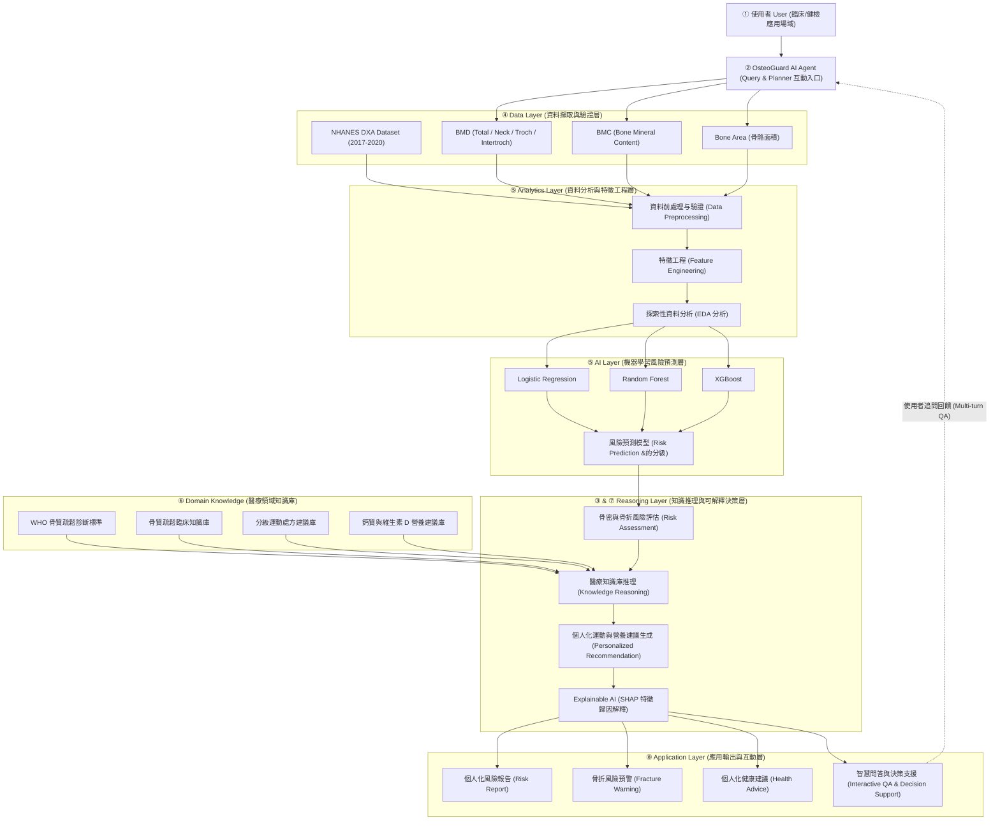
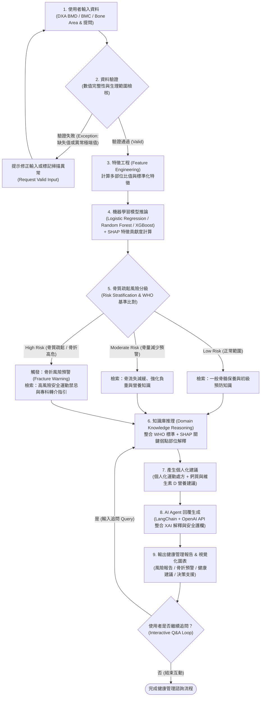

# OsteoGuard AI Agent：基於 NHANES 骨密度資料之骨質疏鬆風險評估與健康管理智慧代理人

> **Final Project Proposal Document**  
> **專題核心公式**：`AI Agent + Domain Knowledge + Data Analytics + Real-World Application`

---

## 1. Abstract 摘要（A–F 六段式結構）

### **A. Attention Getter — Motivation（研究動機與證據）**
隨著全球與台灣在 2025–2026 年正式邁入超高齡社會（65 歲以上人口占比突破 20%），骨質疏鬆症（Osteoporosis）在骨科（Orthopedics）與神經外科（Neurosurgery）臨床實務中長期處於**「高盛行但低管理（High Prevalence but Low Management）」**的次要地位。若跳脫傳統單純聚焦於「開刀與併發症」的框架，外科醫師在**門診、急診、常規行政與醫病溝通等非手術日常場景**中，同樣面臨大量實務痛點：在高周轉率的急診與初診中，微小壓迫性骨折或非典型轉移性骨折極易被誤當單純肌肉扭傷而漏診；在處方端，台灣健保署《藥品給付規定》第 5.6 節條文繁苛，稍有漏檢（如肌酸酐、血鈣）或加簽疏失即招致「整筆放大核扣處分」；在溝通端，患者因無痛感或過度恐懼拔牙顎骨壞死（MRONJ）而頻繁擅自中斷用藥；而在手術端，未察覺的嚴重骨鬆更直接導致脊椎融合之**椎弓根螺釘鬆脫（Pedicle Screw Loosening）與內固定失敗**。因此，導入具備自主檢索、合規預審、溝通圖卡生成與骨質預警的 AI Agent，是解決外科全方位慢性骨病管理失衡的迫切課題。

### **B. But — Challenge（現有挑戰與研究缺口）**
然而，現有外科門診與急診體系管理骨鬆個案時面臨多重瓶頸：第一，**急門診高周轉下的隱形漏診與誤判**，平片常因腸氣干擾或輕微壓迫變形（Genant Grade 1）被忽略，且難以在數分鐘內鑑別單純骨鬆與病理性轉移瘤（Pathologic fracture）；第二，**健保適應症與用藥轉換法規地雷**，第 5.6 節對促骨生成劑與抗流失劑之年限、順序及監測限制嚴苛，外科常因法規更新不及面臨放大核扣；第三，**醫病溝通效率低落與用藥遵從性崩跌**，患者因無痛感排斥長期用藥，或因牙醫一句話引發停藥潮，醫師反覆耗時口沫衛教；第四，**跨科轉介破碎與病患流失**，大量背痛病患淪為「看一次拿止痛藥即失聯的過路客」，無法轉化為長期追蹤；第五，**缺乏圍術期骨質預警閉環**，現有 DXA 報告為靜態數值，無法直接輸出螺釘鬆脫定量風險或術前骨水泥強化建議。

### **C. Cure — Proposed Solution（解決方案）**
為了解決上述問題，本專題提出 **OsteoGuard AI Agent（骨科與神經外科骨鬆個案管理智慧代理人）** 系統。本系統專為**骨科與神經外科醫師**打造，定位為全方位臨床決策支援代理人（CDSS & Clinical Copilot），整合「多部位 DXA 數據分析引擎」、「可解釋性機器學習模型（SHAP）」與「醫療及健保法規知識庫」，能一站式建立**「急門診漏診防火牆、健保法規安全守門員、病患可視化溝通圖卡、圍術期螺釘鬆脫預警，以及長程接續治療甘特圖」**之智慧臨床決策閉環。

### **D. Development — Method（系統方法與整合架構）**
在系統開發上，OsteoGuard AI Agent 以 NHANES 2017–2020 DXA Femur Dataset 為核心數據基礎，擷取 Total Femur BMD、Femoral Neck BMD、Trochanter BMD、Intertrochanter BMD、BMC 與 Bone Area 及人口學特徵進行前處理與特徵工程。系統底層訓練並比較 Logistic Regression、Random Forest 與 XGBoost 三種機器學習風險預測模型，並導入 SHAP（SHapley Additive exPlanations）量化各解剖部位對個案風險的局部貢獻；上層則透過 LangChain 與 LLM API 建構具備規劃與推理能力的臨床 Agent，結合 WHO/ISCD 骨質疏鬆診斷標準、圍術期骨質管理指引、台灣健保第 5.6 節骨鬆用藥給付規則、藥物排程時間軸演算法及牙科 MRONJ 處置安全護欄等領域知識（Domain Knowledge），最終透過 Streamlit 臨床儀表板呈現視覺化決策卡片、用藥甘特圖與 AI Clinical Copilot 互動問答。

### **E. Experiments — Evaluation（實驗與驗證設計）**
本專題預計採用 NHANES 2017–2020 DXA 股骨資料集（共 4,593 位受試者，篩選出 3,545 筆有效 DXA 掃描紀錄）進行實證評估。實驗將以 Logistic Regression、Random Forest 與 XGBoost 作為相互比較的 Baseline Models，透過 K-Fold Cross Validation 驗證模型穩定度，並採用 Accuracy、Precision、Recall、F1-Score 與 ROC-AUC 作為量化評估指標；此外，將結合 SHAP 可解釋性分析與骨科／神經外科典型臨床個案研究（Case Study，涵蓋急診微小骨折篩檢、門診健保促骨生成藥物核銷防核扣、牙科拔牙停藥溝通、以及脊椎融合術前骨水泥螺釘強化評估），驗證 AI Agent 在不同臨床情境下之決策準確性與合理性。

### **F. Findings — Expected Outcomes（預期成果）**
本專題預期完成一套端到端（End-to-End）可實際運作的 OsteoGuard AI Agent 臨床個案管理系統，預期成果包含：（1）具 SHAP 解釋能力之骨鬆風險預測與手術骨質預警模組；（2）無縫核對台灣健保第 5.6 節法規、杜絕放大核扣之安全審核守門機制；（3）跨年度骨鬆用藥時間軸與接續治療換藥甘特圖；（4）一鍵轉化為白話骨折風險圖卡與牙科處置對照單之病患溝通生成引擎；使快節奏的外科門診在不增加額外工時的前提下，建立高效率且零失誤的慢性骨病管理機制。

---

## 2. Introduction 緒論（Why is this project worth doing?）

### **A. Attention Getter：高盛行但低管理——超高齡社會下外科體系的慢性骨病危機**
根據世界衛生組織（WHO）與國際骨質疏鬆基金會（IOF）統計，50 歲以上族群中骨質疏鬆症的盛行率極高。然而，在骨科與神經外科門診及急診實務中，骨鬆卻常處於**「高盛行但低管理」**的次要地位。在快節奏的外科臨床場域，醫師重心多放在急性外傷處置與手術技術上，導致大量伴隨慢性背痛的輕度壓迫骨折患者被當作肌肉拉傷開立止痛藥放回家，形成急診與初診的隱形漏網；而在病房端，高達 30%–50% 接受脊椎減壓融合或人工關節置換的老人合併嚴重骨鬆，術後極易引發椎弓根螺釘鬆脫（Pedicle Screw Loosening）與再骨折。更棘手的是，外科門診普遍面臨嚴苛的健保放大核扣風險、高昂的醫病溝通衛教成本，以及看診後病患大量流失的困境。因此，如何打造一套兼顧「手術預警」與「非手術日常行政/衛教/防核扣」的臨床 AI Agent，已成為智慧外科推動慢性病精準管理的關鍵里程碑。

### **B. Background：應用領域、目標使用者與全方位臨床場景**
在臨床實務上，DXA（Dual-Energy X-ray Absorptiometry）是診斷骨質疏鬆症的黃金標準，量測特定部位（如 Total Femur、Femoral Neck、Trochanter、Intertrochanter 及腰椎）的 BMC、Bone Area 與 BMD，並換算為 T-score。
本系統目標使用者為**骨科醫師、神經外科醫師、脊椎外科手術團隊及骨鬆專科個案管理師**，覆蓋五大核心臨床場景：
1. **急診與初診篩檢端**：協助醫師在幾秒內比對影像與生理指標，避免微小壓迫骨折或非典型溶骨病灶漏診。
2. **門診處方與申報端**：即時核對台灣健保第 5.6 節用藥規定，提示應補檢驗項目，阻絕健保放大核扣。
3. **醫病衛教與溝通端**：一鍵將複雜報告轉換為直觀的病患圖卡與牙科處置對照表，消除病患對用藥及拔牙顎骨壞死（MRONJ）的過度恐懼。
4. **圍術期規劃端**：評估骨質弱點，對脊椎融合螺釘鬆脫發出預警，建議骨水泥強化或術前先期促骨生成治療。
5. **跨科經營與長程追蹤端**：以用藥甘特圖追蹤下次施打日與強制換藥期程，啟動院內轉介，將「過路客」轉化為長期規律追蹤病患。

### **C. Problem：核心待解決問題定義（手術與四大非手術痛點）**
1. **急診與門診端：高周轉率下的「隱形漏診與誤判」**：急診與初診患者因下背痛就診，常規平片常因腸氣遮蔽、骨質稀疏或輕微壓迫變形（Genant Grade 1 wedge fracture）被當成肌肉扭傷；同時，高齡少數惡性腫瘤轉移之病理性骨折（Pathologic fracture）極易在門診 2–3 分鐘內誤判為一般骨折，錯失黃金期。
2. **繁重的門診衛教與極差的醫病溝通效率**：骨鬆無痛無感，病患抗拒長期針劑；尤其遇到洗牙或拔牙時，常被牙醫一句「打針會下巴爛掉（MRONJ）」嚇退而擅自停藥。醫師反覆解釋效益與風險，耗損龐大心力但遵從性依然低下。
3. **健保申報核扣與繁瑣的適應症法規地雷**：健保署第 5.6 節骨鬆用藥轉換規則極嚴（抗骨吸收 vs. 促骨生成製劑順序、年限上限）。外科醫師常因漏測肌酸酐、血鈣或加簽程序疏失，遭健保抽審剔除並「整筆放大核扣處分」。
4. **醫院經營與跨科轉介效益斷層（病患流失）**：大量高齡慢性背痛病患在外科只看一次拿止痛藥即離開，無法建立長期追蹤；且院內跨科轉介機制破碎，轉介至新陳代謝科成功率低於 20%，流失龐大慢性病管理價值。
5. **圍術期內固定失敗與骨骼多特徵整合困難**：多部位 DXA 指標缺乏與手術術式的定量關聯模型，無法即時輔助外科醫師判斷是否需術前促骨生成先期治療或術中骨水泥螺釘強化。

### **D. Existing Limitations：現有方法的不足與挑戰**
1. **傳統臨床判讀與 FRAX 工具之局限**：傳統量表僅考慮單一部位（如 Femoral Neck BMD），忽略幾何特徵（BMC、Area）與其他股骨分區對局部力學的影響，且完全不具備急門診漏診檢核、健保法規自動比對或衛教圖卡生成能力。
2. **單純機器學習模型（Pure ML Models）**：過去研究雖使用 LR、RF 或 XGBoost 預測骨鬆機率，但輸出僅為單一數字，缺乏臨床決策解碼、手術風險關聯、健保條文推理與病患溝通能力。
3. **通用型對話機器人（Pure LLM Chatbots）**：通用 LLM（如未受約束的 ChatGPT）缺乏精確數值計算能力、引用非台灣本土健保診斷閾值，且容易產生幻覺，無法勝任嚴謹的抗骨鬆藥物合規審查。

### **E. Innovation：本專題之創新性與差異化**
本專題提出的 **OsteoGuard AI Agent** 採用 **Neuro-Symbolic / Hybrid AI Agent 架構**，實現四大核心創新：
- **急門診漏診防火牆與臨床安全守門員**：透過 NHANES 數據訓練之高效集成模型（XGBoost/RF + SHAP）量化解剖弱點，結合臨床決策樹在醫師看診當下提供即時診斷提示與圍術期螺釘鬆脫預警。
- **即時健保第 5.6 節安全守門員**：將台灣健保署公開之 5.6.1～5.6.3 用藥條文、ATC 藥物分類與必驗項目轉化為確定性規則引擎，醫師點選藥物時自動檢核資格與禁忌症，杜絕放大核扣。
- **可視化溝通圖卡生成與 MRONJ 安全護欄**：一鍵將複雜生理指標轉化為病患易懂的骨折風險圖卡與牙科處置風險對照表，直接化解病患恐懼，大幅提升醫囑遵從性並節省門診衛教時間。
- **接續治療甘特圖與跨科沉澱**：以視覺化時間軸自動計算下次施打日（防 Prolia 反彈性骨折）與強制換藥期程（Evenity/Forteo 上限），並生成轉介摘要，將單次過路客沉澱為長期骨鬆慢性病管理資產。

### **F. Contributions：本專題預期主要貢獻**
1. **資料與分析貢獻**：完成 NHANES 2017–2020 DXA Femur Dataset（4,593 名受試者、3,545 筆有效掃描）之完整清理、特徵工程與探索性資料分析（EDA），建立多部位股骨指標預測基準。
2. **模型與可解釋性貢獻**：實作並系統性比較 Logistic Regression、Random Forest 與 XGBoost 在骨鬆風險分級上的表現，並結合 SHAP 量化各解剖部位（Total Femur、Femoral Neck、Trochanter、Intertrochanter）之影響力。
3. **領域代理人架構貢獻**：設計並實作結合「ML 預測工具 + WHO/臨床知識庫推理 + 個人化運動營養處方生成」的 OsteoGuard AI Agent，並透過 Streamlit 提供完整互動式決策支援介面。

---

## 3. Related Work 相關研究（1/2 AI Technology + 1/2 Domain Know-how）

本研究同時立基於「AI 與代理人技術（AI Technology）」以及「骨質疏鬆臨床醫學與營養運動科學（Domain Know-how）」兩大支柱：

### **3.1 AI Technology：機器學習骨鬆預測、可解釋性 AI 與醫療 LLM Agent**
在醫療表格數據（Tabular Data）預測領域，集成樹模型（如 Random Forest 與 XGBoost）在處理非線性生理特徵交互作用上展現優於傳統線性模型（Logistic Regression）的效能，但臨床導入的最大障礙在於模型黑箱問題。Lundberg 與 Lee 提出的 **SHAP（SHapley Additive exPlanations）** 基於賽局理論計算各特徵對單一預測的邊際貢獻，使醫師與患者能直觀理解各生理指標如何推升或降低風險。近年（2024–2026）研究進一步從單一預測模型轉向 **Medical AI Agents**，透過 LangChain 等框架賦予大型語言模型（LLM）呼叫外部 ML 模型（Tool Calling）與檢索結構化臨床指引（RAG）的能力，有效解決純 LLM 在數值運算與專業醫療診斷上的幻覺問題。

### **3.2 Domain Know-how：DXA 股骨生物力學、WHO 診斷準則與非藥物介入處方**
在骨科與代謝性骨病領域，**世界衛生組織（WHO）** 定義了以 DXA 測量之骨密度 T-score 作為診斷標準：正常（$T \ge -1.0$）、骨量減少/骨質缺乏（$-2.5 < T < -1.0$）、骨質疏鬆症（$T \le -2.5$），以及合併骨折之嚴重骨質疏鬆症。臨床解剖學指出，近端股骨（Proximal Femur）包含股骨頸（Femoral Neck）、大轉子（Trochanter）與轉子間區（Intertrochanter），其中股骨頸皮質骨較薄且承受高剪力，是預測髖部骨折最敏感的指標；而 BMC（骨礦物質含量）與 Bone Area（骨骼投射面積）則反映了骨骼的幾何尺寸與巨觀結構強度。在預防與管理方面，臨床實證指引（如 IOF 與北美停經學會 NAMS 指南）強調非藥物介入必須包含**充足鈣質（1,000–1,200 mg/日）與維生素 D（800–1,000 IU/日）攝取**，並搭配依風險分級量身設計的**負重運動（Weight-bearing exercise）、肌力阻抗訓練與平衡防跌訓練**。

### **3.3 Article Summary Table（文獻彙整表）**

| Ref. | Year | Problem | AI Method | Domain Knowledge | Dataset | Findings | Limitation |
| :--- | :---: | :--- | :--- | :--- | :--- | :--- | :--- |
| **[1]** Kanis et al. (WHO / IOF Guidelines) | 2019–2024 | 骨質疏鬆診斷標準化與骨折風險臨床分級 | 統計流行病學模型與臨床閾值決策規則 | WHO T-score 分級標準、股骨頸 BMD 參考基準、鈣/維生素 D 與運動介入指引 | 多國世代追蹤與流行病學資料庫 | 確立 Femoral Neck BMD 為國際標準診斷部位，並證實營養與負重運動可減緩骨流失 | 僅依賴單一指標閾值，未整合多部位 DXA 特徵與自動化個人衛教生成 |
| **[2]** NHANES / CDC NCHS Report | 2021–2024 | 美國中高齡人口近端股骨骨密度分佈與流行病學監測 | 雙能量 X 光吸光測定（DXA）影像品質控制與加權統計分析 | 近端股骨四區（Total, Neck, Troch, Intertroch）之 BMD、BMC 與 Bone Area 量測規範 | NHANES 2017–2020 Pre-pandemic DXA Femur (N=4,593) | 提供具代表性之多部位股骨 BMD/BMC/Area 基準數據，揭示高齡骨鬆盛行率 | 僅提供原始調查數據與群體統計，缺乏個人化風險預測工具與臨床解釋系統 |
| **[3]** Shim et al. / Tabular ML for Osteoporosis | 2022–2025 | 利用機器學習模型預測骨質疏鬆風險 | Logistic Regression, Random Forest, XGBoost 等監督式學習分類器 | 人口學特徵與臨床骨密度相關指標篩選 | 國民健康營養調查世代資料（NHANES / KNHANES） | XGBoost 與 Random Forest 在骨鬆風險分類之 ROC-AUC 顯著優於傳統線性迴歸 | 模型為黑盒子，僅輸出機率值，一般民眾無法理解，亦無後續健康管理建議 |
| **[4]** Lundberg et al. & Clinical XAI Studies | 2020–2025 | 醫療機器學習模型缺乏臨床可解釋性與信任度 | TreeSHAP / KernelSHAP 局部與全域特徵歸因分析 | 臨床風險因子貢獻度量化與個別病患特徵解釋 | 醫療結構化电子病歷與生理檢測資料集 | SHAP 能準確識別影響個別病患風險的關鍵生理指標，提升臨床醫師採納意願 | 視覺化圖表（如 Waterfall plot）對非專業患者仍過於抽象，缺乏自然語言轉譯 |
| **[5]** Med-Agent / Healthcare LLM Frameworks | 2025–2026 | 通用 LLM 在醫療衛教與臨床決策上的幻覺與數值推理缺陷 | LLM Agent + Tool Use + Retrieval-Augmented Generation (RAG) | 臨床實踐指南（Clinical Practice Guidelines）與結構化衛教知識庫 | 醫療問答基準測試與臨床個案情境 | 結合外部工具與領域知識庫的 Agent 能大幅降低醫療幻覺並提升個人化建議品質 | 多集中於一般內科問答，缺乏針對 DXA 骨密度多維指標與運動營養處方之專用 Agent |
| **[6]** Koh et al. (Osteoporosis Exercise & Nutrition Consensus) | 2023–2025 | 不同骨鬆風險等級患者之安全運動處方與營養補充策略制定 | 系統性文獻回顧與臨床決策樹（Clinical Pathway） | 負重衝擊運動、阻抗肌力訓練、防跌平衡訓練、高風險脊椎屈曲禁忌症、鈣與維生素 D 協同代謝 | 停經後婦女與高齡骨量減少/骨鬆臨床試驗資料 | 證實需依據骨密度嚴重度分級調整運動強度（如嚴重骨鬆應避免高衝擊與過度彎腰轉體） | 需由專業復健師或營養師人工評估開立，難以在社區篩檢或個人端大規模普及 |

### **3.4 Research Gap 歸納**

> **Existing Research → Limitations → Research Gap → Our Project**
> - **Existing Research**：臨床上已有成熟的 DXA 檢測數據（NHANES）與 WHO 診斷/衛教指南，AI 領域亦已證實 XGBoost/RF 搭配 SHAP 可有效預測並解釋表格型醫療數據，且 LLM Agent 技術日益成熟。
> - **Limitations**：現有 ML 模型停留在「輸出風險分數」，缺乏衛教溝通能力；而一般 LLM Chatbot 缺乏「精準骨密度數值分析」與「分級運動營養處方安全約束」。
> - **Research Gap**：目前缺乏一個能將 **NHANES 多部位股骨 DXA 指標（BMD/BMC/Area）**、**可解釋性機器學習（LR/RF/XGBoost + SHAP）** 與 **WHO 骨鬆醫療知識推理** 緊密結合成單一閉環工作流的領域智慧代理人。
> - **Our Project (OsteoGuard AI Agent)**：透過 AI Agent 串聯「資料驗證 $\rightarrow$ ML 風險預測與 SHAP 歸因 $\rightarrow$ WHO 知識庫推理 $\rightarrow$ 個人化運動與營養建議生成 $\rightarrow$ 互動式問答」，真正落實可解釋、可信任且具行動指導價值的智慧骨骼健康管理。

---

## 4. Deep Research：三大核心問題

針對「骨質疏鬆臨床篩檢、DXA 生物力學解讀與智慧健康管理」領域，本團隊進行深度領域調研，回答以下三大核心問題：

### **Q1. 這個領域的專家普遍認同的五個核心思維模式是什麼？**

#### **思維模式 1：骨骼健康不等於單一密度數字，而是「密度（BMD）× 幾何結構（Area/BMC）× 微觀品質」的綜合體現**
- **意義**：許多外行人只看單一 BMD 數值，但臨床專家明白面積骨密度（$\text{BMD} = \text{BMC} / \text{Bone Area}$）受限於二維投影。相同的 BMD 下，骨骼截面積（Bone Area）較小或股骨頸皮質骨較薄者，其抗彎曲與抗剪力強度截然不同。
- **證據**：NHANES DXA Femur 資料集同時記錄了 Total Femur、Femoral Neck、Trochanter 與 Intertrochanter 四區的 BMD、BMC 與 Bone Area；生物力學研究證實結合 BMC 與 Area 能更完整反映骨骼結構強度。
- **如何影響系統設計**：OsteoGuard AI Agent 的特徵工程與 ML 模型不單只取單一部位 BMD，而是同時納入四個解剖分區的 BMD、BMC 與 Bone Area（以及衍生比例特徵），讓模型捕捉骨骼密度與幾何結構的交互關係。

#### **思維模式 2：「木桶短板效應（Lowest Site Rule）」與解剖部位特異性（Site-Specific Vulnerability）**
- **意義**：在臨床判讀近端股骨時，專家不會將各部位 BMD 取平均，而是採取「最低部位決定風險基準」原則，特別重視股骨頸（Femoral Neck）與全髖部（Total Femur）。
- **證據**：WHO 與國際臨床骨密學會（ISCD）明確規範，診斷時以股骨頸或全髖部較低者的 T-score 為準；因為股骨頸位於關節囊內、血液供應脆弱且承受高機械應力，一旦此處骨密度低落，發生致命性股骨頸骨折的風險極高。
- **如何影響系統設計**：在系統的「風險評估與知識推理層（Reasoning Layer）」中，除了參考 ML 模型的整體預測機率外，我們設計了明確的 WHO 規則檢核機制，針對 Femoral Neck BMD 異常偏低者觸發專項骨折預警（Fracture Alert）。

#### **思維模式 3：預防勝於治療，且「鈣質、維生素 D 與機械負重刺激」具有不可分割的生理協同作用**
- **意義**：專家認為骨質疏鬆管理絕非「單純吃鈣片」就能解決。沒有足夠的維生素 D，腸道對鈣質的吸收率極低；而沒有透過負重運動產生機械應力（Wolff's Law 沃夫定律），補充的鈣質也無法有效促進成骨細胞（Osteoblasts）進行骨質沉積。
- **證據**：多項隨機對照試驗（RCT）與 IOF 臨床指南指出，單獨補鈣對降低骨折率效果有限，必須採取「鈣 + 維生素 D + 規律負重與肌力訓練」的三合一整合介入。
- **如何影響系統設計**：OsteoGuard AI Agent 的知識庫推理模組強制將建議拆分為「個人化營養建議（鈣質飲食來源 + 維生素 D 日照與補充）」與「個人化運動處方（負重 + 肌力 + 平衡）」雙軌並陳，不會給出片面的單一建議。

#### **思維模式 4：運動處方的「風險分級安全邊界（Risk-Stratified Exercise Safety）」**
- **意義**：雖然運動有益骨密，但專家極度重視「不同骨鬆程度對應不同的運動禁忌」。對健康或輕度骨量減少者，跳躍、慢跑等高衝擊負重運動能刺激骨生成；但對已達嚴重骨質疏鬆或高骨折風險者，高衝擊運動或過度脊椎前彎/扭轉動作（如仰臥起坐、高爾夫急轉體）反而會直接誘發壓迫性骨折或跌倒髖部骨折。
- **證據**：美國運動醫學會（ACSM）與物理治療骨鬆運動指引嚴格區分「預防期（高/中衝擊負重）」與「高風險期（低衝擊負重、姿勢穩定與防跌平衡訓練優先）」。
- **如何影響系統設計**：Agent 在生成運動建議（模块 G）前，必須先讀取前一步驟的「骨質疏鬆風險分級（模块 E）」結果。若判定為高風險等級，系統規則會自動過濾高衝擊運動，改為推薦安全肌力與防跌平衡訓練，並附上居家防跌警語。

#### **思維模式 5：可解釋性與風險溝通是決定患者「醫囑順從性（Adherence）」的關鍵**
- **意義**：骨質疏鬆是「沉默的疾病」，在骨折發生前毫無痛感，導致患者對生活型態調整或定期追蹤的順從性極低。臨床專家深知，唯有將抽象的 BMD/T-score 轉化為患者聽得懂的具體部位風險解釋與可執行的日常微習慣，才能真正改變行為。
- **證據**：預防醫學研究顯示，提供視覺化且個人化的 DXA 報告解讀，能顯著提升患者後續補充鈣/維生素 D 與參與規律運動的比例。
- **如何影響系統設計**：本系統整合 **Explainable AI (SHAP)** 與 **LLM 自然語言生成**，將模型內部特徵貢獻度轉譯為結構化風險報告與互動問答，讓使用者不僅看到「高風險」，更能看懂「因為您的股骨頸 BMD 與 BMC 低於標準，導致髖部支撐力下降，因此建議...」。

---

### **Q2. 這個領域專家爭論最激烈的三個問題是什麼？**

#### **爭論一：骨鬆與骨折風險評估應以「純 BMD 指標（WHO T-score）」為核心，還是「多維度臨床因子與骨骼幾何複合模型」？**
- **觀點 A（BMD 核心派）**：主張以 DXA 測得之 Femoral Neck / Total Femur BMD（及對應 T-score）作為唯一核心診斷與分級依據，因其量測標準化程度最高、重現性最好，且全球臨床試驗藥物適應症皆以此為基準。
- **觀點 B（多維度複合模型派）**：主張單看 BMD 會漏掉超過半數實際發生骨折的「骨量減少（Osteopenia）」患者；應同時整合 BMC、Bone Area 等骨骼幾何參數以及多部位（Trochanter、Intertrochanter）退化特徵，透過機器學習捕捉非線性結構弱點。
- **雙方最有力的證據**：
  - 觀點 A 證據：BMD 每下降 1 個標準差（SD），骨折風險即呈指數型翻倍（約 1.5–2.6 倍），是單一最強預測因子。
  - 觀點 B 證據：流行病學數據顯示，絕對數量上發生髖部骨折的患者中，有相當大比例其 T-score 落在 $-1.0$ 到 $-2.5$ 之間（尚未達 $-2.5$ 骨鬆門檻），顯示單一 BMD 閾值敏感度不足。
- **目前共識**：WHO T-score 仍是不可取代的臨床診斷基準，但結合多部位 DXA 特徵（BMD + BMC + Area）與機器學習模型，能提供更細膩的早期風險預警。
- **尚未解決的問題**：如何將多特徵 ML 模型的複合風險分數與傳統 WHO 分級無縫對接，避免臨床判讀混淆？（*本專題透過將 ML 預測與 WHO 診斷標準雙軌整合於 Reasoning Layer 來回應此問題*）。

#### **爭論二：在臨床醫療決策支援中，應採用「高可解釋性的傳統統計模型（Logistic Regression）」還是「高準確率的複雜集成模型（XGBoost / Random Forest）」？**
- **觀點 A（白盒統計模型派）**：醫療領域人命關天，主張使用 Logistic Regression，因為每個特徵的 Odds Ratio（勝算比）清晰透明，完全符合循證醫學（Evidence-Based Medicine）的線性因果直覺。
- **觀點 B（高效能樹模型 + XAI 派）**：人體骨骼生理指標（如不同部位的 BMD、BMC 與面積比值）存在高度共線性與非線性交互作用，主張採用 Random Forest 或 XGBoost 以取得最佳 ROC-AUC 與 Recall（減少漏診），再以事後解釋技術（Post-hoc XAI 如 SHAP）補足透明度。
- **雙方最有力的證據**：
  - 觀點 A 證據：FDA 與臨床指南長期偏好結構簡單、可直接在紙本公式驗算的邏輯迴歸模型，避免複雜模型在分布外數據（Out-of-Distribution）產生不可預期的跳躍。
  - 觀點 B 證據：在 NHANES 等大型醫療表格資料集競賽與實證研究中，XGBoost 與 Random Forest 的分類效能穩定優於線性模型，且 TreeSHAP 已能精確算出單一預測的特徵加總貢獻。
- **目前共識**：不應盲目追求黑盒高分，也不應犧牲預測準確度；最佳實踐是**同時訓練 Baseline 線性模型（Logistic Regression）與樹模型（RF、XGBoost）進行對照驗證**，並強制搭配 SHAP 解釋。
- **尚未解決的問題**：當 SHAP 的局部特徵歸因與臨床直覺發生衝突（例如因特徵高度共線性導致某部位 BMD 的 SHAP 值符號反轉）時，該如何向患者解釋？

#### **爭論三：醫療健康管理 AI Agent 應給予 LLM 多大的自主生成自由度？（「嚴格規則模版 Rule-Based」vs.「開放式生成 Agentic LLM」）**
- **觀點 A（嚴格臨床規則與專家系統派）**：認為醫療建議（運動與營養劑量）容錯率極低，所有輸出應由預先寫死的 If-Else 規則樹與固定衛教模版決定，LLM 最多只能做文字潤飾。
- **觀點 B（自主推理 LLM Agent 派）**：認為固定模版僵化冰冷，無法處理使用者多變的生活情境問答（例如：「我不喝牛奶又膝蓋痛，該怎麼補鈣和運動？」）；應賦予 LLM Agent 動態檢索知識庫並綜合推理生成個人化方案的能力。
- **雙方最有力的證據**：
  - 觀點 A 證據：多篇醫療 AI 評估論文指出，無約束的 LLM 在醫療問答中可能編造不存在的臨床數據或給出超過安全上限的補充劑量。
  - 觀點 B 證據：具備 RAG（檢索增強生成）與結構化 Prompt 約束的領域 Agent，在病患同理心、衛教易讀性與長尾情境應對上遠勝傳統專家系統。
- **目前共識**：採用 **Neuro-Symbolic 混合防護架構**——診斷分級與高風險禁忌由確定性程式與 ML 模型把關，而衛教轉譯與情境配適則由受領域知識庫（RAG）嚴格約束的 LLM Agent 執行。
- **尚未解決的問題**：如何量化評估 AI Agent 生成之個人化健康建議的「臨床忠實度（Clinical Faithfulness）」與「安全性」？

---

### **Q3. 設計 10 個深度理解問題（判斷真正深入了解 vs. 死記硬背）**

以下 10 個問題涵蓋 *Why, What-if, Trade-off, Failure Case, Evidence, Comparison, Design Decision, Real-world Scenario* 八大推理層次：

1. **[Why / 生物力學與解剖學]**  
   *問題*：為什麼在 NHANES DXA 股骨檢測中，臨床醫師與 WHO 標準特別看重「股骨頸（Femoral Neck）BMD」，而不是只看面積最大、數值最穩定的「全髖部（Total Femur）BMD」或「轉子間（Intertrochanter）BMD」？  
   *深度理解重點*：股骨頸解剖結構狹窄、皮質骨薄、承受人體站立與跌倒時極大的彎曲力矩與剪力，且位於關節囊內（一旦骨折極易引發缺血性股骨頭壞死），因此在骨折預警上具有不可被平均稀釋的臨床特異性。

2. **[What-if / 特徵物理意義與共線性]**  
   *問題*：已知 $\text{BMD} = \text{BMC} / \text{Bone Area}$。如果兩位受試者的 Total Femur BMD 完全相同（皆為 $0.75\text{ g/cm}^2$），但受試者 A 的 Bone Area 與 BMC 都遠小於受試者 B，這在生物力學與我們的 ML 模型特徵工程中代表什麼意義？  
   *深度理解重點*：DXA 測量的是二維投影面積骨密度（areal BMD）而非真實三維體積密度。骨架較小者（Bone Area 小）在二維投影下 BMD 常被低估，但其骨骼截面慣性矩（抗彎強度）也確實較小；模型同時納入 BMC 與 Bone Area 有助於校正體型幾何差異。

3. **[Trade-off / 評估指標選擇]**  
   *問題*：在訓練 OsteoGuard AI Agent 的骨質疏鬆高風險篩檢模型時，若必須在 Precision（精確率）與 Recall（召回率/敏感度）之間做取捨，你會優先最佳化哪一個指標？為什麼？這會帶來什麼代價？  
   *深度理解重點*：在預防醫學與社區篩檢場域，應優先確保高 **Recall（敏感度）**，因為將高骨折風險者漏判為正常（False Negative）可能導致長者錯失防跌與治療良機而發生致命髖部骨折；其代價是 False Positive 增加（部分臨界骨量減少者被高度預警），但後續僅需轉介醫師複查與加強安全生活管理，傷害遠小於漏診。

4. **[Failure Case / 資料前處理與臨床異常值]**  
   *問題*：在處理 NHANES 2017–2020 DXA 資料集時（4,593 位受試者中僅 3,545 筆有效掃描），什麼臨床情況會導致 DXA 掃描無效或使特定部位 BMD 出現極端假性偏高（Artifact）？若未妥善處理會如何誤導 AI Agent？  
   *深度理解重點*：曾接受人工髖關節置換術、嚴重退化性關節炎骨刺增生、血管鈣化或金屬植入物，會導致無效掃描或 X 光吸收異常升高（造成 BMD 假性正常）。若系統未在「資料驗證（Data Validation）」階段檢查各部位（如 Neck vs. Trochanter）之合理比值與異常值，Agent 可能會對高風險患者給出錯誤的安心報告。

5. **[Comparison / 模型特性比較]**  
   *問題*：本專題同時採用 Logistic Regression、Random Forest 與 XGBoost。既然在表格資料中高度相關的樹模型（XGBoost）通常準確率最高，為什麼我們仍堅持保留 Logistic Regression 與 Random Forest 進行比較？  
   *深度理解重點*：由於四個股骨部位的 BMD、BMC、Area 之間存在高度多重共線性（Multicollinearity），Logistic Regression 可檢驗線性可分性與基準效能，Random Forest（Bagging）可降低變異數並抗過擬合，而 XGBoost（Boosting）擅長捕捉殘差與非線性邊界；三者對照加上 K-Fold 交叉驗證，才能證明複雜模型是否真的帶來實質增益而非過擬合。

6. **[Evidence / 可解釋性 AI 陷阱]**  
   *問題*：當我們使用 SHAP 解釋 XGBoost 模型對某位患者的預測時，若發現該患者的 Femoral Neck BMD 與 Intertrochanter BMD 都很低，但 SHAP 卻顯示只有 Femoral Neck BMD 有極大的正向風險貢獻，而 Intertrochanter BMD 貢獻接近零，這是否代表該患者轉子間骨骼很健康？  
   *深度理解重點*：不是。這是樹模型在面對高度共線性特徵時，傾向優先挑選資訊獲利最高之特徵（Femoral Neck）進行分裂的現象。因此 Agent 在「知識庫推理」時，不能只盲目念出 SHAP 數值，必須結合各部位原始數值與臨床基準進行綜合解讀。

7. **[Design Decision / 架構設計抉擇]**  
   *問題*：為什麼 OsteoGuard AI Agent 要設計成「先經過 ML 模型預測與風險分級，再進入領域知識庫推理與 LLM 生成」，而不是直接把使用者的 BMD/BMC/Area 數值放進 Prompt 讓 OpenAI API（LLM）直接判斷骨鬆風險並給建議？  
   *深度理解重點*：直接讓 LLM 處理連續浮點數特徵不僅缺乏在 NHANES 3,545 筆群體分布上的統計校準（Calibration），且每次生成的風險判定可能不一致（Non-deterministic）並產生幻覺；將「數值預測/分級」交給確定性的 ML 與 WHO 規則，將「知識整合與自然語言溝通」交給 LLM Agent，才能兼顧統計嚴謹度與互動體驗。

8. **[Real-world Scenario / 臨床處方衝突處理]**  
   *問題*：假設一位 72 歲女性受試者經模型判定為「高骨質疏鬆與骨折風險」，她向 AI Agent 提問：「我聽說跳繩跟慢跑最能增加骨密度，而且我買了高劑量鈣片打算每天吃 2,500 mg，這樣好嗎？」Agent 應該如何推理並回應？  
   *深度理解重點*：Agent 必須識別兩大臨床危險：（1）對高骨折風險長者，跳繩等高衝擊運動極易引發跌倒與骨折，應改為低衝擊負重、阻抗訓練與平衡防跌運動；（2）每日鈣質攝取上限約為 2,000–2,500 mg（建議量 1,000–1,200 mg），單次吸收有限且過量補鈣會增加腎結石與心血管鈣化風險，並提醒需搭配維生素 D。

9. **[What-if / 族群與分佈偏移 Domain Shift]**  
   *問題*：我們的模型是基於美國 NHANES 2017–2020 資料集訓練的，如果未來將 OsteoGuard AI Agent 直接部署到台灣社區健康篩檢供台灣長者使用，可能會遇到什麼資料分佈偏移（Distribution Shift）問題？系統應如何緩解？  
   *深度理解重點*：亞洲人（台灣族群）的平均體型、骨骼面積（Bone Area）與基準 BMD 普遍低於歐美非裔族群。若直接套用未經校正的絕對 BMC/Area 門檻可能高估風險；系統設計上應透過相對比例特徵、T-score 標準化概念，並在輸出報告中標註資料來源限制與台灣臨床轉介建議。

10. **[Design Decision / 醫療倫理與責任邊界]**  
    *問題*：作為一個醫療健康領域的 AI Agent，「決策支援（Decision Support）」與「醫療診斷處方（Medical Diagnosis）」的法律與倫理界線在哪裡？這如何在系統流程中體現？  
    *深度理解重點*：AI Agent 定位為「健康風險評估、衛教解釋與臨床決策支援工具」，絕不可取代醫師開立處方藥（如雙磷酸鹽類、Denosumab 等抗骨鬆藥物）。在系統輸出層（Application Layer），必須明確區分生活型態建議（運動/營養）與專科醫療轉介警語，當檢測出高骨折預警時，強制提示尋求骨科或家醫科醫師進行臨床確診。

---

## 5. Proposed Scheme / Proposed Design（系統設計）

為完全符合「Domain AI Agent」之設計要求，並忠實呈現 **OsteoGuard AI Agent** 的六層核心架構與九步運作流程，本節將系統模組進行 **①–⑧ 標準化編號對應**，並提供完整 **System Architecture**、**Flowchart** 與 **Pseudocode**。

### **5.1 System Architecture（系統架構圖與模組說明）**

以下系統架構圖保留本專題原有的六大核心分層（Data Layer、Analytics Layer、AI Layer、Domain Knowledge、Reasoning Layer、Application Layer），並標註 **①–⑧ 代理人核心模組編號**：



#### **各主要模組（①–⑧）詳細說明：**
- **① User / Application Scenario（使用者與應用場域）**：涵蓋接受 DXA 骨密度檢測之一般中高齡民眾、家屬，以及社區篩檢或預防醫學門診之醫護個管人員。
- **② Query / Input & OsteoGuard AI Agent Interface（查詢與輸入入口）**：透過 Streamlit 建構之互動介面，接收使用者輸入之近端股骨 DXA 檢測數值（Total Femur、Femoral Neck、Trochanter、Intertrochanter 之 BMD、BMC、Bone Area）與自然語言健康提問。
- **③ Planner & Reasoning Coordinator（代理人規劃與協調中樞）**：基於 LangChain 與 OpenAI API 實作之 Agent 核心，負責解析使用者意圖，依序調度「資料驗證」、「ML 風險預測工具」、「SHAP 解釋器」與「醫療知識庫檢索（RAG）」。
- **④ Data Layer（資料擷取與驗證層）**：以 NHANES 2017–2020 DXA Femur Dataset（4,593 位受試者、3,545 筆有效掃描）為底層基準資料庫，負責驗證輸入之 BMD、BMC 與 Bone Area 數值完整性與生理合理範圍。
- **⑤ Analytics & AI Layer（資料分析與機器學習引擎）**：執行缺失值處理、衍生特徵計算（Feature Engineering）與 EDA 分佈對照；平行整合 **Logistic Regression**、**Random Forest** 與 **XGBoost** 三大監督式學習模型，輸出骨質疏鬆風險機率與風險分級。
- **⑥ Domain Knowledge Integration（領域知識庫層）**：結構化儲存四大領域知識——**WHO 骨質疏鬆診斷標準**、**骨質疏鬆病理知識庫**、**分級運動處方建議**（負重、肌力、防跌禁忌）以及**鈣質與維生素 D 營養建議**。
- **⑦ Reasoning & Decision Layer（推理、建議生成與 XAI 層）**：將 ML 預測之骨鬆風險分級（`R`）與領域知識庫進行交叉推理（`S`），生成安全合規之個人化運動與營養處方（`T`），並結合 **SHAP（Explainable AI, `U`）** 量化各解剖部位指標對該名使用者風險的正負向影響。
- **⑧ Output & Interaction Layer（輸出與多輪互動層）**：向使用者輸出四大核心成果——**風險報告（`V`）**、**骨折預警（`W`）**、**個人化健康建議（`X`）** 與 **決策支援智慧問答（`Y`）**，支援使用者針對報告內容進行多輪自然語言追問。

---

### **5.2 AI Agent Flowchart（運作流程圖）**

為了完整呈現 `Input → Processing → AI/Analytics → Decision → Output` 的處理邏輯，我們在原有的九步驟核心主幹（`使用者輸入資料 → 資料驗證 → 特徵工程 → 機器學習模型 → 骨質疏鬆風險分級 → 知識庫推理 → 產生個人化建議 → AI Agent回覆 → 健康管理報告`）基礎上，明確標示條件判斷（Decision）、異常處理迴圈（Exception Loop）與使用者互動迴圈（Human Interaction）：



---

### **5.3 Pseudocode（核心演算法）**

以下提供具備行號之 **OsteoGuard AI Agent** 核心演算法 Pseudocode，涵蓋資料驗證、多模型推論、SHAP 解釋、領域知識推理與互動式個人化建議生成：

```text
Algorithm 1: OsteoGuard Domain AI Agent for Osteoporosis Risk & Health Management
Input : User DXA Features X_user = {BMD_sites, BMC_sites, Area_sites}, User Query Q
        Trained Models M = {M_LR, M_RF, M_XGB}, NHANES Reference Stats D_ref
        Domain Knowledge Base KB = {KB_WHO, KB_Osteo, KB_Exercise, KB_Nutrition}
Output: Comprehensive Health Management Report R_final (Risk Tier, Fracture Alert, XAI Explanation, Personalized Advice)

01: Receive user input data X_user and natural language query Q
02: // Step 1 & 2: Data Validation & Preprocessing
03: is_valid, validation_msg <- ValidatePhysiologicalBounds(X_user, D_ref)
04: if is_valid == False then
05:     return PromptUserCorrection(validation_msg)
06: end if
07: // Step 3: Feature Engineering
08: X_feat <- ComputeEngineeredFeatures(X_user, D_ref)  // Site ratios, regional BMD/BMC/Area alignments
09: // Step 4: Machine Learning Inference & Explainable AI (SHAP)
10: P_LR  <- M_LR.predict_proba(X_feat)
11: P_RF  <- M_RF.predict_proba(X_feat)
12: P_XGB <- M_XGB.predict_proba(X_feat)
13: P_risk <- SelectOptimalEnsembleOrBestModel(P_LR, P_RF, P_XGB)
14: shap_values, top_risk_factors <- ComputeSHAPExplanation(M_XGB, X_feat)
15: // Step 5: Osteoporosis Risk Stratification & WHO Rule Alignment
16: who_status, min_site <- CheckWHODiagnosticCriteria(X_user.BMD_sites, KB_WHO)
17: risk_tier, fracture_warning <- DetermineRiskTier(P_risk, who_status)
18: // Step 6: Domain Knowledge Reasoning
19: retrieved_rules <- RetrieveDomainKnowledge(KB, risk_tier, min_site, top_risk_factors, Q)
20: if risk_tier == "High_Risk" then
21:     exercise_constraints <- FilterHighImpactAndSpinalFlexion(KB_Exercise)
22: else
23:     exercise_constraints <- StandardWeightBearingProtocol(KB_Exercise, risk_tier)
24: end if
25: nutrition_plan <- FormulateCalciumVitaminDPlan(KB_Nutrition, risk_tier, Q)
26: // Step 7, 8 & 9: Personalized Recommendation & Agent Response Generation
27: prompt_context <- BuildAgentPrompt(P_risk, risk_tier, fracture_warning, shap_values, retrieved_rules, exercise_constraints, nutrition_plan, Q)
28: agent_response <- LLM_Agent_Generate(prompt_context)
29: R_final <- FormatHealthManagementReport(agent_response, P_risk, risk_tier, fracture_warning, shap_values)
30: Present R_final on Streamlit Dashboard and listen for follow-up user queries
31: return R_final
```

---

## 6. Experimental Design & Expected Outcomes（實驗規劃與預期成果）

### **6.1 Dataset（資料集說明）**
- **資料來源**：美國國家健康與營養調查 **NHANES 2017–2020 Pre-pandemic DXA Femur Dataset**（檔案代碼：`P_DXXFEM`）。
- **資料規模**：共包含 **4,593 位受試者**，經排除金屬植入物、掃描不完整或無效紀錄後，取得 **3,545 筆有效 DXA 掃描樣本**。
- **核心使用特徵**：
  1. `Total Femur BMD`（全髖部骨礦物質密度, $\text{g/cm}^2$）
  2. `Femoral Neck BMD`（股骨頸骨礦物質密度, $\text{g/cm}^2$）
  3. `Trochanter BMD`（大轉子骨礦物質密度, $\text{g/cm}^2$）
  4. `Intertrochanter BMD`（轉子間骨礦物質密度, $\text{g/cm}^2$）
  5. `Bone Mineral Content (BMC)`（各部位骨礦物質含量, $\text{g}$）
  6. `Bone Area`（各部位骨骼投射面積, $\text{cm}^2$）

### **6.2 Baseline Models & Evaluation Metrics（基準模型與評估指標）**
- **比較模型（Baseline Models）**：
  1. **Logistic Regression**：線性可解釋基準模型。
  2. **Random Forest**：Bagging 集成決策樹模型。
  3. **XGBoost**：Gradient Boosting 高效能樹模型。
- **量化評估指標（Evaluation Metrics）**：
  - **Accuracy**（整體分類準確率）
  - **Precision**（精確率：預測為高風險中實際為高風險之比例）
  - **Recall / Sensitivity**（召回率：實際高風險個案被成功攔截之比例，醫療篩檢關鍵指標）
  - **F1-Score**（Precision 與 Recall 之調和平均數）
  - **ROC-AUC**（受試者工作特徵曲線下面積，衡量不同閾值下之整體鑑別力）
- **驗證方式（Validation Plan）**：
  - **K-Fold Cross Validation**（例如 5-Fold 或 10-Fold 交叉驗證，確保模型非因特定切分而過擬合）。
  - **Explainable AI 分析**：使用 SHAP Summary Plot 與 Individual Waterfall Plot 驗證特徵重要度是否符合骨科生物力學認知。
  - **Case Study（臨床情境個案測試）**：設計低風險、中度骨量減少、重度股骨頸骨鬆合併高骨折風險等代表性案例，端到端驗證 OsteoGuard AI Agent 的報告品質與問答正確性。

### **6.3 Expected Outcomes（預期成果）**
（*註：目前處於 Proposal 階段，以下為預期成果，絕不虛構未執行之實驗數據*）
1. ✅ **骨質疏鬆風險預測系統**：完成三大 ML 模型訓練與交叉驗證比較，預期 XGBoost 與 Random Forest 能有效捕捉多部位 BMD/BMC/Area 的非線性關係，達到優異的 ROC-AUC 與高 Recall 表現。
2. ✅ **Explainable AI 解釋機制**：透過 SHAP 視覺化呈現個別受試者之脆弱骨骼部位（如股骨頸 vs. 轉子間），提升系統可信度。
3. ✅ **醫療知識推理與骨折風險預警功能**：準確對齊 WHO 診斷標準，當關鍵部位低於安全閾值時自動觸發骨折預警。
4. ✅ **個人化健康建議與 AI Agent 智慧問答功能**：透過 LangChain + OpenAI API + Streamlit 打造互動平台，根據風險分級生成客製化運動處方與鈣質/維生素 D 營養方案。

---

## 7. References 參考文獻

1. **Centers for Disease Control and Prevention (CDC), National Center for Health Statistics (NCHS).** (2021). *National Health and Nutrition Examination Survey (NHANES) 2017–March 2020 Pre-pandemic Data Files: Dual-Energy X-ray Absorptiometry - Femur (P_DXXFEM)*. U.S. Department of Health and Human Services. https://wwwn.cdc.gov/Nchs/Nhanes/2017-2018/P_DXXFEM.htm
2. **Kanis, J. A., Cooper, C., Rizzoli, R., & Reginster, J. Y.** (2019). European guidance for the diagnosis and management of osteoporosis in postmenopausal women. *Osteoporosis International*, 30(1), 3–44. (WHO Diagnostic Criteria & IOF Clinical Guidelines)
3. **LeBoff, M. S., Greenspan, S. L., Insogna, K. L., Lewiecki, E. M., Saag, K. G., Singer, A. J., & Siris, E. S.** (2022). The clinician's guide to prevention and treatment of osteoporosis. *Osteoporosis International*, 33(10), 2049–2102.
4. **Lundberg, S. M., & Lee, S. I.** (2017). A unified approach to interpreting model predictions (SHAP). *Advances in Neural Information Processing Systems (NeurIPS)*, 30.
5. **Chen, T., & Guestrin, C.** (2016). XGBoost: A scalable tree boosting system. *Proceedings of the 22nd ACM SIGKDD International Conference on Knowledge Discovery and Data Mining*, 785–794.
6. **Brooke-Wavell, K., Skelton, D. A., Barker, K. L., Clark, E. M., De Biase, S., Arnold, S., ... & Tobias, J. H.** (2022). Strong, steady and straight: UK consensus statement on physical activity and exercise for osteoporosis. *British Journal of Sports Medicine*, 56(15), 837–846.
7. **衛生福利部中央健康保險署 (National Health Insurance Administration, MOHW).** (2024–2026). *全民健康保險藥品給付規定—第5節 激素及影響內分泌機轉藥物：5.6 骨質疏鬆症治療藥物 (5.6.1 抗骨質再吸收劑, 5.6.2 副甲狀腺素及類似劑, 5.6.3 Romosozumab)*. 政府資料開放平臺 (data.gov.tw).

---

## 8. 補充資料：針對「骨科與神經外科醫師」之臨床個案管理擴充規格（Clinical Case Management Expansion）

> **說明**：為使本專題從單次檢測報告解讀進一步延伸至骨科與神經外科門診真實工作流，本節補充定義**「臨床個案管理輸入欄位、CDSS 儀表板介面配置、台灣健保第 5.6 節用藥給付規則引擎，以及骨鬆用藥時間軸與接續治療（Sequential Therapy）換藥排程演算法」**。此模組屬於 `Domain Knowledge Integration` 擴充層，與底層 NHANES ML 模型完全解耦。

### **8.1 臨床決策支援系統（CDSS）介面草稿**


### **8.2 醫師端個案輸入欄位規格（Input Specification）**
每個臨床個案支援輸入以下四大結構化區塊：
1. **基本資料與手術計畫（Demographics & Surgical Plan）**：
   - 年齡（`Age`）、性別（`Sex`）、身高、體重与 `BMI`。
   - **預計手術類型**：`脊椎減壓融合內固定術 (Spinal Fusion / Pedicle Screw Fixation)`、`椎體成形術 (Vertebroplasty / Kyphoplasty)`、`人工髖/膝關節置換術 (THA / TKA)`、`脆弱性骨折復位內固定術 (ORIF)` 或 `門診保守追蹤`。
2. **多部位 DXA 骨密度數據**：
   - 股骨頸（`Femoral Neck`）、全髖部（`Total Femur`）、大轉子（`Trochanter`）、轉子間（`Intertrochanter`）之 `BMD`、`BMC`、`Bone Area`，以及選填之腰椎 `L1–L4 T-score`。
3. **骨鬆臨床風險因子（FRAX & 台灣健保高風險共病）**：
   - 脆弱性骨折病史（部位：脊椎／髖部／遠端橈骨／近端肱骨；次數：`0 次` / `1 次` / `≥ 2 次`）。
   - **健保初級預防三大共病**：`類風濕性關節炎 (RA)`、`糖尿病且使用胰島素`、`長期使用糖皮質類固醇 (>5 mg/天 超過 3 個月)`。
   - 其他風險與安全護欄因子：父母髖部骨折史、抽菸／過量飲酒、近一年跌倒 $\ge 2$ 次、**近期 3 個月內是否計畫拔牙或侵入性牙科處置（MRONJ 顎骨壞死篩檢）**。
4. **骨鬆用藥紀錄與施打日期（Medication History）**：
   - 目前／過去使用之骨鬆藥物名稱、**本療程起算日期（`Start Date`）**、**最近一次施打／領藥日期（`Last Dose Date`）**，以及持續用藥滿 12 個月期間是否發生新骨折。

### **8.3 台灣健保第 5.6 節骨鬆藥物給付資格判定與用藥／換藥時間軸規則庫**

| 健保條號與分類 | 代表藥物（商品名 / 學名 / ATC Code） | 單次給藥週期（預計下次用藥時間公式） | 台灣健保給付核心條件（Rule Engine 判定） | 療程上限與「預計換藥時間（Drug Switch）」規則 |
| :--- | :--- | :--- | :--- | :--- |
| **5.6.1 抗骨質再吸收劑**<br>*(第一線抗骨流失)* | • **Prolia 保骼麗** *(Denosumab, `M05BX04`)*<br>• **Aclasta 骨力強** *(Zoledronate, `M05BA08`)*<br>• **Fosamax 福善美** *(Alendronate, `M05BA04`)*<br>• **Bonviva 骨維壯** *(Ibandronate, `M05BA06`)* | • Prolia：`上次施打日 + 180 天`（每 6 個月）<br>• Aclasta：`上次施打日 + 365 天`（每年 1 次）<br>• Bonviva：`上次施打日 + 90 天`（每 3 個月） | **滿足其一即可給付**：<br>① $T\text{-score} \le -2.5$ 伴隨 $\ge 1$ 處脊椎/髖部（Prolia 等含遠端橈骨/近端肱骨）骨折。<br>② $-2.5 < T\text{-score} < -1.0$ 伴隨 $\ge 2$ 處脊椎/髖部骨折。<br>③ **未骨折初級預防**：$T\text{-score} \le -2.5$ 且合併 **類風濕性關節炎**、**胰島素糖尿病** 或 **類固醇 $>5\text{ mg/天}$ 逾 3 個月**。 | • **Prolia 斷藥反彈預警**：逾期超過 30 天未打（`> 7 個月`）觸發紅色高危警報（防反彈性多發脊椎骨折）；若需停藥，必須在滿 6 個月時**轉換為雙磷酸鹽（如 Aclasta）**。<br>• **Aclasta**：連續施打 3–6 年後評估進入藥物假期（Drug Holiday）或換藥。 |
| **5.6.2 副甲狀腺素類似劑**<br>*(二線促骨生成)* | • **Forteo 骨穩** *(Teriparatide, `H05AA02`)*<br>• **艾歐骨得** *(Teriparatide, `H05AA02`)* | 每日皮下注射，每 28 天回診（`上次領藥日 + 28 天`） | **須同時符合**：<br>① $T\text{-score} \le -3.0$。<br>② 脊椎或髖部 $\ge 2$ 處骨折（且無法耐受一線藥物），或持續使用抗骨流失劑滿 12 個月仍發生新骨折。 | • **終生上限 18 支（於 2 年內用畢）**。<br>• **預計換藥時間**：`起算日 + 18~24 個月` 屆滿時，**必須強制轉換為抗骨流失藥物**以鎖住新生骨量。<br>• 與 Romosozumab 終生僅得擇一使用。 |
| **5.6.3 抑硬化蛋白單株抗體**<br>*(二線雙效促骨生成)* | • **Evenity 益穩挺**<br>*(Romosozumab, `M05BX06`)* | 每月皮下注射 1 次（`上次施打日 + 30 天`） | **須同時符合**：<br>① 限停經後骨鬆婦女，且脊椎/髖部/手腕/肱骨 $T\text{-score} \le -3.0$。<br>② 符合極高風險多處骨折或抗骨流失劑治療滿 12 個月仍發生新骨折。 | • **上限 24 支（共 12 個月，於 1 年內用畢）**。<br>• **預計換藥時間**：`起算日 + 12 個月` 屆滿時，**必須立即接續抗骨流失劑（如 Prolia 或 Aclasta）**。<br>• ⚠️ 過去 1 年內曾發生心肌梗塞或腦中風者禁用。 |

### **8.4 系統四大臨床決策輸出規格（Output Specification）**
1. **輸出 1（風險分級、SHAP 解釋與手術內固定預警）**：呈現 WHO 與 ML 預測等級、SHAP 局部弱點歸因，並針對預計進行脊椎融合或關節置換之骨鬆個案發出 **`⚠️ 椎弓根螺釘鬆脫（Pedicle Screw Loosening）高風險預警`**（建議考慮骨水泥強化螺釘或術前先期促骨生成治療）。
2. **輸出 2（台灣健保給付資格自動核對卡）**：依據 `5.6.1 ~ 5.6.3` 規則即時輸出「符合／未符合健保給付」、適用藥物品項及病歷必載事項。
3. **輸出 3（骨鬆用藥時間軸、下次施打日與預計換藥甘特圖）**：以視覺化時間軸標示目前療程進度、**預計下次施打日期（含逾期紅燈）** 與 **預計換藥時間（Sequential Therapy 接續治療警示）**。
4. **輸出 4（AI Clinical Copilot 門診摘要與個人化安全衛教單）**：生成結構化門診評估紀錄（SOAP 輔助）與病患衛教單（含術後運動安全禁忌、每日鈣質 1,000–1,200 mg 與維生素 D 800–1,000 IU 補充提醒，以及牙科拔牙 MRONJ 照會攔截）。

