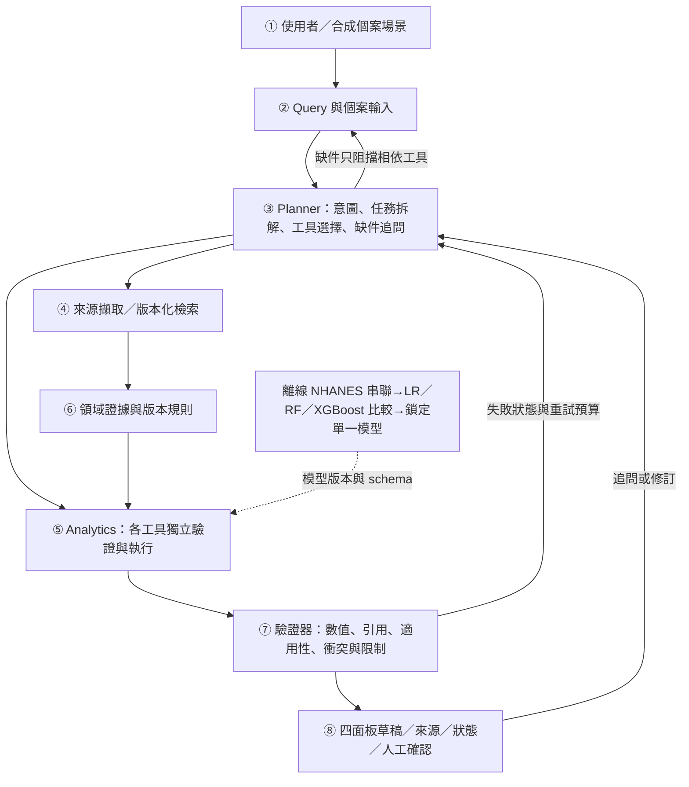
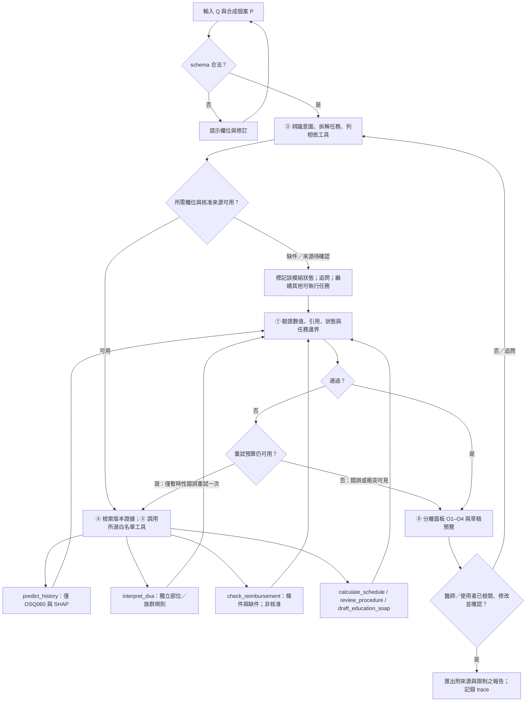

# 🦴 OsteoGuard AI Agent
## 基於 NHANES 自述骨鬆告知史分類與來源支援之骨健康管理智慧代理人

> **課程期末專題**：`AI Agent + Domain Knowledge + Data Analytics + Real-World Application`  
> **專案狀態**：🚧 Proposal（2026-11-22 修訂版）／待實作驗證（NHANES 3,530 人有效標籤樣本盤點已完成，模型與 Agent 效能尚待實作量測）

---

## 📌 快速導覽（Documentation Navigation）

本儲存庫包含期中 Proposal 階段與後續系統開發之核心文件：
- 📄 **[PROPOSAL.md](./PROPOSAL.md)**：完整專題提案書（2026-11-22 修訂版；含 A–F 結構摘要與緒論、AI + Domain Related Work 與文獻彙整表、Deep Research 三大核心問題、①–⑧ 系統架構、Flowchart、38 行 Pseudocode、24 個合成案例驗收規格與 15 篇核實參考文獻）。
- 📐 **[DESIGN.md](./DESIGN.md)**：系統工程與架構設計規格書（已對齊 `PROPOSAL.md`，涵蓋 `Problem → Requirements → Architecture → Components → Data → AI/Analytics → Domain Knowledge → Algorithm → Implementation → How to Run → Evaluation & Limitations`）。

---

## 📖 專案簡介（Overview）

台灣高齡化使骨健康資訊整合與長期追蹤日益重要；內政部統計指出，2025 年 10 月底台灣 65 歲以上人口占比為 19.9%。骨鬆照護涵蓋骨密度評估、治療追蹤與衛教，骨科（Orthopedics）、神經外科（Neurosurgery）醫師及個案管理人員在日常門急診實務中，需同時整合 DXA 報告、病史、健保第 5.6 節給付規定、用藥日期與衛教資訊。然而現有資訊分散於報告、病歷與規範文件，單一模型分數或自由生成的回答，難以完整處理來源版本、缺件及人工確認。

本專題提出 **OsteoGuard AI Agent**，定位為供骨科、神經外科醫師及個案管理人員使用之**證據導向資訊整合與輔助決策原型（CDSS）**（病患僅透過醫療人員檢閱後的圖卡取得資訊）。系統採**任務分離與受限工具白名單架構**：
- **研究分析與規則執行分離**：以 `NHANES 2017–March 2020` 串聯資料建立可重現之 `OSQ060`「自述曾被醫師告知骨鬆」分類參考（`p_history` + SHAP）；有效部位 DXA 判讀、版本化健保第 5.6 節條件核對、已確認醫囑之曆月追蹤時間軸與術式相關複查清單則由獨立且確定性的程式工具分別處理，不混成單一風險分數，亦不由告知史模型輸出個人骨折或內固定失敗機率。
- **人機協作與來源治理**：由受限 Agent 依查詢拆解任務、追問缺件、透過版本化檢索取得核准來源，經驗證器檢核數值、引用與任務邊界後，產出分離的 `O1–O4` 四面板與附來源草稿，強制經**人工修改與確認（Human-in-the-Loop）**後始可匯出。

---

## 🎯 核心研究脈絡（A–F）— 痛點假設、功能與證據邊界

### 1. 研究動機與背景（Attention Getter & Background）
- **高齡社會背景**：2025 年 10 月底台灣 65 歲以上人口占比達 19.9%；骨鬆長期照護需要跨科整合骨密度、病史、給付條文與用藥時程。
- **公開研究資料與指引依據**：NHANES 官方提供 50 歲以上受試者的股骨 DXA 及骨鬆問卷資料，支持公開資料分析研究；ISCD 2023 區分骨密度診斷分類與骨折風險評估，支持將模型分類與臨床 DXA 判讀分開解釋。
- **證據邊界聲明**：上述來源不直接證明台灣外科場域之漏診率或轉介現況；下述臨床工作流需求在本期視為**設計假設**，實際需求強度、工時節省、核扣改善與照護效益仍須另做場域研究。

### 2. 五項需求痛點、本期功能與不能據此宣稱的成效（Problem & Boundaries）
| 需求／痛點假設 | 本期功能 | 本期不能據此宣稱的成效 |
| :--- | :--- | :--- |
| 1. 急門診資料分散，需人工複查 | 顯示缺件、使用者註記與人工複查待辦 | 自動辨識微小壓迫骨折（如 Genant Grade 1）、轉移瘤或降低漏診 |
| 2. 健保第 5.6 節給付條件與文件核對繁複 | 版本化規則核對、條號、缺件與待確認事項清單 | 保證給付核准或避免健保核扣 |
| 3. 衛教與病歷整理反覆（含牙科 MRONJ 溝通） | 附來源的白話衛教圖卡草稿、牙科照會確認問題與 SOAP 草稿 | 提升遵從性、信任度或節省既定工時 |
| 4. 跨科追蹤與回診日期難整合 | 既有確認醫囑之曆月時間軸與追蹤待辦 | 已降低流失率或改善跨科轉介率 |
| 5. 圍術期骨質資訊需整理（脊椎與關節手術） | 依術式顯示骨質評估複查清單與適用指引來源 | 輸出個人螺釘鬆脫機率、選擇術式或決定延後手術 |

### 3. 解決方案與分工定位（Cure — Agent vs. 固定規則）
- **固定規則程式**適合閾值、條件與日期計算，但自然語言需求需額外解析與互動設計；規則仍是本系統的重要元件。
- **表格模型（LR / RF / XGBoost）**可分析既定 X 與 `OSQ060` 告知史的統計關聯，無法憑橫斷面告知史回答影像病灶、未來骨折或手術結果。
- **OsteoGuard AI Agent（雙層分工）**：讓受限 Planner 依自然語言查詢拆解任務、選擇白名單工具（最多 8 個 task）、追問缺件並組織證據；數值推論（單一鎖定模型）、ISCD DXA 閾值、版本化健保條件、曆月排程與術式複查清單則交由獨立程式工具執行，並將與固定工作流、無檢索 LLM 草稿在相同 24 個合成案例下比較完成率與穩定性。

### 4. 研究方法（Development）
- **資料來源**：串聯 `NHANES 2017–March 2020` 四份 XPT（`P_DXXFEM`、`P_DEMO`、`P_BMX`、`P_OSQ`），並整合衛生福利部中央健康保險署公開《藥品給付規定》第 5.6 節（PDF 第 15–17 頁）及國際指引（ISCD 2023、AAOMS 2022、CNS 2021、Endocrine Society 2019、BHOF 2022）。
- **模型與可解釋性**：離線以相同切分比較 `Logistic Regression`、`Random Forest` 與 `XGBoost` 預測 `OSQ060`，依驗證集 PR-AUC（Average Precision, AP）選定單一模型鎖定供線上參考，搭配 `SHAP` 解釋模型分數，不將歸因當作因果或健康程度。
- **RAG 與來源治理**：核准來源依 `clinical / reimbursement / data_definition` 分類、記錄 `sha256` 與有效日期，先依種類／藥品／有效日過濾再以 BM25＋向量檢索，且不將檢索文件內任何潛在提示視為工具指令。

---

### 本期功能優先序
| 優先序 | 痛點 | 預計產出 | 排序理由 |
| :---: | :--- | :--- | :--- |
| 1 | 衛教反覆與文件整理 | 白話圖卡、醫病溝通建議、SOAP／申報摘要草稿 | 可行性高、需求跨情境，內容可由組員核對。 |
| 2 | 健保條件核對繁複 | 版本化條件卡、缺件與待確認清單 | 重要性高，須先依正式現行條文建立規則。 |
| 3 | 回診與跨科追蹤斷層 | 用藥時間軸、預定日期與追蹤待辦 | 日期可內部測試，真實追蹤成效需長期觀察。 |
| 4 | 圍術期骨質管理 | 術式相關評估提醒與指引來源 | 本期可做規則提醒，沒有手術結局標籤。 |
| 5 | 可疑骨折與漏評線索 | 病史統整、補件與人工複查提示 | 臨床重要但影像／鑑別資料不足，進階辨識延後。 |

依重要性與可行性質性排序，並非經臨床調查取得的分數。模型訓練與統計圖表為共同研究基礎，先行完成；不以 `OSQ060` 分類模型證明上述功能的臨床成效。

---

## 🏗️ 系統架構圖（System Architecture ①–⑧）

本系統依據 `PROPOSAL.md` 第 5.1 節設計 **①–⑧ 核心模組控制架構**（輸出四面板另以 `O1–O4` 表示，避免混用）：



---

## 🔄 AI Agent 運作流程圖（Workflow）

包含 Schema 驗證、動態工具路由（8 個白名單工具）、缺件隔離、驗證器重試上限與人工確認匯出把關：



*(註：完整 ①–⑧ 模組說明、8 個工具契約與 38 行含行號 Pseudocode，請參閱 [PROPOSAL.md](./PROPOSAL.md) 第 5 節與 [DESIGN.md](./DESIGN.md) 第 4 & 8 節)*

---

## 🧪 實驗設計與預期成果（Experiments & Expected Outcomes）

| 項目 | 規劃內容 |
| :--- | :--- |
| **Dataset** | NHANES 2017–March 2020（`P_DXXFEM` 4,593 → 有效掃描 3,545 → 50 歲以上且 `OSQ060` 有效標籤 **3,530 筆**［380 陽性／3,150 陰性］；體測完整敏感度子集 3,511 筆）+ 健保署公開藥品給付規定 |
| **Baseline Models** | Logistic Regression、Random Forest、XGBoost（相同分層 80/20 保留測試、訓練內 Stratified 5-fold、20 組 RandomizedSearch、`seed=42`） |
| **Evaluation Metrics** | 主要指標 **PR-AUC（Average Precision, AP）**，另報陽性 Precision／Recall／F1、Macro-F1、Accuracy、ROC-AUC、Brier score 與校準圖（1,000 次分層 Bootstrap 95% CI） |
| **Agent 功能驗收** | **24 個預寫合成案例（A01–D06）**＋固定工作流／無檢索 LLM／受限 Agent 三條件 × 3 次重複（72 次執行）比較；路由與端到端目標 $\ge 22/24$、數值／日期與關鍵引用 100% 一致 |
| **應用展示與限制** | 僅作合成案例與內部展示；期末不安排專業人員回饋，不宣稱臨床驗證、信任或工時節省 |

### 三階段驗證與預期產出
- **第一階段：資料盤點與 ML 模型比較**：已完成本地 3,530 筆有效樣本盤點（`PROPOSAL.md` 第 6.1 節）。後續比較人口學基準、+BMD、+BMC/Area、+部位比值四組特徵增益與 OOF F1 閾值／Sigmoid 校準表現，選定單一模型鎖定供線上參考，搭配 SHAP 說明歸因與誤分類案例。
- **第二階段：Agent 內部功能測試（A01–D06）**：覆蓋 A 類（模型／DXA 任務分離與品質碼）、B 類（健保版本與衝突狀態）、C 類（曆月月底截斷如 `2026-08-31` + 6 月 $\rightarrow$ `2027-02-28`）、D 類（術式排除、`THA/TKA` 不出椎弓根螺釘提醒、Prompt Injection 防護與未確認匯出阻擋）。
- **第三階段：模擬臨床情境展示**：由組員以合成案例操作四面板 `O1–O4`、檢視 `trace`、失敗狀態與人工修改確認流程。

---

## 🛠️ 技術架構、專案目錄與執行規劃（Tech Stack & How to Run）

### 技術堆疊（Tech Stack）
- **資料處理與科學計算**：`Python`, `Pandas`, `NumPy`
- **機器學習與可解釋性 AI**：`Scikit-Learn`, `XGBoost`, `SHAP`
- **AI Agent 與檢索治理**：`LangChain` / LLM API, `BM25 + Vector Retrieval`, JSON Schema Validator
- **前端互動介面**：`Streamlit`

### 專案目錄規劃（對齊 `DESIGN.md` 第 9 節）
```text
nchu-bone-health-agent/
├── README.md                   # [現有] 專題總覽與規格導覽（本文件）
├── PROPOSAL.md                 # [現有] 2026-11-22 修訂版完整 Proposal
├── DESIGN.md                   # [現有] 系統工程與架構設計規格書
├── data/raw/                   # [現有] NHANES 2017–2020 原始 XPT（P_DXXFEM, P_DEMO, P_BMX, P_OSQ）
├── scripts/                    # [規劃] 樣本盤點（audit_proposal_data.py）與實驗腳本
├── src/                        # [規劃] schemas, data_processor, ml_models, explainability, tools, retrieval, validator, agent
├── tests/                      # [規劃] 單元測試與 24 個合成案例驗收測試（A01–D06）
├── output/                     # [現有/規劃] 提案 PDF/PPTX；後續存放盤點 JSON、模型圖表與驗收紀錄
└── app.py                      # [規劃] Streamlit 四面板（O1–O4）預覽、修改與人工確認介面
```

### 快速啟動（規劃流程 — 待實作完成後執行）
```bash
# 1. Clone 儲存庫並建立環境
git clone <YOUR_GITHUB_REPO_URL>
cd nchu-bone-health-agent
pip install -r requirements.txt

# 2. 設定環境變數
cp .env.example .env

# 3. 重建盤點、訓練鎖定模型、執行 24 例驗收並啟動介面
python scripts/audit_proposal_data.py
python -m src.ml_models
pytest tests/
streamlit run app.py
```

---

## 🔍 設計收斂紀錄（從初版草稿到 2026-11-22 修訂版之 7 項關鍵決策）

對照《期末專題提案作業規範》與實證嚴謹度要求，本專題已完成以下 7 項關鍵設計收斂（詳見 [PROPOSAL.md](./PROPOSAL.md)）：

1. **🎯 標籤邊界與任務分離**：明確採用 `OSQ060`（自述曾被醫師告知骨鬆）作為 ML 監督學習標籤 $Y$（3,530 筆），輸出命名 `p_history`；嚴格排除 `OSQ060`、`OSQ072` 及診斷／治療史以防資料洩漏，並將 `p_history` 與臨床 ISCD DXA 判讀、骨折風險完全分離，避免被質疑「已知 T-score 為何還要 ML」。
2. **📚 Related Work（15 篇核實來源，約 1/2 AI + 1/2 Domain）**：已於 `PROPOSAL.md` 第 3 及第 8 節對齊真實來源，包含 AI 技術（`MedAgentBench` 2025、`SHAP` 2017、`XGBoost` 2016、`Huang et al.` 2025、`ReAct` 2023、`RAG` 2020）與領域知識（`CDC P_DXXFEM / P_OSQ` 2021、`ISCD Adult Positions` 2023、`AAOMS MRONJ` 2022、`CNS 脊椎術前評估指引` 2021、`Endocrine Society` 2019、`BHOF` 2022、健保署第 5.6 節及內政部高齡統計 2025）。
3. **🧠 Deep Research（5 個核心思維 + 3 個專業爭論 + 10 個深度問題）**：已收斂於 `PROPOSAL.md` 第 4 節，涵蓋標籤界定、部位／族群先於閾值、SHAP 非因果邊界、臨床與給付依據分離、人工確認責任邊界及 10 題口試防禦邏輯。
4. **🔢 ①–⑧ 模組架構、Flowchart 與 38 行 Pseudocode**：統一 `PROPOSAL.md` 與 `DESIGN.md` 之工具白名單架構、拓撲依賴執行與不變條件（`DXA_result` 不依賴 `p_history`、`THA/TKA` 不出螺釘提醒、無人工確認不匯出）。
5. **🗄️ 混合知識治理（確定性規則引擎 + 版本化 RAG）**：健保第 5.6 節條件樹與曆月排程交由人工核對後之結構化規則執行；RAG 僅負責版本化條文／指引檢索並記錄 `sha256` 與生效日，不從片段臨時創造給付規則，亦不將文件內容當作工具指令。
6. **🧪 24 個預寫合成案例驗收（A01–D06）**：涵蓋模型／DXA、健保版本與衝突、曆月截斷日期、術式排除、Prompt Injection 防護與人工確認邊界，取代僅憑主觀感受評估聊天流暢度。
7. **👥 團隊成員分工與開發落地**：待組員確認負責模組並依 `DESIGN.md` 第 9 節推進實作。

---

## 🏥 臨床決策支援系統（CDSS）規格與健保法規對照

> **規格定位說明**：以下定義 `O1–O4` 四面板互動介面、輸入規格、版本化健保第 5.6 節核對原則與曆月排程規則；[archive/ui_mockup_dashboard.jpg](./archive/ui_mockup_dashboard.jpg) 僅為早期概念草圖，新版實作依本節與 `PROPOSAL.md` 第 7 節 schema 為準。

### 1. 📥 輸入規格與模型／規則分工（Input Specification）
離線訓練與線上模型參考共用年齡、性別、身高、體重、BMI、股骨四區（Total Femur / Femoral Neck / Trochanter / Intertrochanter）之 BMD／BMC／Area 與比值；`OSQ060` 僅作訓練 `Y`。**大轉子／轉子間僅作模型特徵，不進臨床 DXA 診斷規則**。術式枚舉（`spinal_fusion / vertebroplasty / THA / TKA / ORIF / outpatient_followup`，需人工確認）、停經狀態、有效部位 T/Z-score（ISCD 2023 僅適用已確認停經後婦女或 50 歲以上男性）、骨折／共病史、用藥成分／劑型／品項與 ISO 8601 日期（Asia/Taipei）另供獨立規則與草稿使用，未知與否定分開，欄位空白不當作「沒有病史」。

---

### 2. 💊 台灣健保《藥品給付規定》第 5.6 節版本化核對與排程原則
- **官方來源與版本治理**：採衛福部健保署「最新版藥品給付規定內容（分章節）」第 5.6 節 PDF 第 15–17 頁（2026-11-22 查閱入口標示 115.08.21 更新，PDF 另載 5.6.1 之 115/9/1 與 5.6.3 之 115/8/1 修訂）。**網站更新日期不等於各條生效日**；未知生效日或待核對規則預設 `pending`，不可用於「條件相符」輸出。

| 條號／來源定位 | 本期結構化欄位與核對重點 | 嚴格邊界與排程原則 |
| :--- | :--- | :--- |
| **5.6.1 抗骨質再吸收劑**<br>*(PDF 第 15–16 頁)* | 藥品／劑型／品項、性別／停經、有效 DXA、骨折事件、共病及必要檢驗 | • **未骨折高風險條件不可概括套用所有抗吸收藥**；品項例外須保留。<br>• **排程採曆月／曆年加法**（月底截斷並保留原基準日，**不寫為 180 天**）；Denosumab 中斷需後續治療僅作指引提醒供團隊檢視，不自行賦予高危等級或決定停藥日。 |
| **5.6.2 副甲狀腺素類似劑**<br>*(PDF 第 16–17 頁)* | 適用族群、DXA、骨折／不耐受／既往療程及數量期間限制 | • 保存條件原句與 AND／OR 結構，歧義轉人工。<br>• **給付數量上限不等於自動換藥日**。 |
| **5.6.3 抑硬化蛋白單株抗體**<br>*(PDF 第 17 頁)* | 停經、DXA、事件時間窗／新骨折與既往用藥、數量期間限制與禁忌症 | • **與其他藥物互換限制及例外逐項核對**，不寫成絕對終生不得互換。<br>• 條件卡輸出限「條件相符（仍待醫師及正式審查）／條件不符／資料不足／來源待確認」，不得顯示「核准」。 |

---

### 3. 📤 系統四大結構化輸出面板（O1–O4 Output Specification）
以清楚的來源、數值、SHAP 解釋、缺件與限制提示支持人工判斷；未經人工檢閱與確認不得匯出確認版報告，且不宣稱已串接正式 HIS 或申報系統：

1. **O1 研究與 DXA 結果**：分列 `p_history` + SHAP 歸因、有效部位 DXA 判讀（ISCD 2023 適用族群限制），以及依人工確認術式產出之複查待辦（僅 `spinal_fusion` 且具適用來源時顯示脊椎與螺釘相關複查項，`THA/TKA` 排除椎弓根螺釘提醒；不產生單一綜合風險分數或螺釘失敗機率）。
2. **O2 給付條件卡**：逐條列條號、來源、生效版本、符合／不符／待確認狀態與缺件清單；來源未核實時標示 `source_unverified`，不用 LLM 自行補成符合。
3. **O3 時間軸**：顯示已確認醫囑之曆月追蹤日期、行政回診與待檢視療程節點；若需更改治療，轉為醫師待辦，不自行決定藥物或停藥／換藥日。
4. **O4 SOAP／衛教草稿**：基於可支持的工具結果與核准文件轉譯，列牙科 MRONJ 照會確認問題（依 AAOMS 2022，不提供固定停藥或拔牙安全窗口）及衛教確認事項；未有適用營養／運動指引時僅列待討論事項，不自動產生固定補充劑量或運動處方。

---

## 👨‍👩‍👧‍👦 團隊成員與分工（Team Members）

| 姓名 | 學號 | 負責角色與模組（待討論填寫） |
| :--- | :--- | :--- |
| 賴武平 | `待填寫` | 待討論 |
| 李珮華 | `待填寫` | 待討論 |
| 林庭弘 | `待填寫` | 待討論 |

指導老師：陳煥 教授