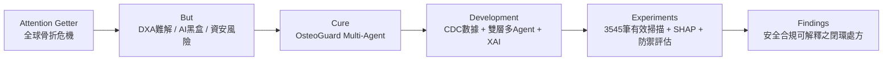
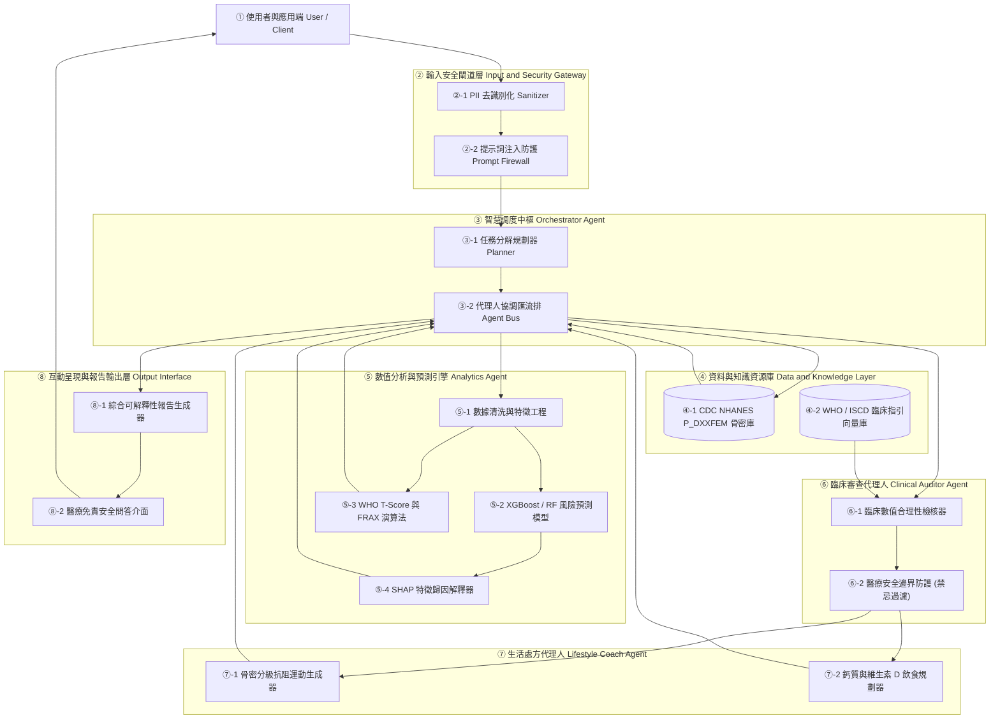

# 🦴 OsteoGuard AI Agent
### 基於多代理人協同架構與 NHANES 骨密度資料之骨質疏鬆健康管理與資安決策系統
> **國立中興大學 (NCHU) — 人工智慧與資訊安全期末專題提案**  
> **Core Concept：AI Agent + Domain Knowledge + Data Analytics + Information Security & Real-World Application**

---

## 📌 專案快速導覽 (Navigation)

* 📄 **[PROPOSAL.md (完整專題提案報告)](file:///Users/leolin/NCHU/nchu-ai-master/courses/人工智慧與資訊安全/Midterm/PROPOSAL.md)**：包含 A–F 完整 Abstract、Introduction、2025–2026 文獻摘要表、三大 Deep Research（5 大專家思維、3 大爭論、10 個深度問題）、八步驟系統架構、流程圖與帶行號 Pseudocode。
* 📐 **[DESIGN.md (系統架構與演算法規格書)](file:///Users/leolin/NCHU/nchu-ai-master/courses/人工智慧與資訊安全/Midterm/DESIGN.md)**：包含模組規格、資料規格（CDC `P_DXXFEM.XPT`）、資安防禦層（Prompt Injection / PII 脫敏）與執行指引。
* 📋 **[作業要求.md (期末專題提案作業規範)](file:///Users/leolin/NCHU/nchu-ai-master/courses/人工智慧與資訊安全/Midterm/作業要求.md)**：課程評分標準與繳交規範。
* 📝 **[readme1.md (原始草稿對照)](file:///Users/leolin/NCHU/nchu-ai-master/courses/人工智慧與資訊安全/Midterm/readme1.md)**：保留同學原版草稿作為對照參考。

---

## 📖 專案故事 (The Project Story)



* **A. Attention Getter (研究動機)**：骨質疏鬆為全球第二大流行病，髖部骨折一年內致死率高達 20%–24%。本專題基於美國 CDC NHANES 2017–2020 預發布之真實雙能量 X 光吸收儀股骨檢測資料集（`P_DXXFEM.XPT`），針對高齡骨骼健康管理展開深入研究。
* **B. But (痛點與挑戰)**：DXA 報告難懂、高達 50% 骨折常發生於「骨質減少」隱性盲區；且傳統 AI 預測模型為不可解釋之黑盒子，通用 LLM 更面臨嚴重的提示詞注入（Prompt Injection）攻擊與致命醫療幻覺風險。
* **C. Cure (解決方案)**：提出 **OsteoGuard Multi-Agent System**，結合數值分析、臨床指南審查、個人化處方生成與資訊安全防護閘道，建立全方位骨骼健康守護體系。
* **D. Development (核心研發)**：
  * **Analytics Agent**：處理 `P_DXXFEM.XPT` 骨密度與面積特徵，利用 XGBoost 與臨床 T-score 進行風險預測，並透過 SHAP 解析特徵歸因。
  * **Clinical Auditor Agent**：依據 WHO/ISCD/NOF 指引進行臨床合理性校驗，並實施禁忌動作過濾。
  * **Lifestyle Coach Agent**：動態生成符合安全的負重阻力運動與高鈣飲食計畫。
  * **Security Gateway**：提供提示詞注入防禦與 PII 去識別化。
* **E. Experiments (實驗與評估)**：3,545 筆有效掃描資料，以 Stratified K-Fold 評估 AUC、F1-Score，並進行 SHAP 特徵一致性檢驗與資安對抗攻擊防禦率測試。
* **F. Expected Outcomes (預期成果)**：實現兼具「高預測力、臨床可解釋性、嚴格資訊安全與精準個人化處方」的閉環智慧醫療 Agent。

---

## 🏗️ 系統架構圖 (Multi-Agent Architecture)

各模組依據作業規範以 **①②③… 編號**：



---

## 📊 核心資料集規格 (CDC NHANES P_DXXFEM)

* **官方資料集連結**：[CDC NHANES 2017-March 2020: P_DXXFEM](https://wwwn.cdc.gov/Nchs/Data/Nhanes/Public/2017/DataFiles/P_DXXFEM.htm)
* **本地檔案**：[P_DXXFEM.XPT](file:///Users/leolin/NCHU/nchu-ai-master/courses/人工智慧與資訊安全/Midterm/P_DXXFEM.XPT)
* **樣本規模**：總受試者 4,593 人，有效掃描（`DXAFMRST = 1`）共 3,545 筆。
* **關鍵骨骼特徵**：
  * `DXXOFBMD` / `DXXOFBMC` / `DXXOFA`：總股骨骨密度、骨礦物質含量、骨面積
  * `DXXNKBMD` / `DXXNKBMC` / `DXXNKA`：股骨頸骨密度（WHO 診斷主特徵）、含量、面積
  * `DXXTRBMD` / `DXXINBMD` / `DXXWDBMD`：大轉子、轉子間、華氏三角骨密度

---

## 🛡️ 資訊安全與醫療邊界防禦亮點

為呼應「人工智慧與資訊安全」課程主軸，本專案實施三大資安防護：
1. **Prompt Injection 防火牆**：嚴格偵測並防禦越獄指令（Jailbreak），防止模型被誘導充當密醫或開立管制止痛藥。
2. **敏感隱私資料脫敏（PII Sanitization）**：遵循 HIPAA 醫療隱私準則，阻絕身分識別資訊進入雲端。
3. **醫療禁忌硬性防呆（First-Do-No-Harm Guardrail）**：`Clinical Auditor Agent` 具備一票否決權，嚴禁對骨鬆個案推薦高衝擊跳躍與脊椎劇烈屈曲動作。

---

## 💻 快速開始 (Quick Start)

### 1. 安裝環境相依套件
```bash
pip install pandas numpy scikit-learn xgboost shap streamlit langchain langchain-openai
```

### 2. 檢視與執行專案
```bash
# 執行資料集前處理與檢驗
python -c "import pandas as pd; df = pd.read_sas('courses/人工智慧與資訊安全/Midterm/P_DXXFEM.XPT'); print('有效掃描筆數:', (df['DXAFMRST'] == 1).sum())"

# 啟動展示介面 (開發完成後)
streamlit run app.py
```

---

## 👨‍🏫 課程資訊
* **開課課程**：國立中興大學 (NCHU) — 人工智慧與資訊安全
* **專題名稱**：OsteoGuard AI Agent
* **階段**：期末專案提案 (Final Project Proposal - 10%)
