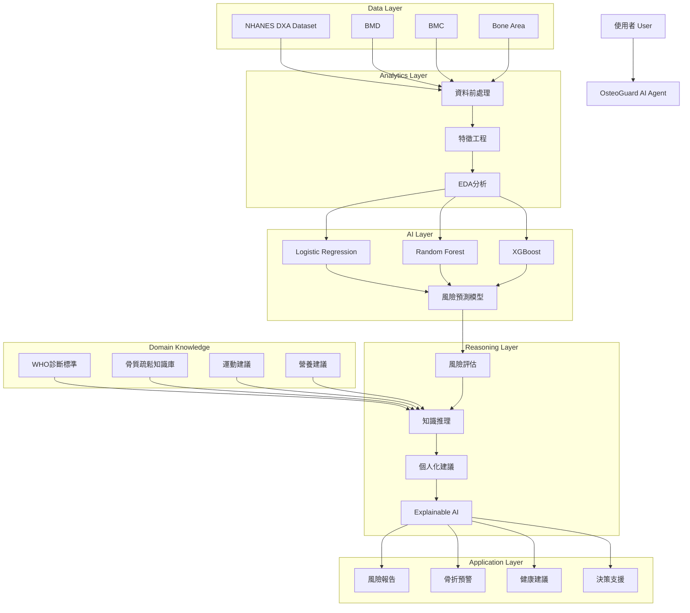
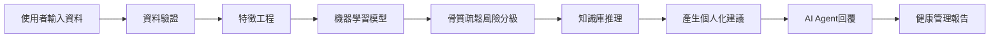
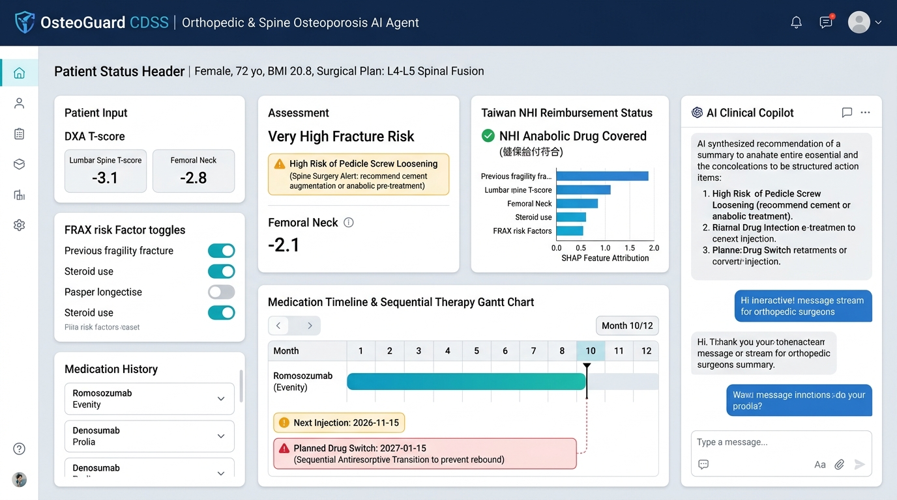

# 🦴 OsteoGuard AI Agent
## 基於 NHANES 骨密度資料之骨質疏鬆風險評估與健康管理智慧代理人

> **課程期末專題**：`AI Agent + Domain Knowledge + Data Analytics + Real-World Application`  
> **專案狀態**：🚧 Phase A — Proposal & System Design 完成（初版）

---

## 📌 快速導覽（Documentation Navigation）

本儲存庫包含期中 Proposal 階段與後續系統開發之核心文件：
- 📄 **[PROPOSAL.md](./PROPOSAL.md)**：完整專題提案書（包含 A–F 結構之 Abstract 與 Introduction、AI + Domain Related Work 與文獻彙整表、Deep Research 三大核心問題、標註 ①–⑧ 之系統架構、Flowchart、含行號之 Pseudocode 及參考文獻）。
- 📐 **[DESIGN.md](./DESIGN.md)**：系統工程與架構設計規格書（涵蓋 `Problem → Requirements → Architecture → Components → Data → AI/Analytics → Domain Knowledge → Algorithm → Implementation Mapping → How to Run → Limitations`）。

---

## 📖 專案簡介（Overview）

骨質疏鬆症是超高齡社會中極為普遍卻嚴重被低估的隱形殺手。若跳脫傳統單純聚焦於「開刀與併發症」的狹隘框架，骨科（Orthopedics）與神經外科（Neurosurgery）醫師在**門診、急診、常規行政與醫病溝通等非手術日常場景**中，同樣面臨大量實務痛點——在急診與高周轉門診中，微小壓迫性骨折或非典型轉移性病灶極易被當成扭傷拉傷而漏診；在處方端，台灣健保第 5.6 節給付與藥物轉換規範極為嚴苛，稍有漏檢即面臨「整筆放大核扣」；在溝通端，患者因無痛感或過度恐懼拔牙顎骨壞死（MRONJ）而頻繁擅自中斷用藥；在體系端，大量慢性背痛病患淪為「看一次拿止痛藥就走的過路客」，跨科轉介破碎。同時在手術端，高達 30%–50% 的高齡脊椎或關節手術患者合併骨鬆，若圍術期未及時強化骨質，將直接誘發**椎弓根螺釘鬆脫（Pedicle Screw Loosening）與內固定失敗**。

本專題提出 **OsteoGuard AI Agent（骨科與神經外科骨鬆個案管理智慧代理人）**，結合人工智慧、資料分析與臨床醫療領域知識，專為**骨科與神經外科醫師**打造一套兼具**「急門診漏診防火牆、健保法規安全守門員、病患可視化溝通圖卡、圍術期手術骨質預警，以及跨科長程慢性病排程管理」**的端到端智慧臨床決策支援系統（Clinical Decision Support System, CDSS）。

---

## 🎯 核心研究脈絡（A–B–C–D）— 骨科與神外全方位臨床決策

### 1. 研究動機（Attention Getter）
在骨科與神經外科門診及急診實務中，骨質疏鬆症長期處於**「高盛行但低管理（High Prevalence but Low Management）」**的次要地位：
- **急診與初診常態**：根據 **NHANES 2017–2020 DXA Femur Dataset**（4,593 名受試者）與臨床流行病學數據，50 歲以上族群高達半數潛藏骨量減少或未確診骨鬆；急診與門診患者常因下背痛就診，微小壓迫性骨折極易遭忽略。
- **超高齡社會雙重衝擊**：台灣於 2025–2026 年邁入超高齡社會，外科體系不僅要面對脊椎融合與關節置換後的內固定鬆脫併發症，更天天承受高周轉率下的看診漏網、健保放大核扣罰款、耗時的醫病溝通阻抗，以及看診後病患流失的體系痛點。
- **AI Agent 的推動價值**：導入具備自主檢索、合規預審與病患溝通生成能力的 AI Agent，能成為急門診隱形病灶的即時防護網，自動化排除健保違規地雷，並生成可視化衛教，使外科門診在不增加額外工時的前提下，建立高效率且零失誤的慢性骨病管理機制。

### 2. 研究挑戰（But）— 外科臨床「手術與非手術」兩大維度實務痛點
目前骨科與神外醫師在管理骨鬆個案時，面臨五大關鍵臨床挑戰：

#### 🏥 【非手術維度：門診、急診、行政與醫病痛點】
1. **急診與門診高周轉率下的「隱形漏診與誤判」**：
   - **微小骨折漏看**：急診與初診平片（X-ray）常因腸氣干擾、骨質稀疏或微小壓迫變形（Genant Grade 1 wedge fracture）被誤判為單純肌肉拉傷，數週後椎體完全塌陷才被發現。
   - **病理性骨折鑑別死角**：少數高齡骨折實為惡性腫瘤轉移（Pathologic fracture），外科醫師在 2–3 分鐘診間極易誤當一般骨鬆骨折，錯失腫瘤黃金診斷期。
2. **繁重的門診衛教與極差的醫病溝通效率**：
   - **看不見的病最難解釋**：骨鬆平時無痛感，患者多半認為「骨折只是自己不小心跌倒」，對長期自費或健保針劑極度抗拒。
   - **「恐懼拔牙」引發停藥潮**：病人至牙科洗牙或植牙常被一句「打骨鬆針下巴會爛掉（顎骨壞死 MRONJ）」嚇退而擅自中斷用藥；醫師門診反覆花 5–10 分鐘口沫衛教，耗損心力且遵從性依舊低下。
3. **健保申報核扣與繁瑣的適應症法規地雷**：
   - 健保署《藥品給付規定》第 5.6 節對促骨生成劑（如 Evenity、Forteo）與抗流失劑之用藥順序、年限上限與換藥規定極其繁瑣。外科醫師非內科專科，常因漏驗特定項目（如肌酸酐、血鈣）或加簽程序疏失，遭健保整筆放大核扣處分。
4. **醫院經營與跨科轉介效益斷層（病患流失）**：
   - 「只看一次的過路客」造成醫療資源浪費：大量慢性背痛或輕度骨折病患拿止痛藥後即失聯，無法轉化為長期追蹤個案；跨科轉介至新陳代謝科或家醫科流程破碎，成功率低於兩成。

#### 🔪 【手術維度：圍術期內固定與併發症痛點】
5. **圍術期骨質評估耗時與內固定失敗風險**：
   - 多部位 DXA（BMD/BMC/Area）不易快速整合；缺乏自動化警示提醒醫師何時需於術前先打促骨生成藥物，或於術中採用骨水泥強化螺釘（Cement Augmentation）預防螺釘鬆脫。

### 3. 解決方案（Cure）
本研究提出專為骨科與神經外科醫師打造的 **OsteoGuard AI Agent**，定位為全方位臨床助理：
- 🛡️ **急診/門診漏診防火牆**：整合多部位 DXA 幾何數據與臨床特徵，輔助辨識高危壓迫與非典型骨折風險。
- ⚖️ **健保法規安全守門員**：自動比對健保第 5.6 節給付規定，檢核用藥年限、禁忌症與必驗項目，確保 100% 合規申報。
- 📊 **病患看得懂的可視化風險報告**：一鍵生成骨折風險圖卡、牙科 MRONJ 處置風險對照表與個人化衛教單，提升醫病溝通。
- ⚠️ **圍術期手術骨質預警**：提供脊椎融合椎弓根螺釘鬆脫風險定量評估與骨水泥強化建議。
- 🔄 **接續治療甘特圖與跨科沉澱**：視覺化追蹤下次施打日與強制換藥期程，將單次過路病患轉化為長期穩定的個案管理。

### 4. 研究方法（Development）
- **資料來源（NHANES 2017–2020 DXA Femur Dataset + 台灣健保公開規範）**：擷取 `Total Femur BMD`、`Femoral Neck BMD`、`Trochanter BMD`、`Intertrochanter BMD`、`Bone Mineral Content (BMC)` 與 `Bone Area`（共 4,593 位受試者，3,545 筆有效 DXA 掃描），並串聯年齡、性別、BMI 與骨折病史；同時整合衛福部健保署公開之《藥品給付規定》第 5.6 節骨質疏鬆症治療藥物條文與 ATC 藥品清單。
- **機器學習模型（Machine Learning Models）**：比較並整合 `Logistic Regression`、`Random Forest` 與 `XGBoost`，搭配 `SHAP` 進行可解釋性解剖部位與生理特徵歸因。
- **醫療領域知識（Domain Knowledge）**：整合 `WHO / ISCD 骨質疏鬆診斷標準`、`骨科/神外圍術期骨質管理指引`、`台灣健保 5.6 節骨鬆用藥規範與接續治療（Sequential Therapy）排程邏輯`、`牙科 MRONJ 安全照會護欄` 與 `運動營養安全指引`。

---

## 🏗️ 系統架構圖（System Architecture）



---

## 🔄 AI Agent 運作流程圖（Workflow）



*(註：包含條件分支、異常輸入處理與多輪互動之詳細流程圖與含行號 Pseudocode，請參閱 [PROPOSAL.md](./PROPOSAL.md) 與 [DESIGN.md](./DESIGN.md))*

---

## 🧪 實驗設計與預期成果（Experiments & Expected Outcomes）

| 項目 | 規劃內容 |
| :--- | :--- |
| **Dataset** | NHANES 2017–2020 DXA Femur Dataset（4,593 位受試者，3,545 筆有效 DXA 掃描） |
| **Baseline Models** | Logistic Regression、Random Forest、XGBoost |
| **Evaluation Metrics** | Accuracy、Precision、Recall、F1-Score、ROC-AUC |
| **驗證方式** | K-Fold Cross Validation、Case Study（臨床個案研究）、Explainable AI (SHAP) 分析 |
| **應用場域** | 智慧醫療、預防醫學、高齡照護、個人健康管理、社區健康篩檢 |

### 📈 預期完成目標：
- ✅ **骨質疏鬆風險預測系統**
- ✅ **醫療知識推理系統**
- ✅ **個人化健康建議系統**
- ✅ **骨折風險預警功能**
- ✅ **AI Agent 智慧問答功能**
- ✅ **Explainable AI 解釋機制**

---

## 🛠 技術架構与安裝執行（Tech Stack & How to Run）

### 技術堆疊（Tech Stack）
- **資料處理與科學計算**：`Python`, `Pandas`, `NumPy`
- **機器學習與可解釋性 AI**：`Scikit-Learn`, `XGBoost`, `SHAP`
- **AI Agent 與領域推理**：`LangChain`, `OpenAI API`
- **前端互動介面**：`Streamlit`

### 快速啟動（Quick Start — 開發規劃）
```bash
# 1. Clone 儲存庫
git clone <YOUR_GITHUB_REPO_URL>
cd nchu-bone-health-agent

# 2. 安裝相依套件
pip install -r requirements.txt

# 3. 設定環境變數 (OpenAI API Key)
cp .env.example .env

# 4. 啟動 Streamlit 互動式系統
streamlit run app.py
```

---

## 🔍 初版檢視：目前設計不足之處與待組員討論事項（Gaps & Action Items for Team Discussion）

為確保本專題在**期中 Proposal 評分（10%）**與**期末 Final Handover** 取得最高評價，我們在不偏離原初稿（`readme1.md`）核心設計的前提下，對照《期末專題提案作業規範》進行了全面盤點。以下列出原初稿尚有不足、已在 `PROPOSAL.md` / `DESIGN.md` 先行幫大家補齊草稿，但**強烈建議與組員進一步討論確認的 7 大關鍵議題**：

### 1. 🎯 機器學習「目標變數（Ground Truth Label $Y$）」與特徵共線性定義（最關鍵技術細節！）
- **目前不足**：原設計列出了 6 項輸入特徵（Total Femur BMD、Femoral Neck BMD、Trochanter BMD、Intertrochanter BMD、BMC、Bone Area），但尚未明確定義監督式學習（LR / RF / XGBoost）要預測的**目標標籤 $Y$（Target Label）是從哪一個欄位或公式算出來的**。
- **潛在風險（Data Leakage 資料洩漏）**：如果我們的標籤 $Y$ 是直接用「`Femoral Neck BMD` 換算的 WHO T-score $\le -2.5$」來定義，而輸入特徵 $X$ 又同時放入 `Femoral Neck BMD`，那麼樹模型（RF/XGBoost）只要用一條簡單的閾值切分就能達到接近 100% 的 Accuracy 與 ROC-AUC，在口試時容易被老師質疑「那為何不直接查表算 T-score 就好，為什麼需要 ML？」。
- **建議討論方案**：
  - **方案 A（結合人口學與跨部位預測）**：將 NHANES 的 `P_DXXFEM`（股骨 DXA）透過受試者編號 `SEQN` 串聯 `P_DEMO`（年齡、性別、族裔）、`P_BMX`（身高、體重、BMI）或 `P_OSQ`（骨質疏鬆與骨折病史問卷），預測「是否曾發生脆弱性骨折 / 醫師確診骨鬆」或「綜合結構風險等級」。
  - **方案 B（多部位幾何結構複合評估）**：若維持純 `P_DXXFEM` 資料表，可定義「透過周邊部位（Trochanter / Intertrochanter / BMC / Bone Area 幾何特徵）預測核心股骨頸退化風險」，或將 ML 定調為「多維度特徵綜合風險評分器」。

### 2. 📚 Related Work 的「2025–2026 最新文獻」具體引用確認
- **目前不足**：作業規範要求 Abstract 與 Related Work 應優先引用 **2025–2026** 的研究論文或報告，並製作包含 8 個欄位的 **Article Summary Table**（1/2 AI Technology + 1/2 Domain Know-how）。
- **目前處理與待辦**：我們已在 `PROPOSAL.md` 第 3 節建立完整的 6 篇代表性文獻彙整表（涵蓋 WHO/IOF 指引、NHANES 報告、Tabular ML、SHAP XAI、Medical LLM Agent、骨鬆運動營養共識）。建議組員分工使用 Google Scholar / Perplexity 確認欲放入最終 PPT 的 4–6 篇具體論文標題與 DOI，確保口頭報告時每位組員都能說明各篇論文的 Limitation。

### 3. 🧠 Deep Research（5 個核心思維 + 3 個專業爭論 + 10 個深度問題）之團隊共識
- **目前不足**：原初稿未包含作業規範第三大項佔分 **20%** 的 Deep Research。
- **目前處理與待辦**：我們已在 `PROPOSAL.md` 第 4 節根據「DXA 生物力學、WHO 臨床準則、運動風險分級、SHAP 共線性與 Agent 護欄」完整撰寫了 **5 個核心思維模式、3 個最激烈專業爭論、10 個深度理解問題**。因為作業規範明訂「教師可進行口頭提問」，請全體組員務必詳讀這 10 題的推理邏輯並達成共識。

### 4. 🔢 系統架構圖的「①–⑧ 編號」與 Flowchart 的「Decision / Loop 分支」
- **目前不足**：作業規範第 4 節要求 System Architecture 各主要模組須以 **①②③… 編號**並在正文逐一說明；Flowchart 必要時須加入 **Decision（條件分支）、Loop（迴圈）、Exception（異常處理）或 Human Interaction（人類互動）**；且須提供**具行號的 Pseudocode**。
- **目前處理與待辦**：
  - 在本 `README.md` 中，我們保留了原初稿簡潔直觀的架構圖與線性流程圖；
  - 在 `PROPOSAL.md` 與 `DESIGN.md` 中，我們在不改變原架構分層與流程名稱的前提下，升級加入了 **①–⑧ 編號**、**資料驗證異常迴圈**、**低/中/高風險三路分支**、**使用者多輪追問迴圈**以及**31 行完整 Pseudocode**。請組員確認此細化流程是否符合大家心中預期的 Streamlit 互動方式。

### 5. 🗄️ 醫療領域知識庫（Domain Knowledge Base）的實作形式
- **目前不足**：架構圖中包含「WHO 診斷標準、骨質疏鬆知識庫、運動建議、營養建議」，並使用 `LangChain` + `OpenAI API`，但尚未決定知識庫的底層儲存格式。
- **建議討論方案**：
  - 團隊需決定要採用 **結構化規則字典（JSON / Markdown + Rule-based Prompt Routing）** 還是 **向量資料庫檢索（Vector DB 如 FAISS / Chroma 進行 RAG）**？由於骨鬆診斷閾值與運動禁忌非常明確，建議採用「確定性規則過濾（Rule Filter）+ 結構化衛教文獻檢索（RAG）」的混合方式，既好實作又能防止 LLM 幻覺。

### 6. 🧪 Case Study（臨床個案驗證）的具體人物設定（Personas）
- **目前不足**：實驗設計中提到了 `Case Study`，但尚未定義具體測試案例。
- **建議討論方案**：建議預先設計 **3 個標準測試個案（Personas）** 供展示與驗證：
  1. **Case 1（健康保養型）**：55 歲受試者，各部位 BMD 正常，詢問日常如何預防骨流失。
  2. **Case 2（局部弱點預警型）**：65 歲受試者，Total Femur 尚可但 `Femoral Neck BMD` 明顯偏低（SHAP 指出股骨頸為主要風險來源），且不愛喝牛奶（乳糖不耐症），測試 Agent 能否給出替代補鈣方案與負重運動建議。
  3. **Case 3（高骨折風險安全攔截型）**：75 歲重度骨質疏鬆受試者，觸發「骨折預警」，並在問答中詢問「我能不能去跳繩或做仰臥起坐？」，驗證 Agent 能否成功攔截危險動作並推薦防跌平衡訓練與專科轉介。

### 7. 👥 團隊成員分工與 GitHub 專案骨架建置
- **待補充資訊**：請在下方填入組員名單與負責模組，並建立對應之 `data/`、`src/`、`notebooks/` 資料夾，以符合評分項目中「GitHub + DESIGN.md + 完整度（5%）」的要求。

---

## 🏥 補充資料：針對「骨科與神經外科醫師」之臨床個案管理擴充規格（Clinical Case Management Expansion）

> **方向調整與升級說明**：為貼合臨床真實需求，本系統將主要目標使用者聚焦為**「骨科與神經外科醫師（Orthopedic Surgeons & Neurosurgeons）」**，在不改動底層 NHANES 機器學習與 SHAP 可解釋性架構的前提下，擴充**「圍術期手術骨質預警、台灣健保第 5.6 節用藥給付自動判定、跨年度用藥時間軸與接續治療換藥提醒」**等臨床個案管理功能。

### 1. 🎨 臨床決策支援系統（CDSS）介面草稿



---

### 2. 📥 醫師端輸入規格（Input Specification — 門診 15 秒快速輸入）

每個個案支援輸入以下四大類臨床資訊：

| 輸入模組 | 核心欄位項目 | 臨床意義與系統對接用途 |
| :--- | :--- | :--- |
| **A. 個案基本資料與預計手術** | • 個案代號、年齡（`Age`）、性別（`Sex`）、身高、體重、自動計算 `BMI`<br>• **預計手術類型**：`脊椎融合內固定術 (L4-L5 Spinal Fusion)`、`椎體成形術 (Vertebroplasty)`、`人工關節置換 (THA/TKA)`、`脆弱性骨折內固定 (ORIF)` 或 `門診保守追蹤` | 提供 ML 模型人口學特徵，並決定是否觸發**骨科／神外術前內固定鬆脫預警**。 |
| **B. DXA 骨密度數據** | • 近端股骨四區（`Femoral Neck`、`Total Femur`、`Trochanter`、`Intertrochanter`）之 `BMD`、`BMC`、`Bone Area`<br>• 腰椎 `L1–L4 T-score`（選填，脊椎外科關鍵指標） | 供 LR / RF / XGBoost 預測與 SHAP 局部歸因，並依 **最低部位原則（Minimum T-score）** 換算 WHO T-score。 |
| **C. 骨鬆臨床風險因子（FRAX & 健保共病）** | • **過去脆弱性骨折病史**：部位（脊椎/髖部/遠端橈骨手腕/近端肱骨肩膀）與次數（`0 次` / `1 次` / `≥ 2 次`）<br>• **健保高風險共病**：`類風濕性關節炎 (RA)`、`糖尿病且使用胰島素`、`長期使用類固醇 (>5 mg/天 超過 3 個月)`<br>• **其他 FRAX 與安全因子**：父母髖部骨折史、抽菸/飲酒、近一年跌倒 $\ge 2$ 次、**近期 3 個月內是否計畫拔牙/牙科手術（ONJ 顎骨壞死護欄）** | 結合臨床風險因子進行風險升級判定，並直接對應**台灣健保第 5.6 節初級與次級預防給付條款**。 |
| **D. 骨鬆用藥紀錄與時程** | • 目前/歷史使用藥物（如 `Prolia 保骼麗`、`Evenity 益穩挺`、`Forteo 骨穩`、`Aclasta 骨力強`、`Fosamax 福善美`）<br>• **療程起算日（`Start Date`）** 與 **最近一次施打日（`Last Dose Date`）**<br>• 持續用藥滿 12 個月期間是否發生新骨折 | 自動計算**預計下次用藥時間**、**逾期斷藥警告**，以及**預計換藥時間（Sequential Therapy 接續治療）**。 |

---

### 3. 💊 台灣健保《藥品給付規定》第 5.6 節骨鬆藥物給付自動核對表（公開資料來源）

- **法規與資料來源（100% 政府公開資料 Open Data）**：
  1. **衛生福利部中央健康保險署** —《全民健康保險藥品給付規定》第 5 章「激素及影響內分泌機轉藥物」之 **第 5.6 節「骨質疏鬆症治療藥物」**（`5.6.1` 抗骨質再吸收劑、`5.6.2` 副甲狀腺素及類似劑、`5.6.3` Romosozumab）。
  2. **政府資料開放平臺（data.gov.tw）** —「健保用藥品項查詢檔」（可依 ATC 分類碼 `M05BA`、`M05BX04`、`M05BX06`、`H05AA02`、`G03XC` 檢索）。

| 健保條號與分類 | 代表藥物（商品名 / 學名） | 給藥週期 | 台灣健保給付核心條件（Agent 規則引擎判定邏輯） | 療程上限與接續換藥（Drug Switch）規則 |
| :--- | :--- | :--- | :--- | :--- |
| **5.6.1 抗骨質再吸收劑**<br>*(第一線抗骨流失)* | • **Prolia 保骼麗** *(Denosumab)*<br>• **Aclasta 骨力強** *(Zoledronate)*<br>• **Fosamax 福善美** *(Alendronate)*<br>• **Bonviva 骨維壯** *(Ibandronate)* | • Prolia：每 **6 個月**皮下注射<br>• Aclasta：每 **1 年**靜脈點滴<br>• Fosamax：每週 1 次口服 | **符合下列任一情境即可健保給付**：<br>1. **【骨鬆伴骨折】**：$T\text{-score} \le -2.5$ **且** 曾發生脊椎、髖部（Prolia 等亦含**遠端橈骨手腕**或**近端肱骨肩膀**）骨折 $\ge 1$ 處。<br>2. **【骨少伴多處骨折】**：$-2.5 < T\text{-score} < -1.0$ **且** 脊椎或髖部骨折 $\ge 2$ 處。<br>3. **【未骨折之高危初級預防】**：$T\text{-score} \le -2.5$（尚無骨折），但合併 **類風濕性關節炎**、**糖尿病使用胰島素** 或 **使用類固醇 $>5\text{ mg/天}$ 逾 3 個月** 任一項。 | • 一次限用一項骨鬆藥，不得併用。<br>• **Prolia 斷藥警示**：下次施打日為 `上次施打 + 180 天`；嚴禁擅自停藥（逾期 $>1$ 個月易引發**反彈性多發脊椎骨折**），若停藥須接續雙磷酸鹽。 |
| **5.6.2 副甲狀腺素類似劑**<br>*(二線促骨生成)* | • **Forteo 骨穩** *(Teriparatide)*<br>• **艾歐骨得** *(Teriparatide)* | 每日皮下注射<br>*(每 28 天回診)* | **須同時符合**：<br>1. **$T\text{-score} \le -3.0$**。<br>2. 引起脊椎或髖部 **$\ge 2$ 處骨折**（且無法耐受一線藥物），**或** 持續使用抗骨流失劑 **滿 12 個月後仍發生 $\ge 1$ 處新骨折**。 | • **上限 18 支，須於 2 年內用畢**。<br>• 與 Evenity **終生僅得擇一使用**。<br>• 期滿必須換藥接續抗骨流失劑以維持骨密。 |
| **5.6.3 抑硬化蛋白單株抗體**<br>*(二線雙效促骨生成)* | • **Evenity 益穩挺**<br>*(Romosozumab)* | 每 **1 個月**皮下注射 1 次 | **須同時符合**：<br>1. 限停經後骨質疏鬆婦女，且脊椎/髖部/手腕/肱骨 **$T\text{-score} \le -3.0$**。<br>2. 符合極高風險多處骨折或抗骨流失劑治療滿 12 個月仍發生新骨折。 | • **上限 24 支（12 個月），須於 1 年內用畢**。<br>• **預計換藥日**：`起算日 + 12 個月` 滿期後**必須強制換藥接續抗骨流失劑**。<br>• ⚠️ 過去 1 年內曾發生**心肌梗塞或腦中風者禁用**。 |

---

### 4. 📤 系統四大結構化輸出結果（Output Specification）

1. **輸出 1：WHO/ML 骨鬆風險分級 + SHAP 局部歸因 + 骨科/神外手術骨質預警**
   - 針對預計接受脊椎融合手術且 $T\text{-score} \le -2.5$ 個案，自動發出 **`⚠️ 椎弓根螺釘鬆脫（Pedicle Screw Loosening）與融合器沉陷高風險預警`**，建議評估術前先期促骨生成治療（Anabolic Pre-treatment）或術中採用骨水泥強化螺釘（Cement Augmentation）。
2. **輸出 2：台灣健保骨鬆藥物給付資格自動判定卡（NHI Reimbursement Card）**
   - 即時顯示該個案符合 `5.6.1 第一線抗骨流失劑`（含未骨折高危初級預防條款）或 `5.6.2 / 5.6.3 第二線促骨生成藥物`，並列出須載明於病歷之審查要點。
3. **輸出 3：骨鬆用藥時間軸、預計下次施打日與預計換藥時間甘特圖（Medication Timeline & Switch Gantt）**
   - 視覺化標示目前療程進度（如 `Evenity 第 10/12 個月`）、**📅 預計下次用藥日期（含倒數天數與逾期紅燈）**，以及 **🔄 預計換藥時間（Sequential Therapy 接續治療提醒）**。
4. **輸出 4：AI Clinical Copilot 門診病歷摘要與個人化安全衛教單**
   - 自動生成結構化門診評估摘要供醫師貼入病歷；同時產出病患衛教單（含術後運動禁忌、每日鈣 1,000–1,200 mg + 維生素 D 800–1,000 IU 預防注射後低血鈣、以及拔牙前 MRONJ 顎骨壞死安全照會提醒）。

---

## 👨‍👩‍👧‍👦 團隊成員與分工（Team Members）

| 姓名 | 學號 | 負責角色與模組（待討論填寫） |
| :--- | :--- | :--- |
| 組員 1 | `待填寫` | 專案統籌 / AI Agent 與 LangChain 知識推理設計 |
| 組員 2 | `待填寫` | NHANES 資料前處理、特徵工程與 EDA 分析 |
| 組員 3 | `待填寫` | 機器學習模型（LR / RF / XGBoost）與 SHAP 可解釋性分析 |
| 組員 4 | `待填寫` | 醫療領域知識庫整理（WHO / 運動 / 營養）與 Streamlit 前端介面 |
