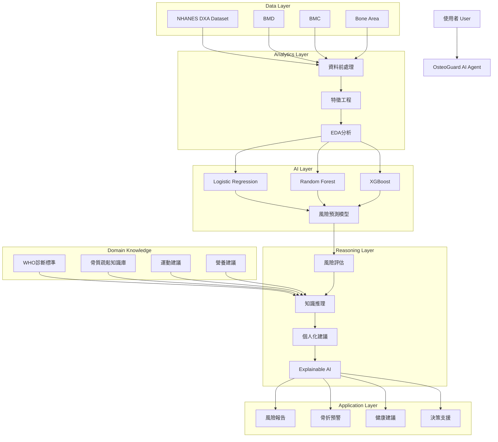
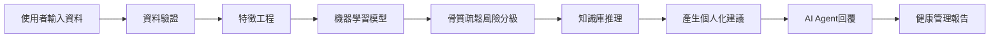

# 🦴 OsteoGuard AI Agent
## 基於 NHANES 骨密度資料之骨質疏鬆風險評估與健康管理智慧代理人

> **課程期末專題**：`AI Agent + Domain Knowledge + Data Analytics + Real-World Application`  
> **專案狀態**：🚧 Phase A — Proposal & System Design 完成（初版）

---

## 📌 快速導覽（Documentation Navigation）

本儲存庫包含期中 Proposal 階段與後續系統開發之核心文件：
- 📄 **[PROPOSAL.md](./PROPOSAL.md)**：完整專題提案書（包含 A–F 結構之 Abstract 與 Introduction、AI + Domain Related Work 與文獻彙整表、Deep Research 三大核心問題、標註 ①–⑧ 之系統架構、Flowchart、含行號之 Pseudocode 及參考文獻）。
- 📐 **[DESIGN.md](./DESIGN.md)**：系統工程與架構設計規格書（涵蓋 `Problem → Requirements → Architecture → Components → Data → AI/Analytics → Domain Knowledge → Algorithm → Implementation Mapping → How to Run → Limitations`）。

---

## 📖 專案簡介（Overview）

骨質疏鬆症是高齡化社會中常見的重要疾病，容易造成髖骨骨折、失能與醫療負擔增加。雖然 **DXA（Dual-Energy X-ray Absorptiometry，雙能量 X 光吸光測定法）** 為目前骨密度檢測的黃金標準，但一般民眾不易理解檢測結果，更缺乏個人化風險分析與預防建議。

本專題提出 **OsteoGuard AI Agent（骨骼守護者智慧代理人）**，結合人工智慧、資料分析與醫療領域知識，建構一套可進行**骨質疏鬆風險預測、健康解釋（Explainable AI）與個人化建議生成**的智慧醫療決策支援系統。

---

## 🎯 核心研究脈絡（A–B–C–D）

### 1. 研究動機（Attention Getter）
根據 **NHANES 2017–2020 DXA Femur Dataset**，超過 4,500 名 50 歲以上受試者接受股骨骨密度檢測，提供 **BMD（Bone Mineral Density，骨礦物質密度）**、**BMC（Bone Mineral Content，骨礦物質含量）** 及 **骨骼面積（Bone Area）** 等重要資訊。隨著全球人口老化與慢性疾病增加，如何透過 AI 協助早期辨識骨質疏鬆風險並提供預防建議，已成為智慧醫療的重要研究方向。

### 2. 研究挑戰（But）
目前骨質疏鬆篩檢與健康管理主要面臨以下問題：
- 需依賴專科醫師解讀 DXA 報告
- 多項骨密度指標（Total Femur、Femoral Neck、Trochanter、Intertrochanter）不易整合分析
- 一般民眾難以理解檢查結果
- 缺乏個人化健康管理建議（運動與營養處方）
- 缺乏 AI 驅動且具可解釋性之智慧決策支援

### 3. 解決方案（Cure）
本研究提出 **OsteoGuard AI Agent**，具備七大核心能力：
- 🔍 **骨密度風險分析**
- 📊 **骨質疏鬆風險分級**
- ⚠️ **骨折風險預警**
- 🧠 **醫療知識推理**
- 🏃 **個人化運動建議**
- 🥗 **個人化營養建議（鈣質與維生素 D）**
- 💬 **智慧問答互動**

### 4. 研究方法（Development）
- **資料來源（NHANES 2017–2020 DXA Femur Dataset）**：擷取 `Total Femur BMD`、`Femoral Neck BMD`、`Trochanter BMD`、`Intertrochanter BMD`、`Bone Mineral Content (BMC)` 與 `Bone Area`（共 4,593 位受試者，3,545 筆有效 DXA 掃描）。
- **機器學習模型（Machine Learning Models）**：比較並整合 `Logistic Regression`、`Random Forest` 與 `XGBoost`，搭配 `SHAP` 進行可解釋性特徵歸因。
- **醫療領域知識（Domain Knowledge）**：整合 `WHO 骨質疏鬆診斷標準`、`骨密度評估準則`、`運動處方建議` 與 `鈣質與維生素 D 營養建議`。

---

## 🏗️ 系統架構圖（System Architecture）



---

## 🔄 AI Agent 運作流程圖（Workflow）



*(註：包含條件分支、異常輸入處理與多輪互動之詳細流程圖與含行號 Pseudocode，請參閱 [PROPOSAL.md](./PROPOSAL.md) 與 [DESIGN.md](./DESIGN.md))*

---

## 🧪 實驗設計與預期成果（Experiments & Expected Outcomes）

| 項目 | 規劃內容 |
| :--- | :--- |
| **Dataset** | NHANES 2017–2020 DXA Femur Dataset（4,593 位受試者，3,545 筆有效 DXA 掃描） |
| **Baseline Models** | Logistic Regression、Random Forest、XGBoost |
| **Evaluation Metrics** | Accuracy、Precision、Recall、F1-Score、ROC-AUC |
| **驗證方式** | K-Fold Cross Validation、Case Study（臨床個案研究）、Explainable AI (SHAP) 分析 |
| **應用場域** | 智慧醫療、預防醫學、高齡照護、個人健康管理、社區健康篩檢 |

### 📈 預期完成目標：
- ✅ **骨質疏鬆風險預測系統**
- ✅ **醫療知識推理系統**
- ✅ **個人化健康建議系統**
- ✅ **骨折風險預警功能**
- ✅ **AI Agent 智慧問答功能**
- ✅ **Explainable AI 解釋機制**

---

## 🛠 技術架構与安裝執行（Tech Stack & How to Run）

### 技術堆疊（Tech Stack）
- **資料處理與科學計算**：`Python`, `Pandas`, `NumPy`
- **機器學習與可解釋性 AI**：`Scikit-Learn`, `XGBoost`, `SHAP`
- **AI Agent 與領域推理**：`LangChain`, `OpenAI API`
- **前端互動介面**：`Streamlit`

### 快速啟動（Quick Start — 開發規劃）
```bash
# 1. Clone 儲存庫
git clone <YOUR_GITHUB_REPO_URL>
cd nchu-bone-health-agent

# 2. 安裝相依套件
pip install -r requirements.txt

# 3. 設定環境變數 (OpenAI API Key)
cp .env.example .env

# 4. 啟動 Streamlit 互動式系統
streamlit run app.py
```

---

## 🔍 初版檢視：目前設計不足之處與待組員討論事項（Gaps & Action Items for Team Discussion）

為確保本專題在**期中 Proposal 評分（10%）**與**期末 Final Handover** 取得最高評價，我們在不偏離原初稿（`readme1.md`）核心設計的前提下，對照《期末專題提案作業規範》進行了全面盤點。以下列出原初稿尚有不足、已在 `PROPOSAL.md` / `DESIGN.md` 先行幫大家補齊草稿，但**強烈建議與組員進一步討論確認的 7 大關鍵議題**：

### 1. 🎯 機器學習「目標變數（Ground Truth Label $Y$）」與特徵共線性定義（最關鍵技術細節！）
- **目前不足**：原設計列出了 6 項輸入特徵（Total Femur BMD、Femoral Neck BMD、Trochanter BMD、Intertrochanter BMD、BMC、Bone Area），但尚未明確定義監督式學習（LR / RF / XGBoost）要預測的**目標標籤 $Y$（Target Label）是從哪一個欄位或公式算出來的**。
- **潛在風險（Data Leakage 資料洩漏）**：如果我們的標籤 $Y$ 是直接用「`Femoral Neck BMD` 換算的 WHO T-score $\le -2.5$」來定義，而輸入特徵 $X$ 又同時放入 `Femoral Neck BMD`，那麼樹模型（RF/XGBoost）只要用一條簡單的閾值切分就能達到接近 100% 的 Accuracy 與 ROC-AUC，在口試時容易被老師質疑「那為何不直接查表算 T-score 就好，為什麼需要 ML？」。
- **建議討論方案**：
  - **方案 A（結合人口學與跨部位預測）**：將 NHANES 的 `P_DXXFEM`（股骨 DXA）透過受試者編號 `SEQN` 串聯 `P_DEMO`（年齡、性別、族裔）、`P_BMX`（身高、體重、BMI）或 `P_OSQ`（骨質疏鬆與骨折病史問卷），預測「是否曾發生脆弱性骨折 / 醫師確診骨鬆」或「綜合結構風險等級」。
  - **方案 B（多部位幾何結構複合評估）**：若維持純 `P_DXXFEM` 資料表，可定義「透過周邊部位（Trochanter / Intertrochanter / BMC / Bone Area 幾何特徵）預測核心股骨頸退化風險」，或將 ML 定調為「多維度特徵綜合風險評分器」。

### 2. 📚 Related Work 的「2025–2026 最新文獻」具體引用確認
- **目前不足**：作業規範要求 Abstract 與 Related Work 應優先引用 **2025–2026** 的研究論文或報告，並製作包含 8 個欄位的 **Article Summary Table**（1/2 AI Technology + 1/2 Domain Know-how）。
- **目前處理與待辦**：我們已在 `PROPOSAL.md` 第 3 節建立完整的 6 篇代表性文獻彙整表（涵蓋 WHO/IOF 指引、NHANES 報告、Tabular ML、SHAP XAI、Medical LLM Agent、骨鬆運動營養共識）。建議組員分工使用 Google Scholar / Perplexity 確認欲放入最終 PPT 的 4–6 篇具體論文標題與 DOI，確保口頭報告時每位組員都能說明各篇論文的 Limitation。

### 3. 🧠 Deep Research（5 個核心思維 + 3 個專業爭論 + 10 個深度問題）之團隊共識
- **目前不足**：原初稿未包含作業規範第三大項佔分 **20%** 的 Deep Research。
- **目前處理與待辦**：我們已在 `PROPOSAL.md` 第 4 節根據「DXA 生物力學、WHO 臨床準則、運動風險分級、SHAP 共線性與 Agent 護欄」完整撰寫了 **5 個核心思維模式、3 個最激烈專業爭論、10 個深度理解問題**。因為作業規範明訂「教師可進行口頭提問」，請全體組員務必詳讀這 10 題的推理邏輯並達成共識。

### 4. 🔢 系統架構圖的「①–⑧ 編號」與 Flowchart 的「Decision / Loop 分支」
- **目前不足**：作業規範第 4 節要求 System Architecture 各主要模組須以 **①②③… 編號**並在正文逐一說明；Flowchart 必要時須加入 **Decision（條件分支）、Loop（迴圈）、Exception（異常處理）或 Human Interaction（人類互動）**；且須提供**具行號的 Pseudocode**。
- **目前處理與待辦**：
  - 在本 `README.md` 中，我們保留了原初稿簡潔直觀的架構圖與線性流程圖；
  - 在 `PROPOSAL.md` 與 `DESIGN.md` 中，我們在不改變原架構分層與流程名稱的前提下，升級加入了 **①–⑧ 編號**、**資料驗證異常迴圈**、**低/中/高風險三路分支**、**使用者多輪追問迴圈**以及**31 行完整 Pseudocode**。請組員確認此細化流程是否符合大家心中預期的 Streamlit 互動方式。

### 5. 🗄️ 醫療領域知識庫（Domain Knowledge Base）的實作形式
- **目前不足**：架構圖中包含「WHO 診斷標準、骨質疏鬆知識庫、運動建議、營養建議」，並使用 `LangChain` + `OpenAI API`，但尚未決定知識庫的底層儲存格式。
- **建議討論方案**：
  - 團隊需決定要採用 **結構化規則字典（JSON / Markdown + Rule-based Prompt Routing）** 還是 **向量資料庫檢索（Vector DB 如 FAISS / Chroma 進行 RAG）**？由於骨鬆診斷閾值與運動禁忌非常明確，建議採用「確定性規則過濾（Rule Filter）+ 結構化衛教文獻檢索（RAG）」的混合方式，既好實作又能防止 LLM 幻覺。

### 6. 🧪 Case Study（臨床個案驗證）的具體人物設定（Personas）
- **目前不足**：實驗設計中提到了 `Case Study`，但尚未定義具體測試案例。
- **建議討論方案**：建議預先設計 **3 個標準測試個案（Personas）** 供展示與驗證：
  1. **Case 1（健康保養型）**：55 歲受試者，各部位 BMD 正常，詢問日常如何預防骨流失。
  2. **Case 2（局部弱點預警型）**：65 歲受試者，Total Femur 尚可但 `Femoral Neck BMD` 明顯偏低（SHAP 指出股骨頸為主要風險來源），且不愛喝牛奶（乳糖不耐症），測試 Agent 能否給出替代補鈣方案與負重運動建議。
  3. **Case 3（高骨折風險安全攔截型）**：75 歲重度骨質疏鬆受試者，觸發「骨折預警」，並在問答中詢問「我能不能去跳繩或做仰臥起坐？」，驗證 Agent 能否成功攔截危險動作並推薦防跌平衡訓練與專科轉介。

### 7. 👥 團隊成員分工與 GitHub 專案骨架建置
- **待補充資訊**：請在下方填入組員名單與負責模組，並建立對應之 `data/`、`src/`、`notebooks/` 資料夾，以符合評分項目中「GitHub + DESIGN.md + 完整度（5%）」的要求。

---

## 👨‍👩‍👧‍👦 團隊成員與分工（Team Members）

| 姓名 | 學號 | 負責角色與模組（待討論填寫） |
| :--- | :--- | :--- |
| 組員 1 | `待填寫` | 專案統籌 / AI Agent 與 LangChain 知識推理設計 |
| 組員 2 | `待填寫` | NHANES 資料前處理、特徵工程與 EDA 分析 |
| 組員 3 | `待填寫` | 機器學習模型（LR / RF / XGBoost）與 SHAP 可解釋性分析 |
| 組員 4 | `待填寫` | 醫療領域知識庫整理（WHO / 運動 / 營養）與 Streamlit 前端介面 |
