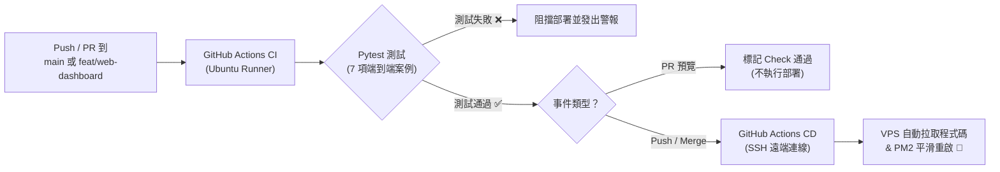

# GitHub Actions CI/CD 自動部署設定指南 (GitHub Secrets Setup Guide)

本文件指引如何設定 GitHub Secrets，使每次推送到 `main` 或 `feat/web-dashboard` 分支時，自動完成 **Pytest 測試驗證** 與 **VPS 遠端自動化部署**。

---

## 一、工作流程運作機制 (Workflow Architecture)



---

## 二、需要在 GitHub 設定的 5 個 Secrets

請前往您的 GitHub 專案儲存庫頁面：  
👉 **`Settings` $\rightarrow$ `Secrets and variables` $\rightarrow$ `Actions` $\rightarrow$ 點擊「New repository secret」**

依序新增以下 5 個環境變數：

| Secret 名稱 | 填入內容說明 | 範例值 |
| :--- | :--- | :--- |
| **`VPS_HOST`** | 您的 VPS 公網 IP 位址或指向的網域名稱 | `123.45.67.89` 或 `cdss.yourdomain.com` |
| **`VPS_USERNAME`** | 登入 VPS 的使用者名稱 | `root` 或 `ubuntu` |
| **`VPS_SSH_KEY`** | 用於免密碼登入 VPS 的 **SSH 私鑰完整內容**（包含 `-----BEGIN ...-----` 到 `-----END ...-----`） | 見下方「三、如何產生專用 SSH Key」 |
| **`VPS_TARGET_DIR`** | VPS 上放置本專案的完整絕對路徑 | `/var/www/nchu-bone-health-agent` |
| **`VPS_PORT`** | SSH 連線連接埠（若使用預設 22 號可填 `22`） | `22` |

---

## 三、如何為 GitHub Actions 產生專用 SSH Key

建議為 GitHub Actions 建立一組獨立的 SSH 金鑰對，既安全又方便隨時管理撤銷：

### 1. 在本地終端機（或 VPS 上）產生一組無密碼金鑰：
```bash
ssh-keygen -t ed25519 -C "github-actions-deploy" -f ~/.ssh/github_deploy_key -N ""
```
這會產生兩個檔案：
- 私鑰：`~/.ssh/github_deploy_key`
- 公鑰：`~/.ssh/github_deploy_key.pub`

### 2. 將公鑰（`.pub`）安裝至您的 VPS：
```bash
# 方式 A：透過 ssh-copy-id (最快)
ssh-copy-id -i ~/.ssh/github_deploy_key.pub root@YOUR_VPS_IP

# 方式 B：手動貼入 VPS 的 authorized_keys
cat ~/.ssh/github_deploy_key.pub
# 複製內容後登入 VPS，貼到 ~/.ssh/authorized_keys 檔案最末行
```

### 3. 將私鑰複製到 GitHub Secret：
```bash
cat ~/.ssh/github_deploy_key
```
完整複製印出的全部內容，貼入 GitHub 的 **`VPS_SSH_KEY`** 中！

---

## 四、VPS 端的首次準備工作

在觸發第一次自動部署之前，請先登入 VPS 一次完成專案目錄初始化：

```bash
# 1. 登入 VPS
ssh root@YOUR_VPS_IP

# 2. 建立目錄並拉取專案 (請替換為您的 Git Repo 網址)
mkdir -p /var/www
cd /var/www
git clone https://github.com/YOUR_GITHUB_USER/nchu-bone-health-agent.git
cd nchu-bone-health-agent

# 3. 執行我們準備好的初始化腳本
chmod +x deploy/setup_vps.sh
./deploy/setup_vps.sh
```

---

## 五、驗證自動化流程

1. 在本地修改代碼後提交至 `feat/web-dashboard` 或 `main` 分支：
   ```bash
   git push origin feat/web-dashboard
   ```
2. 前往 GitHub 儲存庫的 **「Actions」** 頁籤：
   - 即會看見 `OsteoGuard CI/CD Pipeline` 正在自動運行！
   - 先跑 `Run Pytest Suite`（驗證 7 組臨床案例）。
   - 測試綠燈通過後，自動執行 `Deploy to VPS`，透過 SSH 同步程式碼並無縫重啟 PM2！

