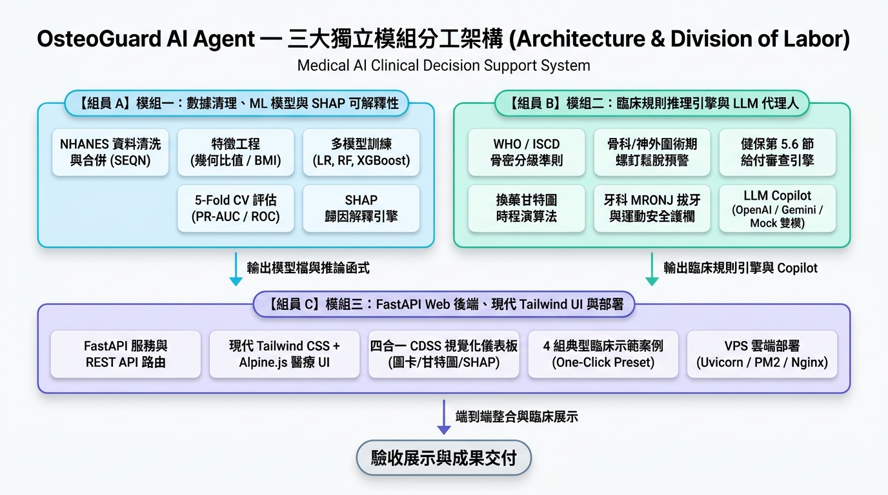
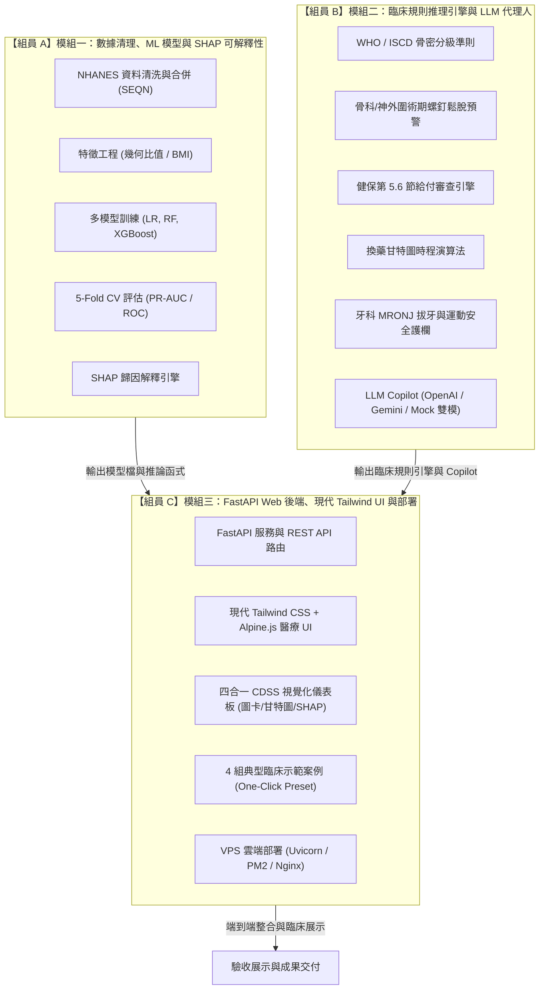

# OsteoGuard AI Agent — 實作規劃總覽 (Implementation Plan Overview)

本專題為國立中興大學 (NCHU) 人工智慧專題：**OsteoGuard AI Agent（骨科與神經外科骨鬆個案管理智慧代理人）**。
本文件夾（`plan/`）將整體系統依據設計規格（`DESIGN.md`）與架構圖，拆解為三大獨立且高內聚、低耦合的子模組，供 3 位組員各自獨立推進，並提供階段性查核清單（Checklist）以便追蹤進度與驗收。

---

## 1. 三大獨立模組分工架構

依據討論決議，系統採用 **輕量化現代 Web 架構（FastAPI + Tailwind CSS + Jinja2 / Alpine.js）**，單一 Python 服務可直接於現有 VPS 上部署，具備現代專業醫療 CDSS 儀表板外觀，並劃分為三大實作計畫：



<details>
<summary>點擊展開原始 Mermaid 流程圖語法</summary>



</details>

---

## 2. 實作計畫檔案清單

| 檔案路徑 | 負責組員 | 模組名稱 | 核心交付成果 |
| :--- | :---: | :--- | :--- |
| [module_1_data_and_ml.md](file:///Users/leolin/NCHU/nchu-bone-health-agent/plan/module_1_data_and_ml.md) | 組員 A | 數據清洗、特徵工程、ML 模型與 SHAP | `cohort_cleaned.csv`, `ml_models.py`, `explainability.py`, 模型權重檔與評估報表 |
| [module_2_clinical_reasoning_and_agent.md](file:///Users/leolin/NCHU/nchu-bone-health-agent/plan/module_2_clinical_reasoning_and_agent.md) | 組員 B | 臨床決策規則庫、接續治療演算法與 LLM Copilot | `nhi_engine.py`, `surgical_advisor.py`, `sequential_therapy.py`, `agent.py` (含 Mock 支援) |
| [module_3_web_dashboard_and_deployment.md](file:///Users/leolin/NCHU/nchu-bone-health-agent/plan/module_3_web_dashboard_and_deployment.md) | 組員 C | 現代醫療儀表板 (Tailwind + Alpine.js)、API 串接與 VPS 部署 | `app.py`, `templates/`, `static/`, 4 示範案例快捷鈕, VPS systemd/pm2 腳本 |
| [integration_and_testing.md](file:///Users/leolin/NCHU/nchu-bone-health-agent/plan/integration_and_testing.md) | 全體組員 | 跨模組整合、情境驗證與 Demo 驗收 | 端到端聯調、四組個案測試腳本、PPT/Demo 錄影檢查清單 |

---

## 3. 模組間資料傳遞契約 (Data Contracts & Schemas)

為確保三位組員各自開發時不互相卡住，定義各模組間標準 Python 資料結構（使用 `dataclass` 或 `Pydantic`）：

### 3.1 個案輸入物件 (`PatientCaseInput`)
```python
{
    "patient_id": "PT-2026-001",
    "age": 68,
    "gender": "Female",           # "Female" | "Male"
    "height_cm": 156.0,
    "weight_kg": 48.5,
    "total_femur_bmd": 0.650,     # g/cm^2
    "total_femur_bmc": 22.1,      # g
    "total_femur_area": 34.0,     # cm^2
    "femoral_neck_bmd": 0.520,
    "femoral_neck_bmc": 2.8,
    "femoral_neck_area": 5.4,
    "trochanter_bmd": 0.490,
    "intertrochanter_bmd": 0.720,
    "lowest_t_score": -3.2,
    "lowest_site": "Femoral Neck", # "Femoral Neck" | "Total Femur" | "Lumbar Spine"
    "surgery_type": "Spinal_Fusion", # "None" | "Spinal_Fusion" | "Vertebroplasty" | "Joint_Replacement"
    "fracture_history": ["L1_Compression_Fracture"],
    "comorbidities": ["Rheumatoid_Arthritis"], # RA, Diabetes_Insulin, Steroid_Use
    "medication_history": {
        "current_drug": "Prolia", # "None" | "Prolia" | "Evenity" | "Forteo" | "Aclasta"
        "first_dose_date": "2025-05-15",
        "last_dose_date": "2025-11-15"
    },
    "upcoming_dental_proc": True,  # 拔牙/植牙計畫
    "recent_cardiovascular_event": False # 一年內心肌梗塞/中風 (Evenity 禁忌)
}
```

### 3.2 系統輸出結果物件 (`CDSSResult`)
```python
{
    "ml_prediction": {
        "risk_probability": 0.78,
        "classification": "High_Risk",
        "top_shap_features": [
            {"feature": "Femoral Neck BMD", "contribution": +0.32},
            {"feature": "Age", "contribution": +0.18},
            {"feature": "BMI", "contribution": +0.12}
        ]
    },
    "who_diagnosis": {
        "tier": "Severe_Osteoporosis", # Normal | Osteopenia | Osteoporosis | Severe
        "lowest_t_score": -3.2,
        "site": "Femoral Neck"
    },
    "surgical_alert": {
        "risk_level": "CRITICAL",
        "title": "椎弓根螺釘鬆脫高風險警訊",
        "recommendations": [
            "術前 1-3 個月評估使用促骨生成劑 (Anabolic Agent)",
            "術中建議使用骨水泥強化螺釘 (Cement Augmentation) 或皮質骨軌道螺釘 (CBT)"
        ]
    },
    "nhi_compliance": {
        "status": "APPROVED_SECOND_LINE", # NOT_ELIGIBLE | APPROVED_FIRST_LINE | APPROVED_SECOND_LINE
        "clause": "5.6.2 Teriparatide / Romosozumab",
        "reimbursement_reason": "T <= -3.0 合併重大骨折且抗流失劑治療滿一年新骨折",
        "missing_items": ["需補齊最近 6 個月內血鈣、肌酸酐抽血數據"]
    },
    "sequential_therapy": {
        "next_dose_date": "2026-05-15",
        "days_remaining": -10,
        "alert_type": "URGENT_OVERDUE", # 逾期斷藥反彈警報
        "switch_schedule": {
            "max_duration_months": 12,
            "recommended_next_drug": "Prolia (抗流失劑)"
        }
    },
    "patient_safety": {
        "dental_guard": "近期欲拔牙，建議先由牙科評估 MRONJ 風險，並依用藥期程安排暫緩窗口",
        "exercise_contraindications": ["禁止高衝擊跳躍", "禁止脊椎過度屈曲與旋轉"],
        "nutrition_guidelines": "每日鈣質 1,000-1,200 mg，維生素 D 800-1,000 IU"
    },
    "copilot_draft": {
        "soap_note": "S: 68 y/o female with chronic back pain...\nO: DXA T -3.2...",
        "patient_card_html": "<div class='p-4 bg-red-50'>...</div>"
    }
}
```

---

## 4. 執行與追蹤方式
各模組的 markdown 檔案中均含有各子任務的 `[ ]` 勾選框。  
每當組員完成某個子步驟後，可將 `[ ]` 更新為 `[x]`，以利透明化掌握全案整體實作進度。

