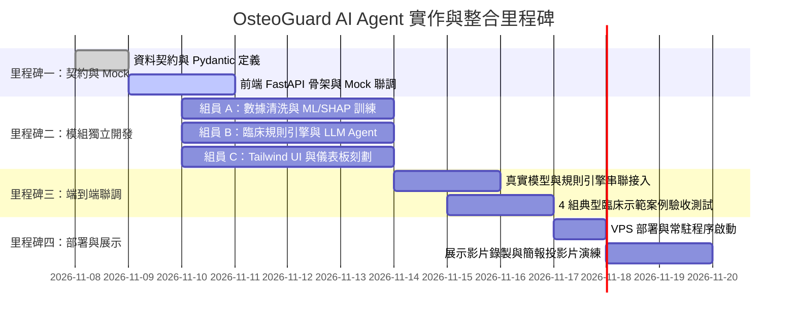

# 【系統整合與測試驗收計畫】跨模組聯調與臨床示範

- **負責組員**：全體組員（組員 A、組員 B、組員 C）共同執行
- **核心目標**：確保三大獨立模組無縫對接，完成端到端（End-to-End）資料流串通，執行 4 組臨床典型合成案例的全面功能驗證，落實《作業要求.md》規範之科學驗證標準，並完成 VPS 部署與期末展示準備。
- **產出檔案**：
  - `tests/test_end_to_end.py`（自動化端到端測試腳本）
  - `tests/test_cases.json`（4 組標準臨床驗證案例集）
  - `docs/DEMO_SCRIPT.md`（臨床展示操作演練手冊）

---

## 一、整合開發時程里程碑 (Milestones)

---

## 二、四大臨床案例整合驗證矩陣 (Verification Matrix)

在系統整合聯調階段，針對 4 組內建案例逐一驗收各面板的輸出正確性：

| 驗證項目 | 案例一：嚴重骨鬆脊椎融合 | 案例二：促骨生成屆期換藥 | 案例三：拔牙恐慌停藥逾期 | 案例四：未骨折高危初級預防 |
| :--- | :--- | :--- | :--- | :--- |
| **病患背景** | 72 歲女、脊椎融合術、L2 骨折 | 68 歲男、Evenity 滿 11 個月 | 65 歲女、Prolia 逾期 35 天、欲拔牙 | 58 歲女、RA、長期類固醇 |
| **最低 T-Score** | $T = -3.4$（股骨頸） | $T = -3.1$（全髖部） | $T = -2.8$（股骨頸） | $T = -2.6$（股骨頸） |
| **ML/SHAP 預測** | 高風險機率（推升主因：BMD 與年齡） | 高風險機率 | 中高風險機率 | 中度風險機率 |
| **手術螺釘預警** | **🔴 觸發高危鬆脫警報**（提示骨水泥螺釘） | ⚪ 不觸發（無脊椎手術） | ⚪ 不觸發 | ⚪ 不觸發 |
| **健保 5.6 節審核** | 符合 5.6.2 二線促骨生成劑 | 審查通過第二線（提醒已屆期滿） | 符合第一線給付 | **符合 5.6.1 條款 C 初級預防** |
| **換藥甘特圖** | 建議術前 1–3 月先打促骨生成劑 | **甘特圖標記 Evenity 僅剩 1 個月**（強制接續 Prolia） | **🔴 觸發 Prolia 逾期斷藥反彈性骨折警報** | 標記第一線常規時程 |
| **安全護欄** | 脊椎高衝擊運動嚴格禁止 | 常規運動與營養補給 | **啟動牙科 MRONJ 拔牙安全指引** | 避免高衝擊活動 |
| **SOAP 病歷草稿** | 自動草擬加簽骨水泥與促骨理由 | 自動草擬 Evenity 屆期換藥病歷 | 自動草擬牙科照會單與用藥處方 | 自動草擬共病初級預防申報理由 |

---

## 三、整合與驗收檢查清單 (Checklist)

### 階段 1：介面與資料契約確認 (Milestone 1)
- [ ] 1.1 全體確認 `plan/README.md` 中的 `PatientCaseInput` 與 `CDSSResult` 規格
- [ ] 1.2 組員 C 於 `app.py` 建立 Mock API，確保組員 A 與 B 在開發期間前端即可呈現完整動態畫面
- [ ] 1.3 建立共用 Git 分支規範（如 `feature/data-ml`, `feature/rules-agent`, `feature/ui-deploy`）

### 階段 2：跨模組對接 (Milestone 2 & 3)
- [ ] 2.1 組員 A 交付 `src/ml_models.py` 與 `src/explainability.py`，組員 C 替換 ML Mock
- [ ] 2.2 組員 B 交付 `src/nhi_engine.py`、`src/surgical_advisor.py`、`src/sequential_therapy.py` 與 `src/agent.py`，組員 C 替換規則與 Copilot Mock
- [ ] 2.3 執行全自動端到端測試腳本：`python -m unittest tests/test_end_to_end.py`

### 階段 3：四大情境臨床驗收測試
- [ ] 3.1 驗收案例一：驗證脊椎融合術高危螺釘鬆脫警報與骨水泥建議正確顯示
- [ ] 3.2 驗收案例二：驗證 Evenity 滿 11 個月之換藥甘特圖與強制切換 Prolia 提示正確顯示
- [ ] 3.3 驗收案例三：驗證 Prolia 逾期 35 天反彈性脊椎骨折紅色警報與牙科 MRONJ 溝通卡正確顯示
- [ ] 3.4 驗收案例四：驗證未骨折合併類風濕關節炎（RA）通過健保 5.6.1 條款 C 初級預防審核

### 階段 4：VPS 雲端部署與展示演練
- [ ] 4.1 在 VPS 上安裝 Python 環境與相依套件（`pip install -r requirements.txt`）
- [ ] 4.2 啟動 Uvicorn 服務並設定 PM2 常駐（`pm2 start ...`），確認重新開機後自動重啟
- [ ] 4.3 測試外部瀏覽器連線流暢度與響應式排版（手機、平板與筆電螢幕寬度）
- [ ] 4.4 演練報告簡報（搭配 `output/OsteoGuard_Proposal_20261102.pptx`），確保口頭報告與即時展示無縫銜接

