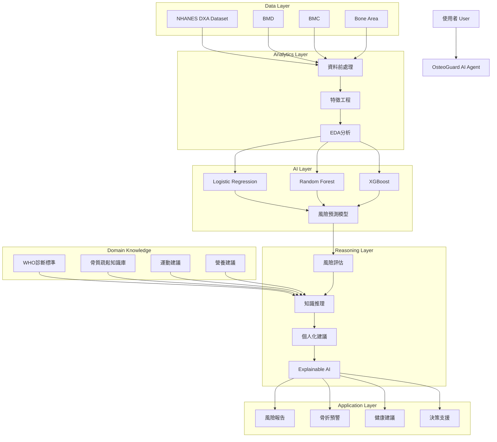
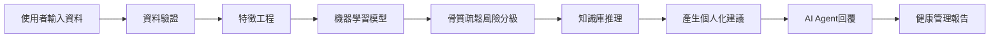

# OsteoGuard AI Agent
## 基於 NHANES 骨密度資料之骨質疏鬆風險評估與健康管理智慧代理人

---

# 📖 專案簡介

骨質疏鬆症是高齡化社會中常見的重要疾病，容易造成髖骨骨折、失能與醫療負擔增加。雖然 DXA（Dual-Energy X-ray Absorptiometry）為目前骨密度檢測的黃金標準，但一般民眾不易理解檢測結果，更缺乏個人化風險分析與預防建議。

本專題提出 **OsteoGuard AI Agent（骨骼守護者智慧代理人）**，結合人工智慧、資料分析與醫療領域知識，建構一套可進行骨質疏鬆風險預測、健康解釋與個人化建議生成的智慧醫療系統。

---

# 🎯 研究動機（Attention Getter）

根據 NHANES 2017–2020 DXA Femur Dataset，超過 4,500 名 50 歲以上受試者接受股骨骨密度檢測，提供 BMD（Bone Mineral Density）、BMC（Bone Mineral Content）及骨骼面積等重要資訊。

隨著全球人口老化與慢性疾病增加，如何透過 AI 協助早期辨識骨質疏鬆風險並提供預防建議，已成為智慧醫療的重要研究方向。

---

# ❗ 研究挑戰（But）

目前骨質疏鬆篩檢主要面臨以下問題：

- 需依賴專科醫師解讀 DXA 報告
- 多項骨密度指標不易整合分析
- 一般民眾難以理解檢查結果
- 缺乏個人化健康管理建議
- 缺乏 AI 驅動之智慧決策支援

---

# 💡 解決方案（Cure）

本研究提出 **OsteoGuard AI Agent**：

- 骨密度風險分析
- 骨質疏鬆風險分級
- 骨折風險預警
- 醫療知識推理
- 個人化運動建議
- 個人化營養建議
- 智慧問答互動

---

# ⚙️ 研究方法（Development）

## 資料來源

### NHANES 2017–2020 DXA Femur Dataset

主要使用特徵：

- Total Femur BMD
- Femoral Neck BMD
- Trochanter BMD
- Intertrochanter BMD
- Bone Mineral Content (BMC)
- Bone Area

## Machine Learning Models

- Logistic Regression
- Random Forest
- XGBoost

## Domain Knowledge

- WHO 骨質疏鬆診斷標準
- 骨密度評估準則
- 運動處方建議
- 鈣質與維生素 D 營養建議

---

# 🏗️ 系統架構圖

---

# 🔄 AI Agent 運作流程圖

---

# 🧪 實驗設計（Experiments）

## Dataset

- 4,593 位受試者
- 3,545 筆有效 DXA 掃描

## Baseline Models

- Logistic Regression
- Random Forest
- XGBoost

## Evaluation Metrics

- Accuracy
- Precision
- Recall
- F1-Score
- ROC-AUC

## 驗證方式

- K-Fold Cross Validation
- Case Study
- Explainable AI 分析

---

# 📈 預期成果（Expected Outcomes）

預期完成：

✅ 骨質疏鬆風險預測系統

✅ 醫療知識推理系統

✅ 個人化健康建議系統

✅ 骨折風險預警功能

✅ AI Agent 智慧問答功能

✅ Explainable AI 解釋機制

---

# 🏥 應用場域

- 智慧醫療
- 預防醫學
- 高齡照護
- 個人健康管理
- 社區健康篩檢

---

# 🛠 技術架構

- Python
- Pandas
- NumPy
- Scikit-Learn
- XGBoost
- SHAP
- Streamlit
- LangChain
- OpenAI API

---

# 👨‍🎓 課程期末專題

AI Agent + Domain Knowledge + Data Analytics + Real-World Application

專題名稱：OsteoGuard AI Agent
